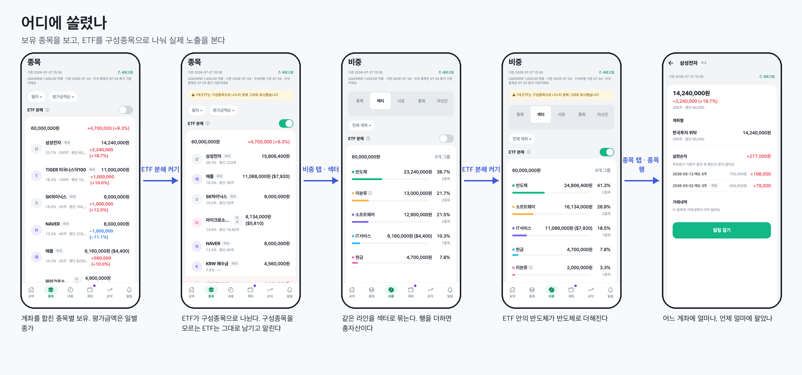
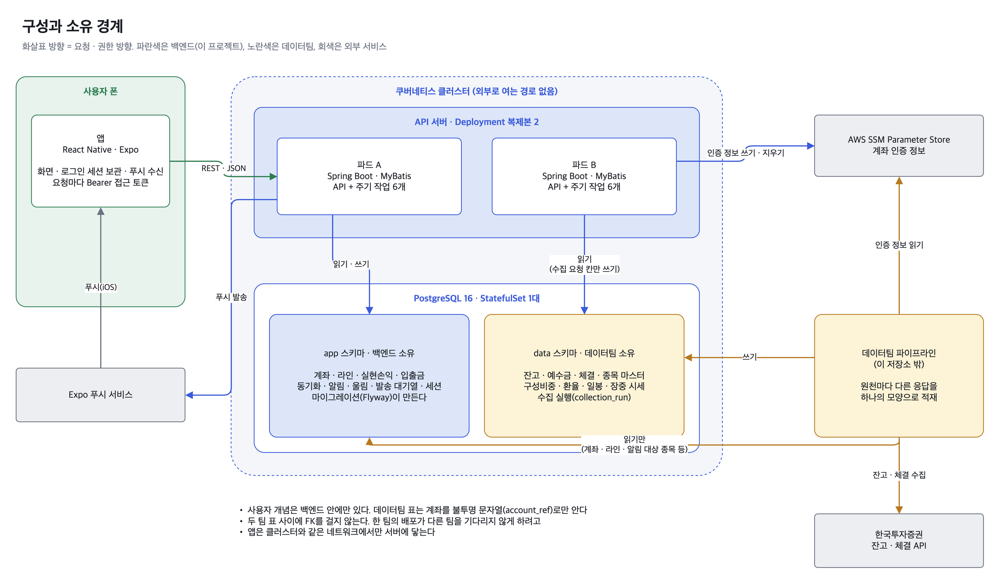

# 포트폴리오 · 매수매도 알림 앱

증권 계좌를 연동하면 내 자산이 어디에 얼마나 들어가 있는지 보여 주고, 종목에 걸어 둔 조건이 참이 되면 알려 주는 모바일 앱이다. 장기 투자자가 세 가지를 바로 알 수 있게 하는 데 집중했다.

- **실제로 어디에 쏠렸나**: ETF를 구성종목으로 나눠 겉보기 비중이 아니라 실제 노출을 본다.
- **번 돈인가 넣은 돈인가**: 늘어난 자산을 넣은 돈과 번 돈으로 나눈다.
- **모르는 값은 모른다고**: 계산할 수 없는 값을 0이나 그럴듯한 값으로 채우지 않는다.

실제 증권 계좌를 붙여 AWS 위 쿠버네티스 클러스터에서 API 복제본 2대로 운영했다. 백엔드 · 앱, 데이터 파이프라인, 인프라를 나눠 맡았고, 나는 백엔드 · 앱을 맡았다. API와 주기 작업, 모바일 앱, 설계서와 결정 기록이 내 몫이다. 경계와 주고받는 것은 [common.md «역할 분담»](../specs/common.md)에 있다.

## 기능 한눈에

| 기능 | 화면 | 핵심 규칙 | 설계서 |
|---|---|---|---|
| 계좌 연동 · 동기화 | 계좌 연동 · 한국투자증권 연동 · 인증 정보 갱신 · 계좌 | 사용자가 자기 앱키로 계좌를 연동하면 데이터팀이 매일 밤 잔고를 수집한다. 인증 정보는 비밀 저장소에만 둔다 | [portfolio.md «계좌 연동·동기화»](../specs/portfolio.md) |
| 보유 현황 | 요약 · 종목 · 비중 · 계좌별 | 계좌 × 종목 × 기준일 한 칸(라인)을 만들고, 화면은 묶는 기준만 바꾼다. 평가금액은 일별 종가로 매긴다 | [portfolio.md «화면» · «집계 모델»](../specs/portfolio.md) |
| ETF 분해 | 종목 · 비중 | ETF를 구성종목으로 나눠 실제로 무엇에 돈이 들어가 있는지 보인다 | [portfolio.md «ETF 분해»](../specs/portfolio.md) |
| 실현손익 | 손익 · 종목 상세 | 체결 이력으로 계산한다. 취득원가를 확신할 수 없으면 추정으로 표시하고, 계산할 수 없는 매도는 합계에서 뺀다 | [portfolio.md «원장과 등급»](../specs/portfolio.md) |
| 자산 변화 · 입출금 | 자산 변화 · 입출금 | 기간 동안 늘어난 자산을 넣은 돈과 번 돈으로 나눈다. 증권사가 입출금 내역을 주지 않아 넣은 돈은 사용자가 입력한다 | [portfolio.md «자산 변화 항등식과 분해» · «입출금 입력과 미입력 판정»](../specs/portfolio.md) |
| 매수 · 매도 타이밍 알림 | 알림 · 새 알림 · 알림 상세 | 종목에 조건을 걸면 서버가 장중 시세나 일별 종가로 평가해 참이 되면 울린다. 보유하지 않은 종목에도 걸 수 있다 | [alert.md «조건 모델» · «평가»](../specs/alert.md) |
| 울린 알림 · 푸시 | 울린 알림 · 울린 알림 상세 | 울림은 앱 안 기록으로 반드시 남고, 푸시는 그 기록을 원천으로 보낸다 | [alert.md «울림 전달»](../specs/alert.md) |
| 로그인 · 세션 | 로그인 · 계정 시트 | 서버 세션과 갱신 토큰 회전. 계정이 바뀌면 앱이 이전 계정의 화면 데이터를 지운다 | [common.md «로그인·세션»](../specs/common.md) |

모든 화면과 진입 경로는 [common.md «앱 구조»](../specs/common.md)에 있다.

## 핵심 설계 판단

무엇을 대신해 무엇을 골랐고, 그 뒤에 무엇이 드러났는지는 결정 기록(ADR)에 있다. 대표 세 개:

| 결정 | 무엇을 대신해 무엇을 |
|---|---|
| [리더 없는 다중 복제본](../decisions/0001-leaderless-replicas.md) | 리더 선출 · 분산 잠금 대신, 모든 복제본이 모든 주기 작업을 돌리고 중복은 데이터 조건으로 막았다 |
| [배포 중 스키마 호환](../decisions/0006-schema-compat-during-deploy.md) | 별도 마이그레이션 Job 대신 기동 시 Flyway를 돌리고, 롤링 중 공존은 호환 규칙과 CI 정적 검사로 막는다 |
| [조회 성능](../decisions/0005-read-performance.md) | 집계 캐시나 데이터팀 표 인덱스 대신, 질의가 읽는 범위를 좁히는 쪽으로 질의 모양을 바꿨다 |

나머지 다섯 개(스냅샷 파이프라인 · 발송 대기열 · 조회 정합성 · 세션과 토큰 회전 · 입출금 멱등 키)는 [결정 기록 목록](../decisions/README.md)에 있다.

## 기술 스택

| 영역 | 쓴 것 |
|---|---|
| 서버 | Java 21 · Spring Boot 3.4 · MyBatis · Spring Security(JWT 접근 토큰 + 서버 세션) · Flyway |
| DB | PostgreSQL 16. 백엔드(`app`)와 데이터팀(`data`)이 한 데이터베이스를 스키마로 나눠 쓴다 |
| 앱 | React Native · Expo · TanStack Query |
| 배포 · 운영 | 쿠버네티스(API 복제본 2) · GitHub Actions · AWS ECR · ArgoCD · AWS SSM Parameter Store · Expo 푸시 |
| 데이터 | 데이터팀 파이프라인(이 프로젝트 밖)이 증권사 · 시장 데이터를 `data` 스키마에 적재한다 |

## 하지 않은 것 · 재지 않은 것

<!-- 작성 예정: 고도화 실습이 끝난 뒤 확정. 지금은 과제별 현황을 고도화 구상에 둔다 -->

부하 · 데이터 규모 · 잠금 · 관측 · 배포 호환에 대해 무엇을 재고 무엇을 아직 재지 않았는지는 [고도화 구상](../review/upgrade-plan.md)에 과제별로 있다. 잰 것만 수치로 적고, 재지 않은 것은 "측정 안 함"으로 적는다.

## 문서 지도

| 문서 | 무엇 |
|---|---|
| [사용자 여정](journeys.md) | 실제 앱 캡처를 여정 순서로 이은 그림 다섯 장 |
| [아키텍처](architecture.md) | 구성 · 데이터 흐름 · 복제본 런타임 · 배포 그림 네 장 |
| [인프라](infrastructure.md) | AWS 배치도 · 클러스터 구성 · 배포 · 관측 기록 |
| [ERD](erd.md) | 백엔드 표의 전체 컬럼과 관계 |
| [API 명세](api.md) | 서버 코드에서 생성한 OpenAPI. [HTML](api/index.html) · [원본](api/openapi.json) |
| [공통 설계](../specs/common.md) | 서비스 개요 · 용어 · 시스템 구성 · 앱 구조 · 로그인 · API 공통 규칙 · 서버 런타임 |
| [포트폴리오 설계](../specs/portfolio.md) | 화면 · 집계 모델 · 원장과 등급 · 계좌 연동 · 보유 스냅샷 생성 |
| [알림 설계](../specs/alert.md) | 화면 · 조건 모델 · 평가 · 평가 런타임 · 울림 전달 |
| [데이터 계약](../specs/data-contract.md) | 데이터팀과 주고받는 표와 약속 |
| [테스트 문서](../test/) | 테스트 설계 · 케이스 · 실행 절차 · 결함 |
| 코드 | [back-end](https://github.com/stock-project-crew/back-end) · [front-end](https://github.com/stock-project-crew/front-end) |
