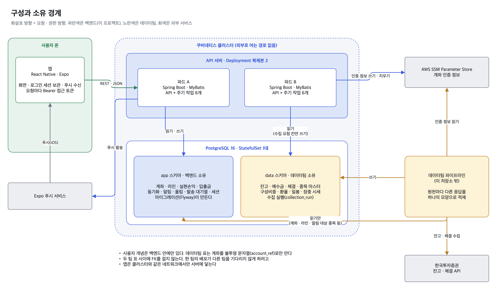
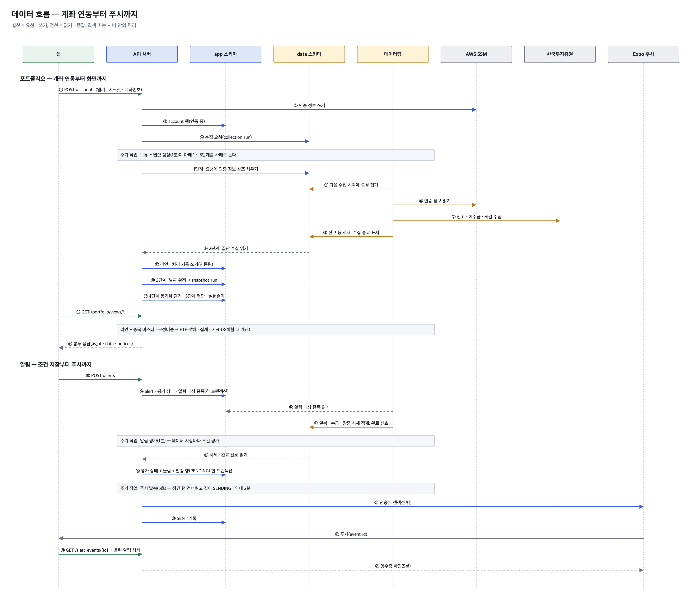
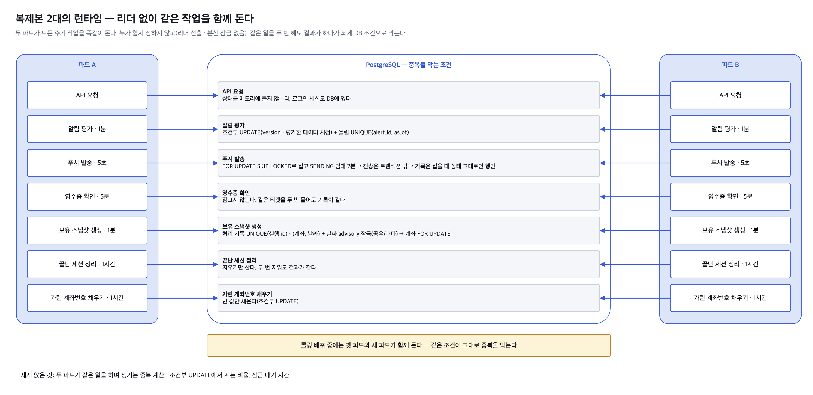
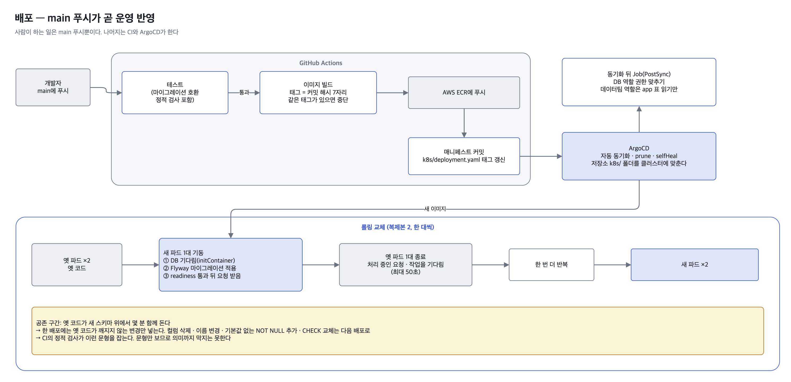

# 아키텍처

시스템이 어떤 조각으로 되어 있고, 데이터가 어떻게 흘러 화면과 푸시가 되는지를 그림 네 장으로 보인다. 규칙과 이유는 그림마다 단 설계서 절에 있다.

## 1. 구성과 소유 경계



- 한 PostgreSQL을 두 팀이 나눠 쓴다. `app` 스키마는 백엔드, `data` 스키마는 데이터팀이 소유하고, 권한이 스키마 단위로 끊긴다.
- 백엔드는 `data`를 읽기만 하고 수집 요청 칸만 쓴다. 데이터팀은 `app`을 읽기만 한다.
- 증권사 인증 정보는 백엔드가 비밀 저장소(AWS SSM)에 쓰고, 수집할 때 데이터팀이 읽는다. 백엔드는 수집용 값을 읽지 못하고, DB에는 파라미터 이름과 가린 계좌번호만 둔다.
- 자세히: [common.md «시스템 구성» · «데이터팀 연동»](../specs/common.md), [data-contract.md «경계와 공통 규칙» · «데이터팀이 읽는 백엔드 테이블»](../specs/data-contract.md)

## 2. 데이터 흐름 — 계좌 연동부터 푸시까지



- **포트폴리오**: 백엔드는 수집을 직접 하지 않는다. 수집 요청을 넣으면 데이터팀이 다음 수집 시각에 집어 증권사에서 받아 오고, 백엔드는 끝난 수집을 1분 주기로 라인으로 바꾼다. 화면 숫자는 조회할 때 라인에서 계산한다.
- **알림**: 알림을 저장하면 알림 대상 종목 목록이 함께 바뀌고, 데이터팀은 그 목록의 종목만 수집한다. 평가 상태 갱신 · 울림 기록 · 발송 행은 한 트랜잭션이라, 울렸는데 기록이 없거나 두 번 울리는 일이 없다. 푸시는 트랜잭션 밖에서 보낸다.
- 자세히: [portfolio.md «계좌 연동·동기화» · «보유 스냅샷 생성·확정»](../specs/portfolio.md), [alert.md «평가» · «평가 런타임» · «울림 전달»](../specs/alert.md)

## 3. 복제본 2대의 런타임



- 두 파드가 같은 주기 작업을 함께 돈다. 누가 할지 정하지 않고, 같은 일을 두 번 해도 결과가 하나가 되도록 작업마다 DB 조건으로 막는다.
- 같은 조건이 롤링 배포 중 옛 파드와 새 파드가 함께 도는 동안에도 중복을 막는다.
- 재지 않은 것: 중복 계산과 조건부 UPDATE에서 지는 비율, 잠금 대기 시간. 고도화 과제로 둔다([upgrade-plan.md](../review/upgrade-plan.md)).
- 자세히: [common.md «서버 런타임»](../specs/common.md), [portfolio.md «중복 실행 방지와 멱등성»](../specs/portfolio.md), [alert.md «중복 방지» · «발송»](../specs/alert.md)

## 4. 배포



- main 푸시가 곧 운영 반영이다. CI가 테스트를 통과한 커밋만 이미지로 만들고, 매니페스트의 태그를 고치는 커밋을 남기면 ArgoCD가 클러스터를 맞춘다.
- 새 파드는 기동하면서 마이그레이션을 운영 DB에 적용한다. 그래서 롤링 중에는 옛 코드가 새 스키마 위에서 돈다. 이 구간에서 깨지는 문형은 CI의 정적 검사가 잡는다.
- 자세히: [common.md «시스템 구성» · «두 대 동시 실행 전제»](../specs/common.md)

## 고치기

그림의 원본은 `architecture/*.drawio`다. [diagrams.net](https://app.diagrams.net)이나 drawio 데스크톱에서 열어 고친 뒤 PNG로 다시 내보낸다.

```
/Applications/draw.io.app/Contents/MacOS/draw.io -x -f png -s 2 -b 20 -o architecture/<그림>.png architecture/<그림>.drawio
```
