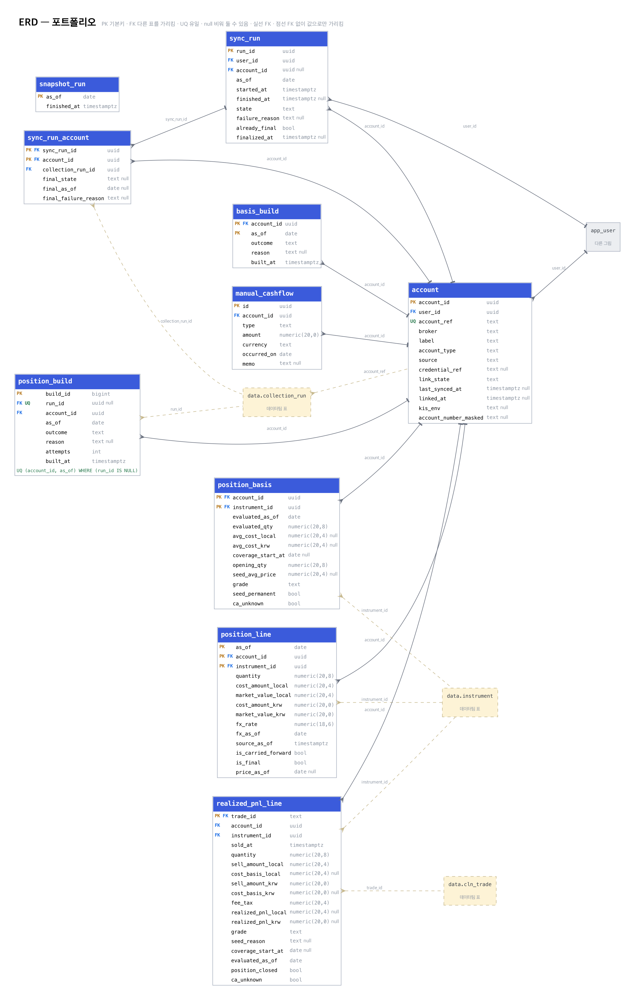
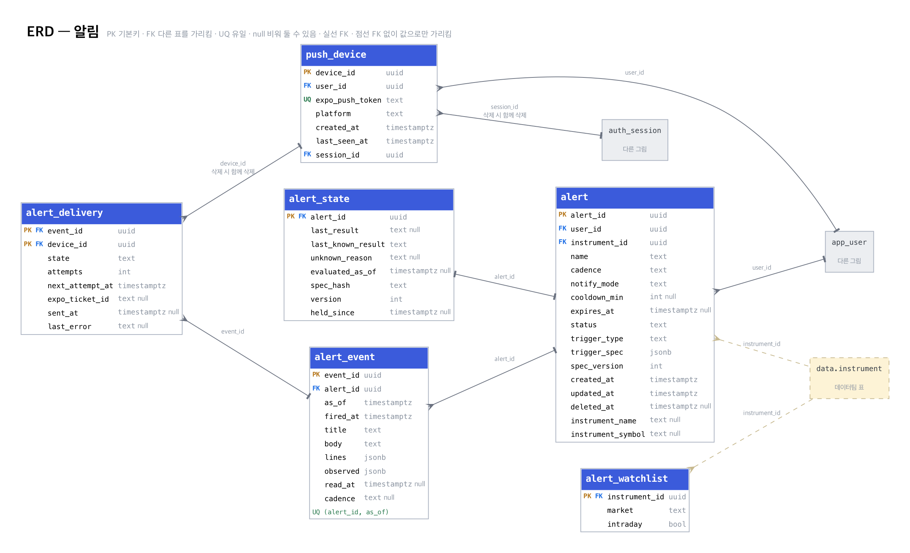
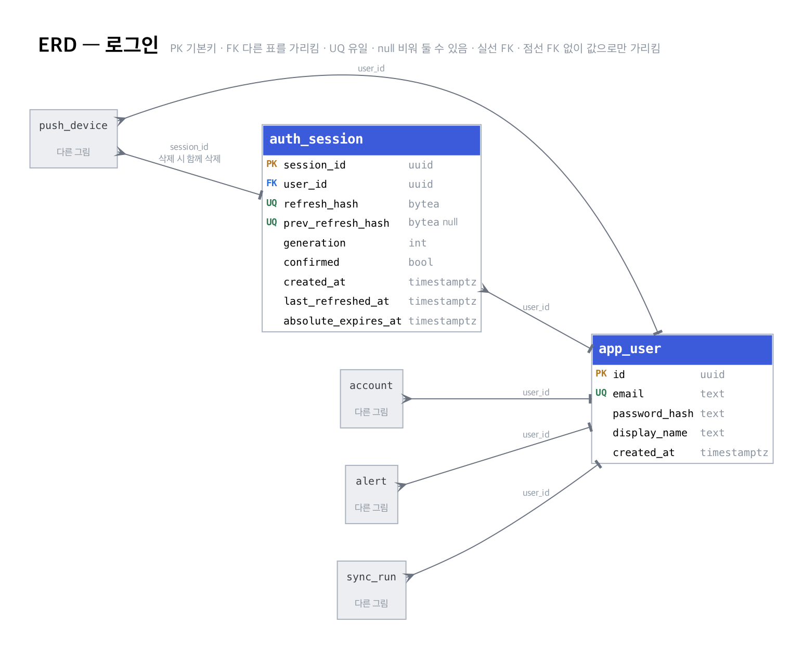

# ERD

백엔드가 소유하는 표(`app` 스키마)의 전체 컬럼과 관계다. 그림은 마이그레이션을 적용한 스키마에서 스크립트로 그렸다. 표가 왜 그런 키와 수명을 갖는지는 설계서가 정한다.

- 표의 역할 · 키 · 수명: [portfolio.md «7. 데이터 모델»](../specs/portfolio.md), [alert.md «7. 데이터 모델»](../specs/alert.md), [common.md «4.3 세션 저장»](../specs/common.md)
- 데이터팀 표(`data` 스키마)의 컬럼과 약속: [data-contract.md](../specs/data-contract.md)

**읽는 법**

- `PK` 기본키, `FK` 다른 표를 가리키는 컬럼, `UQ` 유일, `null` 비워 둘 수 있음
- 실선은 FK 제약이 걸린 관계다. 선의 라벨은 가리키는 컬럼이고, "삭제 시 함께 삭제"는 가리키는 행이 지워지면 이 행도 지워진다는 뜻이다
- 점선은 FK 없이 값으로만 가리키는 관계다. 데이터팀 표와는 FK를 걸지 않는다. 두 팀이 따로 배포하므로, 한쪽 배포가 다른 쪽 배포를 기다리지 않게 하려는 것이다
- 회색 상자는 다른 그림에 있는 표, 노란 점선 상자는 데이터팀 표다
- 표 아래 `UQ (…)` 줄은 여러 컬럼에 걸친 유일 조건이다. `WHERE`가 붙으면 그 조건을 만족하는 행끼리만 유일하다

## 1. 포트폴리오

| 표 | 한 줄 |
|---|---|
| `account` | 연동한 증권 계좌 하나. 소유자(`user_id`)를 가리키는 유일한 표이고, 나머지 포트폴리오 표는 모두 계좌를 거쳐 소유자가 정해진다 |
| `position_line` | 라인. 기준일 × 계좌 × 종목 한 칸의 수량 · 매입금액 · 평가금액. 화면의 모든 보유 숫자가 여기서 나온다 |
| `position_build` | 수집 실행 하나(또는 확정 단계의 계좌 · 날짜 하나)의 처리 기록. 같은 실행을 두 번 처리하지 않게 하는 키다 |
| `snapshot_run` | 기준일 확정 신호. 그날의 대상 계좌가 모두 확정되면 한 행이 생긴다. 다른 표와 키로 잇지 않고 날짜로 읽힌다 |
| `position_basis` | 계좌 × 종목의 지금 열린 포지션의 평단과 등급 |
| `basis_build` | 평단 계산의 계좌 × 확정일 처리 기록 |
| `realized_pnl_line` | 매도 체결 한 건의 실현손익과 등급 |
| `manual_cashflow` | 사용자가 넣은 입출금 한 건. id는 앱이 만들어, 같은 저장을 다시 보내도 행이 늘지 않는다 |
| `sync_run` | 동기화 요청 하나와 그 상태 |
| `sync_run_account` | 동기화 요청 × 계좌. 공유한 수집 실행과 계좌별 최종 결과 |

## 2. 알림

| 표 | 한 줄 |
|---|---|
| `alert` | 알림 한 건. 소유자(`user_id`)를 직접 갖는다. 보유하지 않은 종목에도 걸리므로 계좌를 거치지 않는다 |
| `alert_state` | 알림마다 평가 상태 한 행 |
| `alert_event` | 울림 한 건. `UQ (alert_id, as_of)`가 한 알림이 한 데이터 시점에 한 번만 울리게 한다 |
| `alert_delivery` | 울림 × 기기마다 발송 한 행. 이 표가 푸시 발송 대기열이다 |
| `push_device` | 푸시를 받을 기기 하나. 로그인 세션이 지워지면 함께 지워진다 |
| `alert_watchlist` | 감시 중인 알림이 걸린 종목 목록. 데이터팀이 이 목록으로 수집 대상을 정한다 |

## 3. 로그인

| 표 | 한 줄 |
|---|---|
| `app_user` | 앱 계정. 관리자가 발급하고 회원가입은 없다 |
| `auth_session` | 로그인 세션 하나. 갱신 토큰은 해시로만 두고, 직전 해시도 유일하게 지켜 회전한 토큰의 재사용을 가려낸다 |

## 다시 그리기

[`src/erd.py`](src/erd.py) 머리말에 실행법이 있다. 일회용 Postgres 컨테이너에 마이그레이션을 적용하고 카탈로그를 읽어 `erd/`의 SVG · PNG를 다시 만든다. 새 표가 생기면 스크립트가 실패하며 어느 그림에 넣을지 정하라고 알린다.
