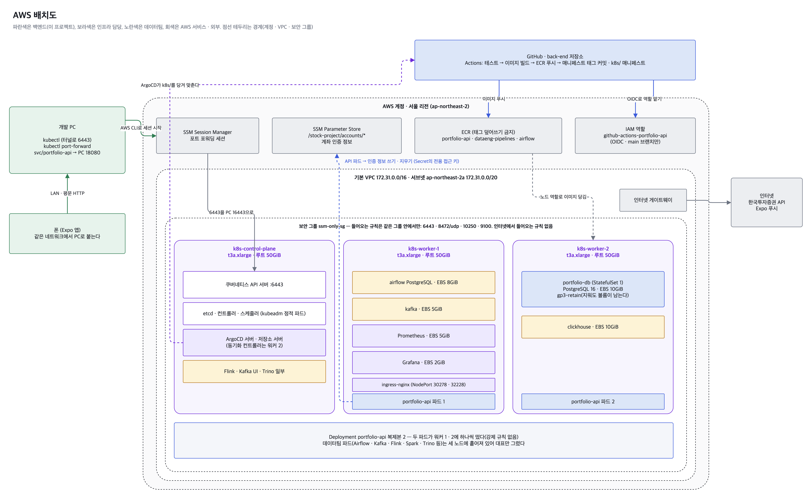
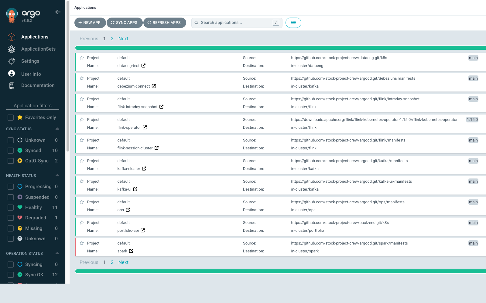
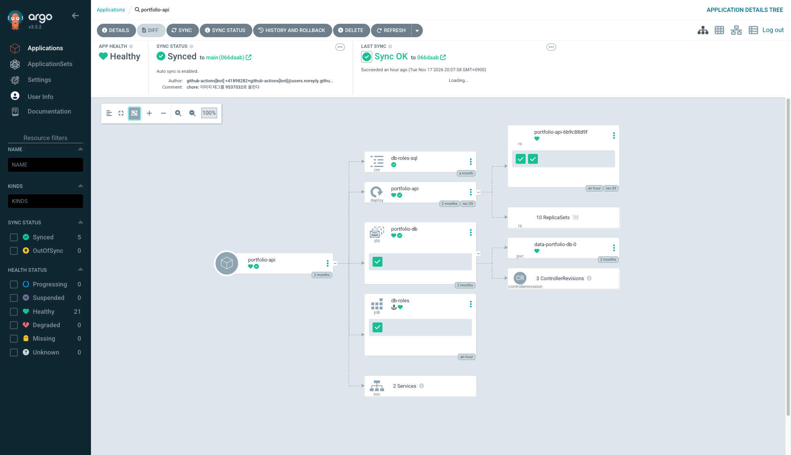
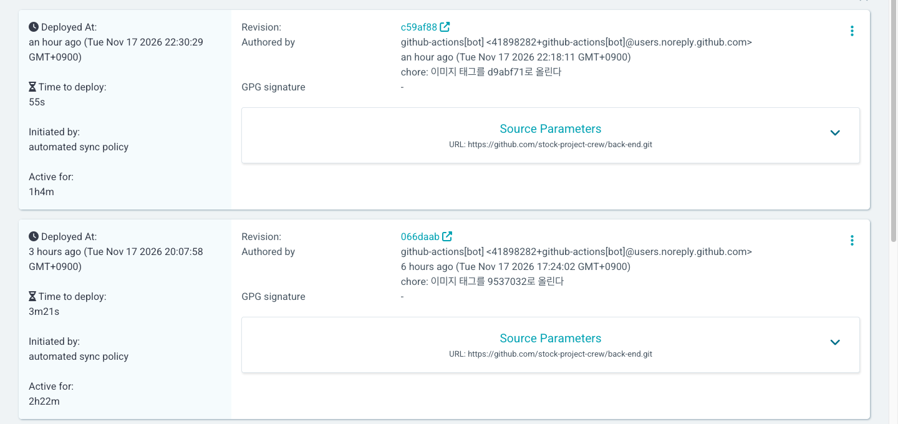
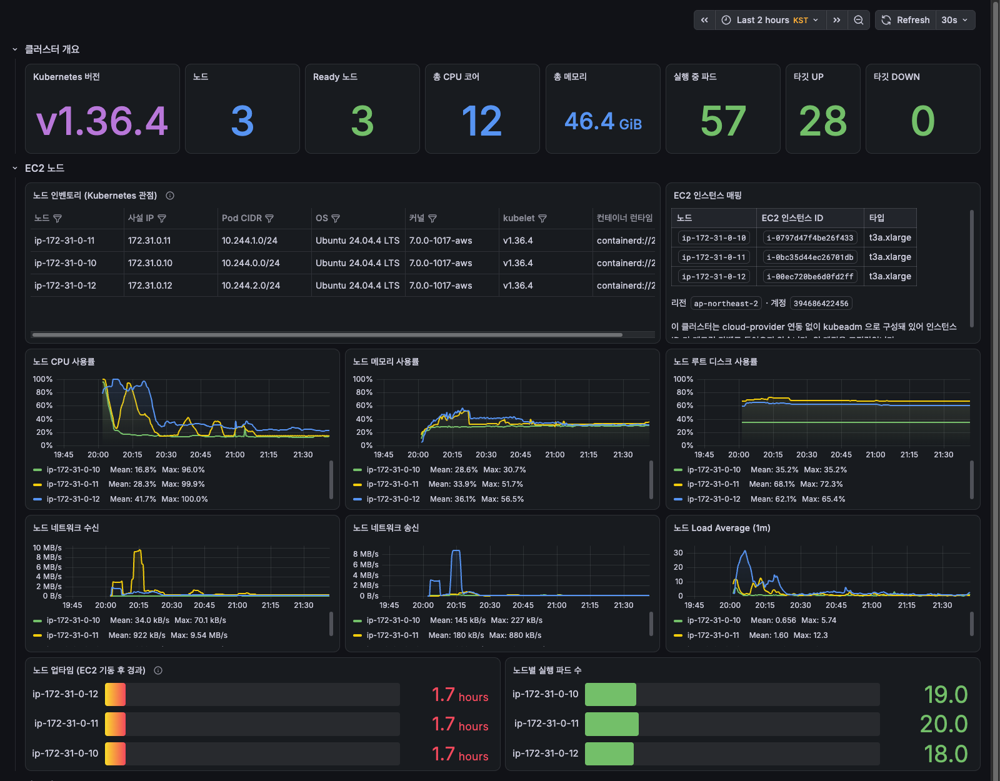
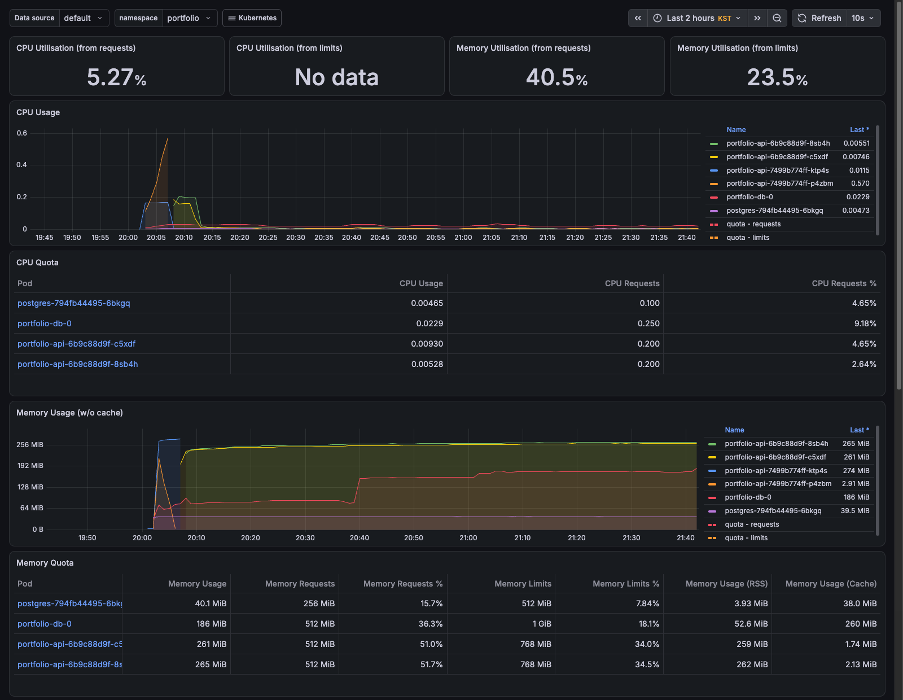

# 인프라 — AWS에서 운영한 환경

이 앱의 서버와 DB는 AWS EC2 세 대 위에 직접 세운 쿠버네티스 클러스터에서 돌았다. 이 문서는 그 환경이 어떻게 놓였는지를 기록한다.

설계 수준의 구성 · 데이터 흐름 · 배포 흐름은 [아키텍처](architecture.md)에 있다. 그 그림은 클러스터가 없어도 유효하고, 이 문서는 실제로 쓴 환경의 기록이다.

**맡은 범위.** AWS 계정과 클러스터는 팀의 인프라 담당(전대홍)이 세우고 운영했다. 백엔드가 맡은 것은 `portfolio` 네임스페이스의 리소스, ECR 저장소 `portfolio-api`, 그 저장소에 이미지를 올리는 CI 역할이다. 데이터팀 네임스페이스는 데이터팀이 맡았다.

## 1. 한눈에

| 항목 | 값 |
|---|---|
| 리전 · 가용 영역 | 서울(`ap-northeast-2`), 노드 세 대 모두 `ap-northeast-2a` |
| 네트워크 | 기본 VPC(`172.31.0.0/16`), 서브넷 하나(`172.31.0.0/20`). 인터넷 게이트웨이로 나가고 NAT · VPC 엔드포인트는 없다 |
| 노드 | EC2 `t3a.xlarge`(4 vCPU · 16 GiB, x86_64) 세 대. 컨트롤 플레인 한 대, 워커 두 대 |
| 쿠버네티스 | EC2 위에 kubeadm으로 세운 클러스터(EKS 아님). v1.36.4 · Ubuntu 24.04 · containerd 2.2 · CNI flannel · EBS CSI 드라이버 |
| 가동 | 정해진 시간에만 켰다(인스턴스 태그 `Schedule=nightly`). 켤 때마다 파드가 다시 뜬다 |
| 이미지 저장소 | ECR, 앱마다 저장소 하나 |
| 비밀값 | 계좌 인증 정보는 SSM Parameter Store, 서버 설정 비밀값은 쿠버네티스 Secret |
| 배포 | GitHub Actions → ECR → 매니페스트 태그 커밋 → ArgoCD |
| 사람의 접근 | SSM Session Manager 포트 포워딩. 인터넷에서 들어오는 규칙이 없다 |

## 2. 네트워크와 접근

- 노드는 보안 그룹 `ssm-only-sg` 하나를 쓴다. 들어오는 규칙은 모두 **같은 보안 그룹 안에서만** 허용한다.

  | 포트 | 쓰임 |
  |---|---|
  | TCP 6443 | 쿠버네티스 API 서버 |
  | UDP 8472 | 노드 사이 파드 네트워크(flannel VXLAN) |
  | TCP 10250 | kubelet |
  | TCP 9100 | 노드 지표 수집(node-exporter) |

  나가는 방향은 모두 열려 있다. 노드가 ECR · SSM · 증권사 · Expo 푸시에 직접 나간다.
- 노드는 켜질 때 공인 IP를 받지만, 인터넷에서 들어오는 규칙이 없으므로 SSH도, 쿠버네티스 API도, 앱 API도 밖에서 닿지 않는다. 공인 IP는 나가는 통신에만 쓰인다.
- 사람은 SSM Session Manager로 컨트롤 플레인의 6443을 자기 PC로 끌어와 `kubectl`을 쓴다. 노드의 인스턴스 프로필(`EC2-SSM-Profile`)이 이 세션을 받는다.
- 앱(폰)은 API에 직접 닿지 않는다. 개발 PC에서 `kubectl port-forward`로 API 서비스를 PC 포트에 잇고, 폰이 같은 네트워크에서 그 PC로 붙는다. 그래서 앱 연결은 평문 HTTP이고, 앱은 `https://`가 아닌 주소에서 실제 키를 넣는 폼에 경고를 띄운다.
- `ingress-nginx`는 NodePort(80→30278, 443→32228)로 떠 있고, ArgoCD와 Grafana가 `*.stock-project.local` 호스트로 그 뒤에 붙어 있다. NodePort도 보안 그룹 밖에서는 닿지 않아, 이 화면들도 SSM 포트 포워딩으로 노드 포트를 끌어와 연다. 앱 API에는 Ingress가 없다.

## 3. 클러스터 안

네임스페이스를 관심사마다 나눴다. 백엔드가 소유한 것은 `portfolio` 하나다.

| 네임스페이스 | 무엇 | 소유 |
|---|---|---|
| `portfolio` | API 서버 · DB | 백엔드 |
| `dataeng` | 시세 수집기(`quote-ingestor`) 등 데이터 파이프라인 | 데이터팀 |
| `airflow` | 수집 스케줄러(API 서버 · 스케줄러 · DAG 처리기 · 트리거러)와 메타 DB | 데이터팀 |
| `kafka` | Strimzi로 띄운 Kafka · Debezium Connect(변경 데이터 수집) · Kafka UI | 데이터팀 |
| `flink` · `spark` · `trino` · `clickhouse` | 스트림 처리(장중 스냅샷) · 배치 · 질의 엔진 · 분석 저장소 | 데이터팀 |
| `monitoring` | Prometheus · Grafana(kube-prometheus-stack), 이 앱 DB의 지표 수집기(`portfolio-db-exporter`) | 인프라 담당 |
| `argocd` | GitOps 동기화 | 인프라 담당 |
| `ingress-nginx` | 인그레스 컨트롤러 | 인프라 담당 |
| `team` · `ops` | 팀원별 접근 계정(서비스 어카운트) · 주기 정리 작업 | 인프라 담당 |
| `kube-system` · `kube-flannel` | 컨트롤 플레인 구성요소 · CoreDNS · kube-proxy · EBS CSI · 파드 네트워크 | 인프라 담당 |

- 컨트롤 플레인 노드에는 `NoSchedule` 테인트가 있지만 ArgoCD · Flink · Kafka UI · Trino 등 일부 파드가 이를 견디도록 설정돼 그 노드에도 떠 있다.
- 지표 수집 서버(Metrics API)가 없어 `kubectl top`으로 사용량을 볼 수 없다. 사용량은 Prometheus · Grafana로 본다.

### 3.1 `portfolio` 네임스페이스

| 리소스 | 형태 | 값 |
|---|---|---|
| `portfolio-api` | Deployment, 복제본 2 | 요청 CPU 200m · 메모리 512Mi, 한도 메모리 768Mi. 준비 점검은 DB까지, 생존 점검은 앱만 본다 |
| `portfolio-api` | Service, ClusterIP | 8080. 클러스터 안에서만 닿는다 |
| `portfolio-db` | StatefulSet, 한 대 | PostgreSQL 16. 요청 CPU 250m · 메모리 512Mi, 한도 메모리 1Gi. 볼륨 10Gi |
| `db-roles` | Job(ArgoCD 동기화 훅) | 데이터팀이 쓰는 DB 역할과 권한을 만든다. 동기화 때마다 다시 돈다 |
| `postgres` | Deployment, 한 대 | Git 매니페스트에 없는 DB. ArgoCD가 만든 것이 아니라 `prune` 대상이 아니다. API는 이 DB에 붙지 않는다(`DB_URL`은 `portfolio-db`) |
| `portfolio-api` | Secret | DB 비밀번호 · JWT 서명 키 · Expo 토큰 · SSM 접근 키 등. Git 밖에서 `kubectl`로 만들었다 |

- API 파드 두 대는 워커 1과 워커 2에 하나씩 떴다. 이를 강제하는 규칙(파드 안티어피니티)은 없어 스케줄러가 그렇게 나눈 것이다. DB 파드는 볼륨이 붙은 워커 2에 있다.
- 파드가 쓰는 이미지는 커밋 해시 태그다. ReplicaSet 이력에 배포마다 태그가 하나씩 남는다.
- 실제 사용량은 아래 «관측»에 있다.

## 4. 저장소(EBS)

모든 볼륨이 gp3다. 쿠버네티스가 만든 볼륨은 PVC 이름 태그로 어느 것인지 알 수 있다.

| 볼륨 | 크기 | 붙은 노드 | 쓰임 |
|---|---|---|---|
| 노드 루트 × 3 | 50 GiB씩 | 각 노드 | OS · 컨테이너 이미지 |
| `portfolio/data-portfolio-db-0` | 10 GiB | 워커 2 | 이 앱의 DB |
| `airflow/data-airflow-postgresql-0` | 8 GiB | 워커 1 | Airflow 메타 DB |
| `clickhouse/data-clickhouse-0` | 10 GiB | 워커 2 | 데이터팀 분석 저장소 |
| `kafka/data-0-my-cluster-dual-role-0` | 5 GiB | 워커 1 | 데이터팀 메시지 로그 |
| `monitoring/prometheus-…-0` | 5 GiB | 워커 1 | 지표 |
| `monitoring/kube-prometheus-stack-grafana` | 2 GiB | 워커 1 | 대시보드 설정 |

- 이 앱의 DB 볼륨은 회수 정책이 `Retain`인 스토리지 클래스(`gp3-retain`)에서 만들었다. PVC를 지워도 EBS 볼륨은 남는다.
- EBS 볼륨은 한 가용 영역에 묶인다. DB 파드는 볼륨이 있는 영역의 노드에만 뜰 수 있고, 노드가 모두 `2a`라 이것이 제약이 되지는 않았다.
- 볼륨은 EBS CSI 드라이버가 만든다. 정기 스냅샷은 없다.

## 5. 이미지와 배포

| 항목 | 값 |
|---|---|
| ECR 저장소 | `portfolio-api`(백엔드) · `dataeng-pipelines` · `airflow`(데이터팀) |
| 태그 | 커밋 해시. 세 저장소 모두 덮어쓰기 금지(`IMMUTABLE`) |
| 수명 규칙 | `portfolio-api`는 태그 없는 이미지를 7일 뒤 지운다. 태그 붙은 이미지는 남긴다 |
| CI 자격증명 | GitHub Actions가 실행마다 OIDC로 역할(`github-actions-portfolio-api`)을 맡는다. 신뢰 조건은 백엔드 저장소의 `main` 브랜치 하나, 권한은 이 저장소에 이미지를 올리는 것뿐이다 |
| 노드가 이미지를 받는 법 | 노드 인스턴스 역할의 ECR 읽기 권한. 매니페스트에 `imagePullSecrets`가 없다 |
| 클러스터 반영 | ArgoCD Application이 백엔드 저장소의 `k8s/`만 본다. `prune` · `selfHeal`을 켰다 |
| 사람의 배포 권한 | 팀원 계정은 읽기 전용이다(DB 파드 접속과 port-forward만 예외). Git이 클러스터로 가는 유일한 입구다 |

흐름 그림은 [아키텍처 «배포»](architecture.md#4-배포)에 있다.

ArgoCD(v3.5.2)에는 애플리케이션이 12개 있다. 백엔드의 것은 `portfolio-api` 하나이고 백엔드 저장소의 `k8s/`를 본다. 데이터팀 애플리케이션은 대부분 팀 공용 `argocd` 저장소의 경로별 매니페스트를 보고, Flink 오퍼레이터와 Strimzi 오퍼레이터는 외부 Helm 차트를 본다. 모두 자동 동기화다. Airflow · ClickHouse · 모니터링 · ArgoCD 자신 · ingress-nginx는 ArgoCD 애플리케이션이 아니다.

`portfolio-api` 애플리케이션. CI 봇의 태그 커밋(`chore: 이미지 태그를 …로 올린다`)을 자동으로 동기화했고, Deployment · StatefulSet · 동기화 훅 Job · 서비스 둘 · ConfigMap이 매니페스트대로 있다. ReplicaSet 10개는 배포 이력이다. Git 밖에서 만든 `postgres` Deployment는 이 트리에 없다.

배포 이력. 동기화 하나가 CI 봇의 태그 커밋 하나이고, 시작은 모두 자동 동기화(`automated sync policy`)다. 동기화부터 새 파드가 준비될 때까지 1~3분 남짓 걸렸다.

## 6. 비밀값

| 무엇 | 어디 | 누가 읽나 |
|---|---|---|
| 증권사 앱키 · 시크릿(수집용 값) | SSM Parameter Store `/stock-project/accounts/*` | 백엔드는 쓰고 지우기만 한다. 수집할 때 데이터팀 워커(IAM 사용자 `dataeng-pipeline`)가 읽는다 |
| 계좌번호 | SSM Parameter Store `/stock-project/account-numbers/*` | 백엔드가 쓰고 읽고 지운다 |
| 계좌 식별 솔트 백업 | SSM Parameter Store `/stock-project/backend/account-ref-salt` | 운영자만. 백엔드 키로는 읽지 못한다 |
| DB 비밀번호 · JWT 서명 키 · Expo 토큰 · SSM 접근 키 · 계좌 식별 솔트 | 쿠버네티스 Secret `portfolio-api` | API 파드가 환경변수로 받는다 |

- 백엔드는 노드 역할이 아니라 전용 IAM 사용자 `portfolio-api-credentials`의 접근 키를 Secret으로 받아 SSM을 부른다. 그 사용자의 권한은 위 두 경로에 대한 쓰기 · 지우기(계좌번호는 읽기 포함)뿐이라, 수집용 값을 읽지 못한다.
- 클러스터에 SealedSecrets나 External Secrets가 없어 Secret은 Git에 두지 않고 손으로 만들었다.

## 7. 관측

클러스터에는 Prometheus와 Grafana(kube-prometheus-stack)가 있고, 인프라 담당이 클러스터 종합 · 서비스 · PortfolioDB 대시보드를 따로 만들어 두었다. Prometheus의 보관 설정은 3일이지만, 남아 있던 값은 마지막으로 켠 저녁 몇 시간치뿐이었다. 아래 값은 그 시간의 것이라 장중 부하가 있을 때의 값은 없다.

**클러스터.** 노드 세 대 · 12코어 · 46.4GiB에 파드 57개가 돌았다. 켠 직후 20분 남짓은 모든 파드가 한꺼번에 뜨며 노드 CPU가 100% 가까이 올랐고, 그 뒤로는 15~40%였다. 메모리는 최대 57%, 루트 디스크는 35~72%를 썼다.

**`portfolio` 네임스페이스.** 클러스터를 켜면 직전 태그의 API 파드 두 대가 먼저 뜨고, 몇 분 뒤 ArgoCD가 새 태그를 동기화해 새 파드 두 대로 롤링 교체됐다. 그래프 앞부분에 옛 파드와 새 파드가 겹친 구간이 그것이다. API 파드는 기동할 때 CPU를 0.2~0.6코어 쓰고, 그 뒤로는 0.01코어 안팎이다.

| 파드 | 메모리 사용 | 요청 / 한도 | CPU(평상시) |
|---|---|---|---|
| `portfolio-api` × 2 | 각 약 260~270MiB, 최대 약 305MiB | 512Mi / 768Mi | 0.01코어 안팎 |
| `portfolio-db-0` | 약 190~220MiB, 최대 약 310MiB | 512Mi / 1Gi | 0.02~0.07코어 |

메모리 한도는 실측보다 두 배 넘게 넉넉하다. 요청량(512Mi) 대비 사용률은 API 파드가 약 51%다.

## 8. 하지 않은 것

| 항목 | 지금 | 하려면 |
|---|---|---|
| 가용 영역 이중화 | 노드 · 볼륨이 모두 한 영역(`2a`) | 서브넷을 여러 영역에 두고 노드를 나눈다. DB는 볼륨이 영역에 묶이므로 복제나 매니지드 DB가 함께 필요하다 |
| 컨트롤 플레인 이중화 | 한 대 | 세 대 이상. 이 노드가 내려가면 배포 · 재스케줄이 멈춘다 |
| 매니지드 DB | 클러스터 안 StatefulSet 한 대 | RDS. 앱 쪽 변경은 `DB_URL` 하나 |
| DB 백업 | 없음. 볼륨 `Retain`으로 실수 삭제만 막는다 | EBS 스냅샷 정책 또는 `pg_dump` 주기 작업 |
| 외부 노출 · TLS | 없음. port-forward로만 닿는다 | 공인 진입점(로드 밸런서) · 도메인 · 인증서 |
| 비밀값 동기화 | Secret을 손으로 만든다 | External Secrets로 SSM에서 받아 온다 |
| Git 밖 리소스 정리 | `portfolio`에 매니페스트에 없는 `postgres` Deployment가 남아 있다 | 지우거나 매니페스트로 옮긴다 |
| 앱 지표 · 경보 | 컨테이너 자원과 DB 지표는 Prometheus에 쌓이지만, API 서버의 지표(요청 수 · 지연 · JVM)는 내보내지 않는다. 경보도 없다 | actuator `metrics`를 열고 대시보드 · 경보를 둔다 |

## 9. 이 값을 읽은 방법

- AWS: `aws ec2 describe-instances · describe-vpcs · describe-subnets · describe-security-groups · describe-volumes · describe-route-tables`, `aws ecr describe-repositories · get-lifecycle-policy`. 모두 읽기 전용이다.
- 클러스터: ArgoCD 화면과 애플리케이션 목록, Grafana 대시보드, Prometheus 질의(`container_memory_working_set_bytes` · `container_cpu_usage_seconds_total` · `node_memory_*` · `node_cpu_seconds_total`), `kubectl version · get nodes -o wide · get ns · get pods -A -o wide · get deploy,sts,ds,svc,ingress,networkpolicy -A · get all,pvc,cm -n portfolio · auth can-i --list`. `kubectl describe nodes`. 이 계정(`team` 네임스페이스의 서비스 어카운트)은 읽기 전용이라 `kubectl`로 스토리지 클래스 · PV · Secret · ArgoCD 애플리케이션 객체를 읽지 못했다. 스토리지 값은 매니페스트와 AWS 쪽 볼륨 태그로, ArgoCD는 화면으로 확인했다.
- 매니페스트와 CI: [back-end `k8s/`](https://github.com/stock-project-crew/back-end/tree/main/k8s), [`build-and-push.yml`](https://github.com/stock-project-crew/back-end/blob/main/.github/workflows/build-and-push.yml), 결정과 이유는 [back-end `docs/decisions-deploy.md`](https://github.com/stock-project-crew/back-end/blob/main/docs/decisions-deploy.md).
- 이 계정은 IAM · EventBridge · Lambda · SSM 목록을 읽을 권한이 없어, 역할 목록과 가동 스케줄 장치는 여기서 확인하지 못했다.
