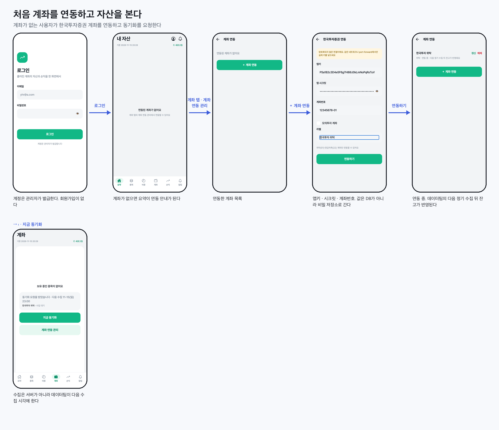
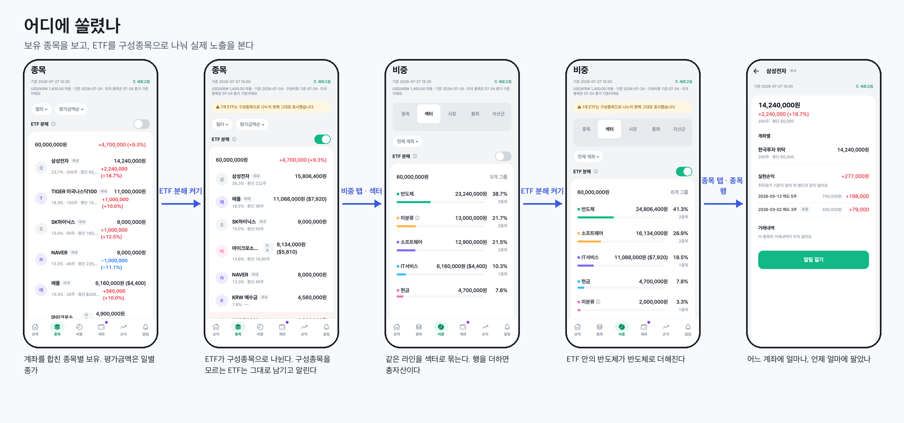
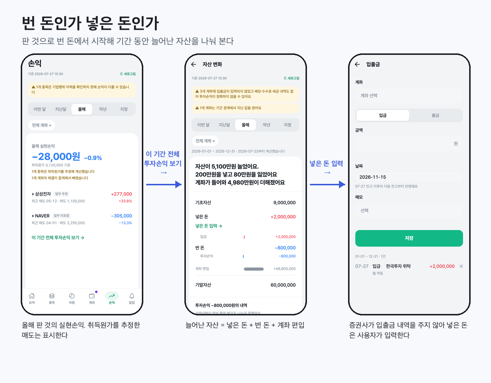
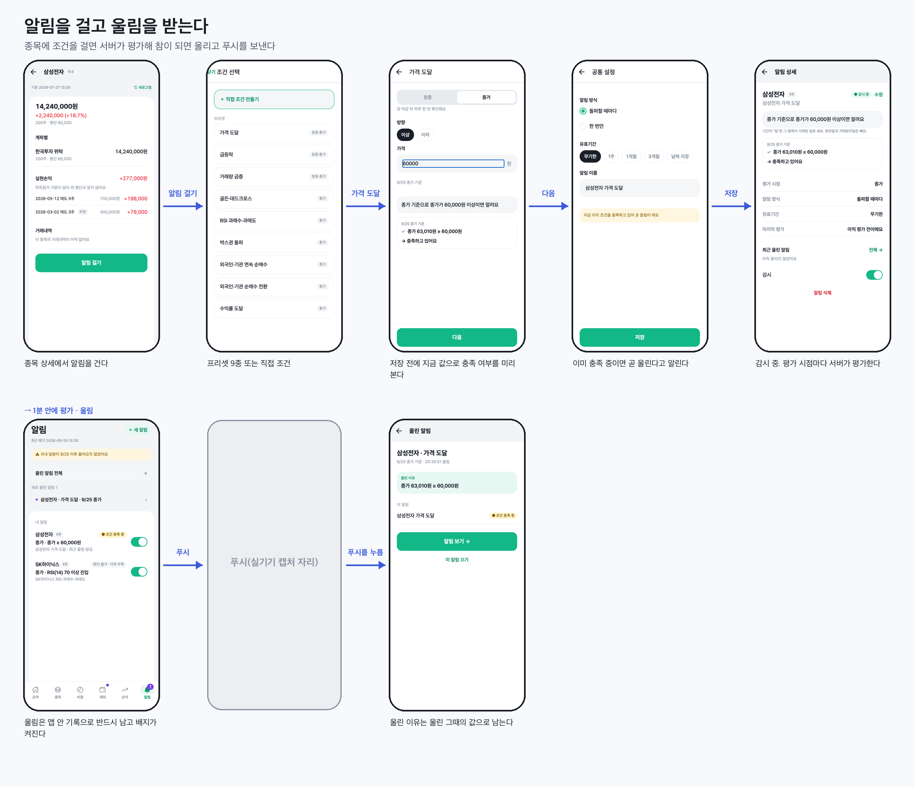
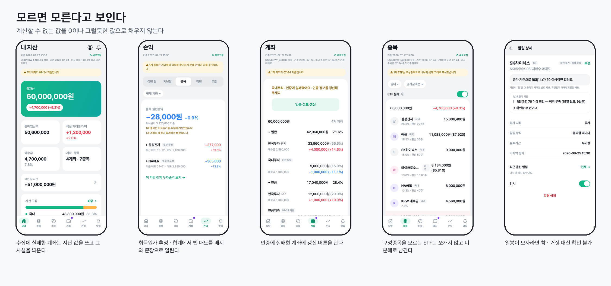
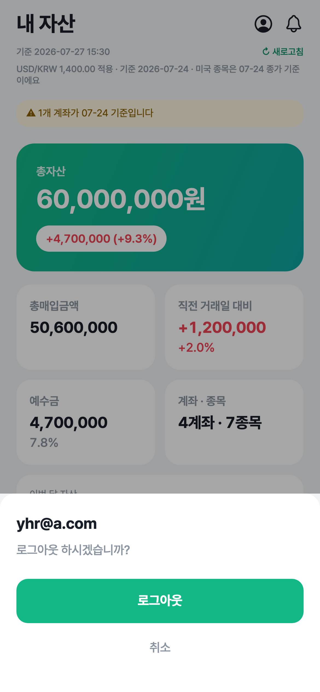
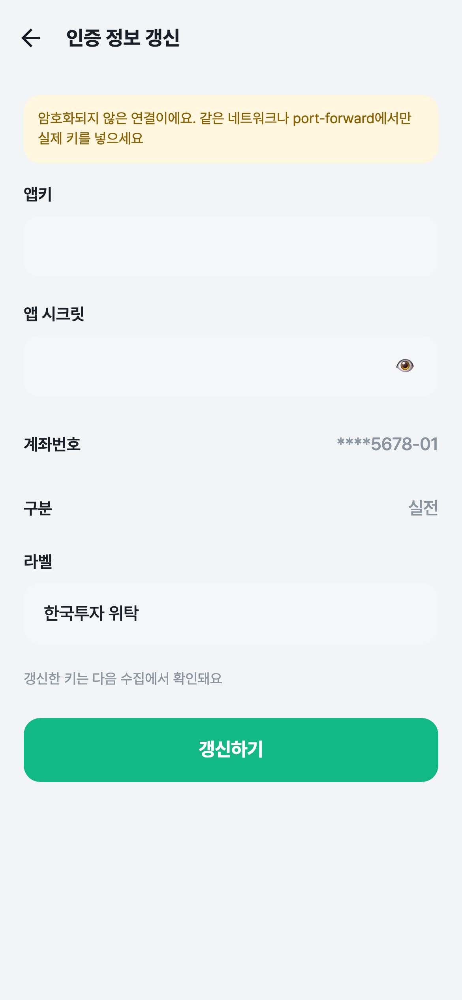
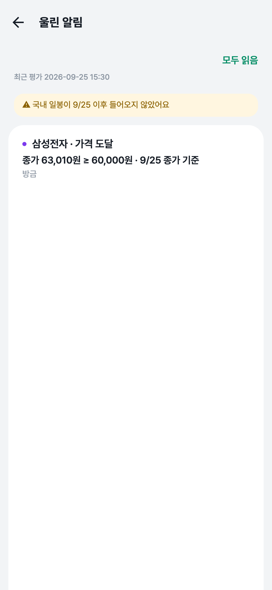

# 사용자 여정

실제 앱 화면을 여정 순서로 이었다. 화살표 위는 누르는 것, 화면 아래는 그 화면이 보이는 것이다. 각 여정 아래에 그 화면 뒤의 규칙이 있는 설계서 절을 단다.

- 화면은 샘플 데이터로 찍었다. 실제 계좌 · 자산이 아니다.
- 푸시 외의 화면은 웹으로 띄운 같은 앱을 폰 크기(390×844)로 찍었다. 탭 막대는 아이폰처럼 아래 여백을 주어 찍었다.

## 1. 처음 계좌를 연동하고 자산을 본다

- 로그인 · 계정: [common.md «로그인·세션»](../specs/common.md)
- 빈 요약과 첫 화면: [common.md «로그인 직후 첫 화면»](../specs/common.md), [portfolio.md «요약»](../specs/portfolio.md)
- 연동 · 인증 정보 보관: [portfolio.md «연동 경로와 받는 계좌» · «인증 정보 보관»](../specs/portfolio.md)
- 연동 상태 · 동기화: [portfolio.md «계좌 상태» · «동기화» · «수집 시점»](../specs/portfolio.md)

## 2. 어디에 쏠렸나

- 종목 · 비중 화면: [portfolio.md «종목» · «비중»](../specs/portfolio.md)
- 같은 라인을 묶는 기준만 바꾼다: [portfolio.md «그레인» · «가산성»](../specs/portfolio.md)
- ETF 분해: [portfolio.md «ETF 분해» · «ETF 분해 계산»](../specs/portfolio.md)
- 종목 상세: [portfolio.md «종목 상세»](../specs/portfolio.md)

## 3. 번 돈인가 넣은 돈인가

- 실현손익과 등급: [portfolio.md «실현손익» · «평단과 실현손익» · «등급 판정»](../specs/portfolio.md)
- 자산 변화의 분해: [portfolio.md «자산 변화» · «자산 변화 항등식과 분해»](../specs/portfolio.md)
- 입출금 입력: [portfolio.md «입출금» · «입출금 입력과 미입력 판정»](../specs/portfolio.md)

## 4. 알림을 걸고 울림을 받는다

- 새 알림 흐름 · 미리보기: [alert.md «새 알림 흐름» · «현재값 갱신»](../specs/alert.md)
- 조건과 프리셋: [alert.md «조건 모델» · «프리셋»](../specs/alert.md)
- 첫 평가에서 바로 울리는 이유: [alert.md «첫 평가» · «알림 방식»](../specs/alert.md)
- 울림 기록 · 푸시: [alert.md «울림 전달»](../specs/alert.md), [common.md «배지» · «푸시를 눌렀을 때»](../specs/common.md)

## 5. 모르면 모른다고 보인다

- 원칙: [common.md «원칙»](../specs/common.md)
- 이월: [portfolio.md «이월»](../specs/portfolio.md)
- 추정 · 미포함: [portfolio.md «등급 판정» · «추정 표시»](../specs/portfolio.md)
- 인증 실패 안내: [portfolio.md «수집 안내»](../specs/portfolio.md)
- 미분해: [portfolio.md «ETF 분해»](../specs/portfolio.md)
- 확인 불가: [alert.md «평가 결과» · «결측·지연»](../specs/alert.md)

## 그 밖의 화면

| 화면 | 설명 |
|---|---|
|  | **계정 시트.** 요약 제목 줄의 계정 아이콘으로 연다. 로그인한 이메일과 로그아웃 |
|  | **인증 정보 갱신.** 계좌번호는 다시 받지 않고 앱키 · 시크릿만 바꾼다. 새 키는 다음 수집에서 확인된다 |
|  | **울린 알림.** 울린 알림 전체 목록과 모두 읽음 |

## 다시 찍기

캡처와 합성은 스크립트로 다시 할 수 있다. 화면 문구나 모양이 바뀌면 아래를 다시 돌린다.

1. 캡처용 DB를 만든다: `src/journeys/setup.sh <back-end 경로>`. 일회용 Postgres(127.0.0.1:5510)에 마이그레이션, back-end의 샘플 네 개, 캡처용 덧씌움(`src/journeys/extra.sql`, 인증 실패 수집 한 건)을 넣는다.
2. 백엔드를 로컬 프로필로 띄운다(back-end 레포에서):
   `SPRING_PROFILES_ACTIVE=local DB_URL='jdbc:postgresql://localhost:5510/portfolio?currentSchema=app,data' SERVER_PORT=8180 APP_WEB_ORIGINS=http://localhost:8191 ./gradlew bootRun`
3. 앱을 웹으로 띄운다(front-end 레포에서): `EXPO_PUBLIC_API_BASE_URL=http://localhost:8180 npx expo start --web --port 8191`
4. 캡처한다: `playwright-core`를 설치한 폴더에서 `NODE_PATH=<그 폴더>/node_modules node src/journeys/capture.js`. 설치된 Chrome을 쓴다. 알림을 실제로 만들고 평가 주기(1분)를 기다려 울림까지 찍으므로 약 3분 걸린다. 결과는 `screens/`에 화면 이름으로 쓰인다.
5. 합성한다: `python3 src/journeys.py`(Pillow 필요). `journeys/`의 이미지 다섯 장이 다시 만들어진다.

푸시(잠금 화면 알림 · 앱 안 배너)는 실기기에서 찍어 `screens/`에 넣고, `src/journeys.py`의 여정 4에서 비워 둔 자리(`None`)를 그 파일 이름으로 바꾼다.
