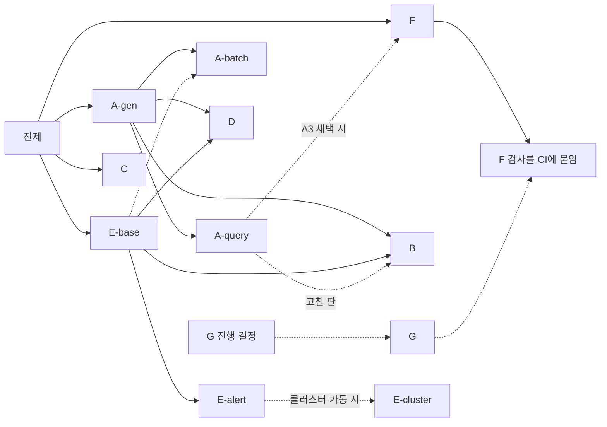

# D단계 고도화 구상

> **실습하지 않았다. 아래 숫자는 측정하지 않은 가설이다.**
> 과제마다 "결과" 칸에 "측정 안 함"이라고 적었다. 실습하면 그 칸과 "실습 시 고칠 문서" 목록만 고친다.
> 판정 기준에 쓴 숫자와 그 근거는 0.4에 모았다.

- 범위: `triage.md` §7의 백엔드 과제 A~G와 쿼리·인덱스 후보 5개.
- 앱 과제는 두지 않는다. 이유는 다음과 같다.
  - 세션 경계 캐시 격리는 R2 수정이 대신한다.
  - 생명주기·오프라인 중 서버와 닿는 부분은 N11 멱등 키가 대신한다.
  - 공통 화면 키트는 그냥 둔다.
  - 응답 계약 안전망만 G에 한 줄로 둔다.
- 메우려는 역량: 실트래픽 운영(관측·경보), 부하 테스트, 동시성 제어, 쿼리·인덱스 튜닝.
- 코드 위치 기준 커밋: back-end `275cb26`, front-end `21df26c`. 실습할 때는 그 시점 main에서 위치를 다시 찾는다.
- "실습 시 고칠 문서"의 경로는 `doc-map.md` §7 배치를 따른다.
  - 설계서: `yhr/specs/{common,portfolio,alert,data-contract}.md`
  - ADR: `triage.md` §8의 번호
  - 테스트 문서: `yhr/test/`
  - 런북: `back-end/docs/ops/`
  - 이 가운데 ADR은 아직 파일이 없다.
- 설계서 원칙(`doc-map.md` §7)대로 실측값·인덱스 목록·SQL은 설계서에 적지 않는다. ADR과 테스트 문서에 적는다.

## 0. 공통

### 0.1 환경

- 모든 측정은 로컬에서 한다.
  - 기본은 back-end `docker-compose.yml`의 Postgres 16과 로컬 앱이다.
  - 운영 클러스터와 운영 DB는 쓰지 않는다. 예외는 E-cluster이고, 그때 따로 승인받는다.
  - 복제본 두 대가 필요한 과제(B·D·E)는 로컬에서 앱 두 개를 다른 포트로 띄운다.
- 운영 DB의 EXPLAIN은 ADR 5 근거 보강(`triage.md` §8)으로 따로 다룬다. 운영 DB를 읽는 일이라 승인이 필요하다.
- 마이그레이션이나 대량 합성 데이터는 공유 `portfolio_test`가 아니라 전용 DB에 넣는다.

#### 사용자가 미리 승인한 범위

과제 세션은 아래를 묻지 않고 한다. 컨테이너 이름과 포트는 0.2의 테이블을 따른다.

- 설치
  - `brew install k6`
  - Docker 이미지: `postgres:16-alpine`, `prom/prometheus`, `tufin/oasdiff`
  - Gradle 의존성(실습 브랜치에서만): `micrometer-registry-prometheus`, `springdoc-openapi`, OpenAPI 생성기 플러그인
  - 실습 DB의 Postgres 확장: `pg_stat_statements`, `pg_trgm`
- 컨테이너·서버 기동
  - 단위별 Postgres 컨테이너 `pf-a`~`pf-g`(5501~5507)의 생성·기동·정지·삭제. 자원 제한과 시작 옵션(`shared_preload_libraries` 등)을 붙이는 것도 포함한다
  - Prometheus 컨테이너 하나(9090)
  - 로컬 앱 기동(`bootRun`, 또는 `bootJar`로 만든 jar를 `java -jar`로. local 프로필, 단위당 최대 2개, 0.2 테이블의 앱·관리 포트). 자기 컨테이너만 가리키고, 푸시(`EXPO_PUSH_ENABLED`)와 실현손익 생성기(`BASIS_ENABLED`)는 끈다. 스케줄 작업은 측정 목적에 따라 켜고 끈다
  - 로컬 앱을 대상으로 한 k6 실행
  - 자기 컨테이너(`TEST_DB_URL`)를 쓰는 Gradle 테스트
- DB 쓰기(`pf-*` 컨테이너 안에서만)
  - DB 생성·삭제, Flyway 적용(실습 브랜치의 V 마이그레이션 포함)
  - 합성 데이터 대량 적재, 인덱스·파티션·확장 생성
  - 서버 설정 변경(`deadlock_timeout`, `log_lock_waits` 등)
  - 장애 주입을 위한 행 삭제·수정
- git
  - back-end의 `practice/*` worktree·브랜치 생성과 그 브랜치의 로컬 커밋
  - docs의 `practice-note/*` worktree·브랜치 생성과 그 브랜치의 로컬 커밋(실습 노트)

그때마다 묻는 것:

- 운영 DB·클러스터 접근(운영 행 수 확인, 운영 EXPLAIN 포함)
- main 머지·푸시, 원격 푸시
- 비밀 파일 열기, 실제 외부 API 호출(KIS, Expo 푸시)
- compose의 `portfolio`·`portfolio_test`와 `pf-*`가 아닌 기존 컨테이너를 건드리는 일
- 위 목록에 없는 설치, Docker Desktop 자원 설정 변경

### 0.2 진행 방식·순서·의존

#### 역할

- 실습의 목적은 사용자의 역량이다. 결과 숫자보다 사용자가 절차와 원리를 설명할 수 있는지가 먼저다.
- 총괄 세션
  - 단위 사이의 순서와 의존을 관리한다.
  - 과제 세션이 공유한 결과를 받아 다음 단위의 시작 조건을 확인한다.
  - 이 문서의 "결과" 칸과 판정을 고친다.
- 과제 세션
  - 사용자가 새 세션에서 아래 단위 하나를 맡는다. 세션끼리는 직접 대화하지 않는다. 사용자가 공유 메모를 총괄 세션에 옮긴다.
  - 코드 작성, 데이터 생성, 측정 실행은 AI가 한다. 단계마다 무엇을 왜 하는지 설명하고, 사용자가 이해했는지 확인한 뒤 넘어간다.
- 결정 지점
  - 단위마다 "사용자가 정할 것"(아래 테이블)에 이르면 AI는 멈춘다. 배경, 문제, 선택지별 영향, 고르는 기준을 적는다.
  - 추천도 함께 낸다. 선택지 사이에 트레이드오프가 있으면 선택지마다 얻는 것과 잃는 것을 먼저 객관적으로 적고, 추천은 그와 나눠 적는다.
  - 도구 사용법이나 쿼리 작성처럼 결정이 아닌 것은 AI가 진행하고 이유만 남긴다.

#### 전제

- 회고 C단계 수정이 main에 들어간 뒤 시작한다. 이 문서의 코드 위치가 그 수정으로 바뀌기 때문이다.
- 0.3의 기준 규모를 정한 뒤 A-gen을 시작한다.
- 0.1의 승인 범위가 정해져 있어야 과제 세션이 중간에 멈추지 않는다.

#### 작업 단위와 의존

과제를 실습 단위로 나눈다. A와 E는 다른 단위가 기다리는 관문 부분을 떼어 낸다.

| 단위 | 내용 | 먼저 있어야 하는 것 | 다음 단위에 넘기는 것 |
|---|---|---|---|
| A-gen | 0.3 축대로 app·data 스키마를 채우는 합성 데이터 생성기 | 전제 | 생성기와 규모 파라미터 → A-query, A-batch, B, D |
| A-query | 후보 A1~A5 실행 계획, 파티셔닝 비교 | A-gen | 후보 판정 → B(고친 판 재측정), F(A3를 채택하면 새 마이그레이션) |
| A-batch | 스냅샷 회차 처리량, 확정 마감 | A-gen. E-base가 있으면 단계 소요를 지표로 읽는다 | batch-size 판정 |
| E-base | Prometheus 레지스트리, `/actuator/prometheus`, LOST 계수기, 지표 이름·태그 목록 | 전제 | 지표 이름·태그 목록 → A-batch, B, D, E-alert |
| E-alert | 나머지 지표, 경보 규칙, 장애 주입, 런북 | E-base | 경보 규칙과 런북 |
| B | 조회 부하 | A-gen, E-base. A-query 판정이 나오면 고친 판으로 한 번 더 | 병목 지목 |
| C | 잠금·교착 | 전제 | 잠금 규약 판정 |
| D | 리더 없는 복제본의 비용 | A-gen, E-base(LOST 계수기) | 방식 검토 결과 |
| F | 마이그레이션 호환 검사 | 전제 | 검사 두 방식의 비교 |
| G | API 계약 검사 | 진행 여부와 방향(명세 방식, 산출물로 쓸지)이 정해지는 것 | 명세 방식 비교, 깨지는 변경 검사 |
| E-cluster | 운영 Prometheus가 앱 지표를 수집하고 경보 규칙이 도는지 확인. 롤링 배포 중 파드가 몇 대까지 겹치는지(C의 경계 경로), Ingress 유무와 경로 규칙, 운영 Prometheus가 수집 대상을 찾는 방식(Service에 관리 포트가 없다), NetworkPolicy가 없는 상태, 클러스터를 켤 때 이전 판이 먼저 뜨고 롤링되는지(F)를 함께 본다 | E-alert, E-base의 main 반영 결정, 클러스터 가동 | 운영 확인 결과 |

#### 진행 묶음

- 1묶음: A-gen, E-base, C, F. 서로 기다리지 않아 동시에 시작한다.
  - G는 진행 여부와 방향이 정해지지 않았다. 정해지면 다른 단위를 기다리지 않으므로 그때 시작한다.
  - A-gen과 E-base는 뒤 단위가 기다리는 관문이다. 먼저 끝내는 것을 우선한다.
  - E-base는 지표 이름·태그 목록을 가장 먼저 정해 공유한다. 그래야 E-alert·B·D가 같은 이름을 쓴다.
- 2묶음
  - A-gen이 끝나면 A-query, A-batch를 시작한다.
  - E-base가 끝나면 E-alert를 시작한다.
  - 둘 다 끝나면 B, D를 시작한다.
- 마무리
  - A-query 판정을 반영한 판으로 B를 한 번 더 잰다.
  - F의 정적 검사는 main 푸시 CI의 테스트 단계에 붙어 있다. G를 진행하면 같은 워크플로를 바꾸므로 F의 주석과 맞춘다.
  - E-cluster는 클러스터를 켤 수 있을 때 따로 한다. 다른 단위는 이것을 기다리지 않는다.
  - 문서를 고치고, main 반영 여부를 단위마다 정한다.
- 가장 긴 경로는 A-gen → B → B 재측정이다. A-gen이 늦어지면 전체가 늦어진다.

#### 병렬로 돌릴 때의 규칙

- 구현은 병렬로, 시간 측정은 한 번에 하나만 돌린다.
  - 한 노트북에서 측정 둘이 겹치면 서로의 CPU·디스크를 먹어 숫자가 틀어진다.
  - 측정 실행 단위: A-query, A-batch, B, C, D, E-alert의 장애 주입.
  - 과제 세션은 측정을 돌리기 직전에 다른 측정이 돌고 있지 않은지 직접 확인한다. `pf-*` 컨테이너의 CPU(`docker stats`)와 k6·bootRun 프로세스를 본다.
  - 두 설정을 비교할 때는 한 설정을 몰아 돌리지 않고 번갈아 돌린다. 노트북 부하의 차이가 두 설정에 고르게 나뉜다.
  - SQL 전체 로그(`log_min_duration_statement=0`)는 회차당 GB 단위로 쌓이고 부하도 더한다. 분포가 필요할 때 표본 몇 회에만 켠다.
- 코드 브랜치
  - back-end에서 단위마다 worktree와 브랜치 `practice/<단위>`를 하나씩 둔다.
  - A-gen과 E-base의 결과는 `practice/base`에 모은다. A-batch, B, D, E-alert는 `practice/base`에서 딴다.
  - main 푸시는 곧 운영 배포다. 그래서 `practice/*`의 main 반영은 변경의 성격으로 나눈다.
    - 운영 동작이 바뀌지 않는 변경(테스트, 주석, 로컬 전용 스크립트): 단위가 끝나면 사용자 결정으로 main에 올릴 수 있다. main 위로 리베이스한 뒤 전체 테스트를 통과시키고 올린다.
    - 운영 동작이 바뀌는 변경(의존성, 설정, 노출 경로, 마이그레이션): 마무리에서 따로 정한다. 예를 들어 E-base를 그대로 올리면 운영에 `/actuator/prometheus`가 열린다.
    - 한 브랜치에 둘이 섞이면 운영 동작이 바뀌는 쪽으로 본다.
- 여러 단위가 같이 바꾸는 파일
  - `build.gradle.kts`: E-base(Micrometer), G(springdoc)
  - `application.yaml`: E-base(노출 범위), B(풀 크기)
  - `.github/workflows/build-and-push.yml`: F, G
  - 이 파일을 바꾼 단위는 공유 메모에 적는다. 합칠 때 총괄 세션이 충돌을 정리한다.
- 마이그레이션 번호
  - 실습에서 V 마이그레이션을 만들면 그 시점 main의 다음 번호를 임시로 쓴다.
  - 두 단위가 같은 번호를 쓸 수 있다. main에 반영할 때 다시 매긴다.
- DB와 포트
  - 단위마다 자기 Postgres 컨테이너를 쓴다. compose의 `portfolio`·`portfolio_test`는 쓰지 않는다.
  - 앱 포트는 8081을 피한다. 로컬 설정이 Expo 웹 개발 서버 주소로 8081을 쓴다.

| 단위 | 컨테이너 | DB 포트 | 앱 포트 | 관리 포트 |
|---|---|---|---|---|
| A-gen, A-query | `pf-a` | 5501 | 8201, 8202 | 8203, 8204 |
| A-batch | `pf-a`(DB `batch_x10`·`batch_x100`) | 5501 | 8205, 8206 | 8207, 8208 |
| B | `pf-b` | 5502 | 8211, 8212 | 8213, 8214 |
| C | `pf-c` | 5503 | 없음(테스트만) | — |
| D | `pf-d` | 5504 | 8221, 8222 | 8223, 8224 |
| E-base, E-alert | `pf-e` | 5505 | 8231, 8232 | 8233, 8234. Prometheus 9090 |
| F | `pf-f` | 5506 | 없음(테스트만) | — |
| G | `pf-g` | 5507 | 없음(테스트만) | — |

- 관리 포트는 `practice/base`부터 있다(`MANAGEMENT_PORT`, 운영 기본값 8090). 앱 포트에는 `/livez`·`/readyz`만 열리고, `/actuator/prometheus`는 관리 포트에 열린다.
- 앱 두 개를 띄울 때는 `bootJar`로 한 번 빌드하고 `java -jar`로 두 번 띄운다. 같은 worktree에서 `bootRun` 두 개를 돌리면 Gradle 빌드 디렉터리 잠금에서 부딪힌다.
  - 환경변수: `SERVER_PORT`, `MANAGEMENT_PORT`, `SPRING_PROFILES_ACTIVE=local`, `DB_URL=jdbc:postgresql://localhost:<DB 포트>/portfolio?currentSchema=app,data`, `EXPO_PUSH_ENABLED=false`, `BASIS_ENABLED=false`
- Prometheus 수집 설정(`metrics_path: /actuator/prometheus`, 대상 `host.docker.internal:<관리 포트>`, 간격 15초)은 쓰는 단위의 브랜치에 파일로 둔다. 세션 임시 폴더는 세션이 끝나면 지워질 수 있다.

- B와 D는 A-gen의 생성기를 자기 컨테이너에서 다시 돌려 같은 데이터를 만든다.
  - 실행법은 back-end `scripts/synthetic/README.md`에 있다. 예: `DB_NAME=portfolio_x10 scripts/synthetic/load.sh pf-b --scale 10`. 호스트에 psql을 설치하지 않고 컨테이너 안의 psql을 쓴다.
  - Postgres 컨테이너는 `--shm-size=1g`로 만든다. 기본 64MB면 VACUUM과 병렬 쿼리가 실패한다. 생성기는 256MB 미만이면 시작에서 멈춘다.
  - Flyway는 `TEST_DB_URL=... ./gradlew cleanTest test --tests SchemaSmokeTest`로 적용한다. `cleanTest`가 없으면 캐시 때문에 테스트가 돌지 않는다.
  - 같은 옵션과 같은 `--end`면 같은 행이 나온다. 다른 컨테이너에서 돌리면 다섯 표의 체크섬을 pf-a와 견준다.
- 데이터를 바꾸는 단위는 조회만 하는 단위와 DB를 나눈다. A-batch는 EOD 처리로, D는 평가기로 행을 쓴다. 그래서 A-batch는 pf-a 안에 `batch_x10`·`batch_x100`을 따로 만들고, A-query가 읽는 `portfolio_x10`·`portfolio_x100`은 건드리지 않는다.
- 100배 DB는 하나에 약 12GB다. Docker 볼륨이 커지므로 100배 DB는 기록에 쓸 때만 만들고 끝나면 지운다. 적재 전에 `docker system df`로 볼륨 크기를 본다.
- C는 `deadlock_timeout` 같은 서버 설정을 바꾼다. 그래서 다른 단위와 컨테이너를 나눈다.
- 테스트는 `TEST_DB_URL`로 자기 컨테이너를 가리킨다. 앱은 `DB_URL`로 가리킨다.

#### 단위마다 익힐 원리와 사용자가 정할 것

| 단위 | 익힐 원리 | 사용자가 정할 것 |
|---|---|---|
| A-gen | 데이터 분포와 통계가 실행 계획을 바꾼다(선택도, ANALYZE) | 분포 가정(사용자별 쏠림, 종목 인기 편중) |
| A-query | 실행 계획 읽기, 인덱스 선택, 일반 계획, 파티션 가지치기 | 후보별 "채택 / 데이터팀 요청 / 불필요", 파티셔닝 판정 |
| A-batch | 고정 지연 스케줄과 회차 상한으로 처리량 계산 | batch-size를 바꿀지 |
| E-base | 지표 종류(Counter·Gauge·Timer), 태그 카디널리티, 노출 범위 | 노출 방식(앱 포트 / 관리 포트), 지표 이름 규칙 |
| E-alert | 증상 경보와 원인 경보, 지속 시간, 거짓 경보 | 경보 문턱, 확정 멈춤에서 캘린더 누락(데이터팀)과 이쪽 결함을 나눌지, 캘린더에 날짜가 없어 마감을 못 정할 때 확정 지연을 어떻게 낼지, `spring_security_*` 지표를 끌지 |
| E-cluster | 운영 수집 구성(수집 대상 찾기), 노출 경로 보호 | 운영 노출 범위, 경보를 받을 곳 |
| B | 부하 모양, 리틀의 법칙(동시 요청 = 처리량 × 응답 시간), 연결 풀 대기 | 고칠 병목 하나, 서버 p95를 Prometheus HTTP 히스토그램으로도 볼지(켠다면 B 브랜치에서만) |
| C | 잠금 모드와 대기열, 교착 검출기, 잠금 순서 | 결과에 따른 규약 판정, 고친다면 방법 |
| D | 낙관적 동시성, 작업 분할과 넘겨받기 | 다른 방식을 검토할지 |
| F | 확장-축소(expand/contract) 마이그레이션, 롤링 배포 중 두 판의 공존 | 채택할 검사 방식 |
| G | 코드 우선과 명세 우선, 하위 호환 변경의 정의 | 명세 방식, 생성 명세를 API 명세 산출물로 쓸지 |

#### 공유 메모

과제 세션은 끝날 때, 그리고 다음 단위를 막는 결정이 나올 때마다 아래를 남긴다. 사용자가 총괄 세션에 붙여 넣는다.

- 단위와 상태(완료 / 진행 중 / 막힘)
- back-end 브랜치와 커밋
- 바꾼 파일. 위 "여러 단위가 같이 바꾸는 파일"에 든 것은 따로 표시한다
- "결과" 칸에 들어갈 문장(측정값, 조건, 가설 판정)
- 사용자가 내린 결정과 그 이유
- 다음 단위에 넘기는 것(생성기 경로, 지표 이름 목록 등)
- "실습 시 고칠 문서" 가운데 자기 브랜치에서 고친 것과 남긴 것
- 실습 노트의 docs 브랜치와 커밋
- 남은 질문

#### 실습 노트

단위마다 진행 배경·내용·결과·배운 점을 docs 레포 `yhr/practice/<단위>.md`에 남긴다.

- 쓰는 곳: docs origin/main에서 딴 worktree와 브랜치 `practice-note/<단위>`. 로컬 커밋까지 하고, main 반영은 총괄 세션이 사용자 확인을 받아 한다.
- 쓰는 사람: 과제 세션의 AI가 전부 초안을 쓰고 사용자가 검토한다. 사용자가 고친 것을 반영한 뒤 커밋한다.
- 실습 노트는 과정 기록이라 "처음엔 X로 봤는데 Y였다" 같은 진행 서술을 쓴다. 이 예외는 실습 노트에만 해당한다. 계획서·ADR·설계서·코드 주석은 계속 최신 사실만 쓴다.
- 잰 것과 코드를 읽고 추론한 것을 나눠 적는다. 검증하지 않은 것은 단정하지 않는다.
- 구성
  1. 배경: 왜 이 실습을 했는지, 출발한 문제와 가설
  2. 진행: 절차와 그 원리, 결정 지점마다 선택지·고른 것·이유
  3. 결과: 숫자와 측정 조건(데이터 규모, 환경), 가설마다 맞음 / 틀림 / 일부
  4. 배운 점: 원리, 예상과 달랐던 것, 다시 한다면 바꿀 것
  5. 남은 것: 하지 못한 것, 다음 단위나 다른 과제로 넘긴 것

#### 진행 상태

총괄 세션이 공유 메모를 받을 때마다 고친다.

| 단위 | 상태 | back-end 브랜치 | 실습 노트 |
|---|---|---|---|
| A-gen | 완료. `practice/base`에 합침 | `practice/A-gen` `1c0ec4f` | `practice-note/A-gen` `77be4bc` |
| E-base | 완료. `practice/base`에 합침(main 반영은 마무리에서) | `practice/E-base` `8ab9493` | main `7a0ac18` |
| (기반) | E-base·A-gen 합침 | `practice/base` `1bac894`(origin/main `f178657` + E-base + A-gen, 전체 테스트 1,471개 통과) | — |
| C | 완료. main 반영(`843c432`) | `practice/C` | `practice-note/C` `6059be4` |
| F | 완료. main 반영(`6d6c18c`·`cb55d7f`·`d0d22d0`) | `practice/F` | main `f45238e`·`2107afe` |
| A-query, A-batch, E-alert, B, D | 시작 전 | — | — |
| E-cluster | 시작 전(클러스터 가동 때) | — | — |
| G | 진행 여부 미정 | — | — |

### 0.3 기준 규모와 늘리는 축

운영의 실제 행 수는 확인하지 않았다. 아래 값은 배수의 출발점으로 둔 가정이다. 운영 행 수를 확인하면 이 테이블만 바꾼다.

사용자 축(position_line, 스냅샷 배치, B의 부하):

| 항목 | 1배 | 10배 | 100배 |
|---|---|---|---|
| 사용자 | 20 | 200 | 2,000 |
| 사용자당 계좌 | 2 | 2 | 2 |
| 계좌당 하루 보유 라인 | 30 | 30 | 30 |
| 보관 거래일 | 250 | 250 | 250 |
| position_line 행 | 30만 | 300만 | 3,000만 |
| 활성 알림(사용자당 10) | 200 | 2,000 | 2만 |

100배의 position_line은 파티셔닝 검토 기준을 넘는다. 그 기준은 1,000만 행 또는 p95 200ms다(decision-inventory QD-34). 기준이 맞는지도 같이 본다.

후보별 축(사용자 수와 무관하게 크는 테이블):

| 후보 | 늘리는 축 | 값 |
|---|---|---|
| A1 etf_constituent | 보유 ETF 수 × 구성종목 수 × 보관 기준일 수 | ETF 50 × 300 × 기준일 20 / 250 / 1,000 |
| A2 collection_run | 계좌 수 × 보관 일수 × 하루 실행 수 | 사용자 축 계좌 × 250일 × 1~2 |
| A3 alert_event | 사용자당 발화 수 | 500 / 5,000 / 5만 |
| A4 instrument | 종목 수 | 1만 / 3만 / 10만 |
| A5 realized_pnl_line | 계좌당 매도 행 수 | 100 / 1,000 / 1만 |

- 판정은 10배(후보별 축은 가운데 값)에서 한다. 100배는 어디서 깨지는지 기록만 하고 판정에 쓰지 않는다. 현실에 없는 부하를 위한 인덱스·설계 변경을 막기 위해서다.
  - 예외: 파티셔닝은 100배에서 판정한다. 검토 기준(QD-34의 1,000만 행)이 맞는지 보는 것이 목적이라 그 기준을 넘는 규모가 필요하다.

### 0.4 판정 숫자와 근거

과제의 판정 규칙에 쓰는 숫자다. 근거가 실습 결과로 바뀌면 이 테이블과 해당 과제의 성공 기준을 같이 고친다.

| 대상 | 값 | 근거 |
|---|---|---|
| A 사용자 요청 쿼리 | EXPLAIN ANALYZE 실행 시간 50ms 초과, 바꾼 판이 절반 이하 | 50ms는 요청 예산 200ms의 1/4이다. 요청 하나가 쿼리 여러 개와 인증·소유 확인 두 번을 돈다. 절반은 측정 흔들림(10~20%)보다 확실히 크고, 인덱스의 쓰기 비용과 데이터팀 조율 비용을 넘는 이득이라는 뜻이다 |
| A 배치 쿼리 | 회차 소요의 20% 이상, 바꾼 판이 절반 이하 | 회차 사이에 1분을 쉰다(fixedDelay). 회차 소요에서 작은 몫을 줄여도 EOD 반영 전체 시간은 거의 줄지 않는다 |
| A·B 조회 응답 | 서버 p95 200ms | 파티셔닝 검토 기준(QD-34)과 같은 값이다. 모바일 통신과 렌더링을 더해도 화면이 1초 안에 뜨는 예산이다 |
| B 오류율 | 0% | 오류는 2xx가 아닌 응답과 k6 타임아웃이다 |
| A-batch EOD 반영 | 마지막 실행 도착 뒤 4시간 안에 반영 완료 | 실행은 23:00 픽업(`application.yaml`의 `pickup-cron`) 뒤 30분 안에 다 들어온다고 본다. 사용자 기억이고 확인하지 않았다. 23:30부터 마감 08:00까지 8시간 30분의 절반이다 |
| C 순환 대기 | 최대 `deadlock_timeout` × 2(기본값이면 2초) | 교착 검출기가 첫 검사에서 풀었다는 뜻이다. 순환 대기에만 적용한다. 순환이 아닌 일반 줄 서기 대기(수동 동기화 체감)의 기준은 B에서 정한다 |
| D 모델 점검 | 실측 중복 비율이 e / (e + 60) 예측의 1.5배 초과면 원인 조사 | 예측과 크게 다르면 겹침 모델이 틀린 것이다 |
| D 검토 시점 | 주기 소요 30초 | 워커 분리 기준(OD-22)이자 지금 주기 보고의 경고 기준(`TickReport.java:12`)이다. 이때 모델의 중복은 1/3 안팎이다 |
| E 경보 문턱 | E의 경보 테이블 | 경보마다 근거를 그 테이블에 적는다 |

- 경보 대응은 당일 안(업무 뒤)으로 가정한다. 그래서 "즉시" 등급은 유실을 막는 장치가 아니라 빨리 알게 하는 장치다.

---

## A. 배치 규모 실험

### 이유

- 메우는 역량: 쿼리·인덱스 튜닝, 규모에 따른 배치 작업 소요.
- 조회는 사전 집계 없이 요청마다 position_line을 집계한다(QD-04). 파티셔닝은 기준만 있고 잰 적이 없다(QD-34).
- look-through 구성비중 조회는 사용자가 보유한 ETF만 읽는다.
  - 이렇게 읽게 한 뒤 운영 소요가 약 340ms에서 40ms로 줄었다(`77e48b1`).
  - 외부 테이블 인덱스는 이쪽이 걸지 않고 데이터팀에 요청한다(DI-40).
  - 실행 계획은 확인하지 않았다.
- 스냅샷 작업은 한 회차가 끝나고 1분 뒤에 다음 회차를 돈다(`SnapshotJobs.java:35`, fixedDelay).
  - 한 회차에 실행을 최대 `batch-size: 100`개 처리한다(`application.yaml`의 `portfolio.snapshot.batch-size`, `RunProcessor.java:56`).
  - 두 복제본이 같은 대기 목록을 읽는다(`CollectionRunMapper.java:32-46`).
  - 계좌 수가 늘 때 회차가 몇 번 필요한지 잰 적이 없다.

측정 대상인 쿼리·인덱스 후보 5개:

| # | 후보 | 코드 위치 | 테이블 소유 |
|---|---|---|---|
| A1 | `etf_constituent (etf_instrument_id, as_of)` 인덱스 | 조회는 `AggregateMapper.xml:40-53`(`decomposableWeight`)이다. 미러의 PK는 `(as_of, etf_instrument_id, underlying_instrument_id)`다(`V14__etf_constituent_mirror.sql:12`). ETF로 거르는 조건이 PK의 첫 칸과 맞지 않는다 | 데이터팀 |
| A2 | `collection_run.account_ref` 인덱스 | 아래 테이블 | 데이터팀 |
| A3 | `alert_event`에 user_id를 두어 조인 없이 사용자별 발화 읽기 | 목록은 `AlertEventMapper.java:20-33`이다. user_id로 alert를 거른 뒤, 그 사용자 모든 알림의 발화를 모아 `fired_at DESC, event_id DESC`로 정렬한다. 인덱스는 알림별 `(alert_id, fired_at DESC)`뿐이다(`V4__alert_tables.sql:75`) | 백엔드 |
| A4 | 종목 검색에 pg_trgm | `InstrumentSearchMapper.java:28-37`. `ILIKE '%' \|\| q \|\| '%'`라 B-tree를 쓰지 못한다 | 데이터팀(instrument) |
| A5 | 실현손익 기간 조건의 시간대 변환식 | `RealizedPnlMapper.xml:24`의 `(r.sold_at AT TIME ZONE 'Asia/Seoul')::date BETWEEN …`이다. 인덱스 `(account_id, sold_at)`(`V1__initial_schema.sql:101`)의 sold_at 범위를 쓰지 못하는 모양이다 | 백엔드 |

A2가 대상인 쿼리(collection_run을 account_ref로 읽는 곳):

| 위치 | 쓰임 | 경로 |
|---|---|---|
| `CollectionRunMapper.java:16-23` | 자격증명 채우기 | 스냅샷 회차 |
| `CollectionRunMapper.java:32-46` | 처리할 실행 | 스냅샷 회차 |
| `PositionWriteMapper.java:82-87` | CONNECTED 전이의 NOT EXISTS | 실행마다 |
| `FinalizeMapper.java:21, 27-34, 39-43` | 확정 대상·완료·미처리 판정의 상관 EXISTS | 확정하지 못한 날이 있으면 회차마다 |
| `FinalizeMapper.java:55` | `earliestRunAsOf` | 회차마다 |
| `SyncMapper.java:31-38` | 수동 동기화의 열린 행 찾기 | 사용자 요청 |
| `CollectionRunStatusMapper.java:22-27` | 계좌별 수집 상태 | 사용자 조회 |

- A1·A2·A4는 데이터팀 소유 테이블이다. 이쪽이 인덱스를 걸지 않는다(V14 머리 주석, DI-40).
- 측정은 로컬 미러에서 한다. 미러에는 PK만 있다. 운영 테이블의 인덱스와 크기는 확인하지 않았다.

### 측정 방법

- 데이터
  - 합성 데이터 생성기를 새로 만든다(SQL `generate_series` 또는 테스트 코드).
  - 0.3의 두 축대로 app·data 두 스키마를 채운다.
  - 기존 `db/sample/*.sql`은 수십 행이라 출발점으로만 쓴다.
- 조회
  - 후보마다 대표 쿼리를 `EXPLAIN (ANALYZE, BUFFERS)`로 해당 축의 세 값에서 뜬다.
  - 바인드 값이 있는 쿼리는 일반 계획(generic plan)도 같이 뜬다. MyBatis는 PreparedStatement를 쓰기 때문이다.
  - 인덱스나 쿼리 모양을 바꾼 판도 같이 뜬다.
  - 볼 것: 실행 시간, 스캔 종류(Seq/Index/Bitmap), 읽은 버퍼 수, 정렬 방식(top-N heapsort인지 외부 정렬인지).
- API 단위
  - 같은 데이터에서 다음을 순서대로 한 번씩 부른다: summary, positions·allocation(DIRECT·LOOK_THROUGH), realized-pnl, alert-events.
  - 요청별 서버 소요를 10회 중앙값으로 잰다. 동시 요청은 B가 맡는다.
- 배치
  - 사용자 축 10배와 100배에서 EOD 실행 행을 계좌 수만큼 넣는다.
  - 앱 하나로 한 번, 앱 둘로 한 번 스냅샷 작업을 돌린다.
  - 모든 실행이 반영될 때까지의 회차 수, 전체 시간, 회차별 단계 소요를 잰다.
  - 단계 소요는 E의 지표로 읽는다. E가 없으면 로그 시각으로 잰다.
- 파티셔닝
  - 사용자 축 100배에서 `position_line`을 as_of RANGE로 나눈 판과 나누지 않은 판을 비교한다.
  - 날짜 하나로 읽는 쿼리와, 날짜 조건이 없거나 범위인 쿼리를 따로 잰다.
  - 나눈 판은 실험용 사본이고 마이그레이션으로 만들지 않는다.

### 가설

A1
- 기준일 수가 늘수록 `etf_constituent`를 Seq Scan으로 읽는 비용이 테이블 크기에 비례해 커진다.
- 인덱스를 걸면 보유 ETF의 행만 읽는다.
- 최신 기준일은 윈도 함수로 그 ETF의 모든 날짜 행에서 구한다(`AggregateMapper.xml:43`). 그래서 보관 기간이 길수록 인덱스만으로는 부족하다.
- ETF별로 최신 기준일 하나를 먼저 고르는 모양(`as_of DESC LIMIT 1`)과 인덱스를 함께 써야 보관 기간과 무관해진다.

A2
- 처리할 실행 조회(`pending`)는 상태 조건으로 collection_run 전체를 훑는다. 그 비용이 커서 account_ref 인덱스로는 거의 줄지 않는다.
- 상관 EXISTS와 NOT EXISTS는 인덱스가 없으면 계좌 수 × 테이블 크기로 커진다. 확정 판정(`FinalizeMapper`)과 CONNECTED 전이, 사용자 요청인 수집 상태 조회가 여기에 든다. 인덱스의 효과는 이쪽에서 크게 난다.

A3
- 사용자당 발화가 수백 건이면 지금 모양으로도 수 ms다.
- 수만 건이면 그 사용자의 발화를 전부 읽고 정렬하는 비용이 보인다.
- `(user_id, fired_at DESC, event_id DESC)` 인덱스를 두면 LIMIT만큼만 읽는다.
- 키셋 조건과 알림 조건이 `(#{x} IS NULL OR …)` 모양이다. 일반 계획에서는 새 인덱스를 범위 조건으로 쓰지 못할 수 있다.
- 알림의 소유자는 바뀌지 않는다. 비정규화한 user_id가 어긋날 경로는 INSERT 한 곳뿐이다.

A4
- instrument는 수만 행 규모다. 이 크기에서는 Seq Scan으로도 수 ms라 pg_trgm이 필요 없다고 예상한다.

A5
- 실현손익은 먼저 사용자의 계좌로 거른다. 계좌당 매도 행이 적으면 차이가 없다.
- 계좌당 매도가 많아질 때만, sold_at 범위를 쓰지 못하는 비용이 보인다.
- 조건을 timestamptz 범위로 바꾸면 인덱스 범위 조건이 된다. 범위는 "서울 시각 from일 0시 이상, to+1일 0시 미만"이다.

배치
- 사용자 축 100배(계좌 4,000개)에서는 SQL보다 회차당 100건 상한이 먼저 병목이 된다.
- 회차당 처리량은 앱 하나면 100건이다. 앱 둘이면 두 회차가 어긋난 정도에 따라 100~200건 사이가 된다.
- 실행이 한꺼번에 몰리면 20~40회차가 필요하다. 회차마다 처리 시간에 1분이 더해지므로 수십 분 걸린다.
- 확정 마감은 다음 영업일 08:00이다(`application.yaml`의 `finalize-at`). 마감은 지킬 것으로 예상한다.

파티셔닝
- 날짜 하나로 읽는 쿼리는 인덱스 `(account_id, as_of)`(`V1__initial_schema.sql:74`) 덕분에 3,000만 행에서도 파티셔닝 이득이 작다.
- 날짜 조건이 없거나 범위인 쿼리는 파티션이 많을수록 더 많은 파티션을 훑는다. 그래서 오히려 느려질 수 있다.
  - `SnapshotCalendarMapper.java:24-55`의 최신·직전 기준일
  - `SnapshotCalendarMapper.java:76-97`의 경계 합계(BETWEEN)
  - `PositionWriteMapper.java:69-73, 106-112`의 사용자 직전·이후 날짜
- 파티셔닝의 이득은 보관 기간 삭제와 VACUUM 쪽에서 난다.

### 성공 기준

- 다섯 후보마다 축의 세 값에서 실행 계획과 소요를 테이블로 남긴다.
- 후보마다 "채택 / 데이터팀 요청 / 불필요" 중 하나로 판정한다.
  - 판정 규칙(0.4): 축의 가운데 값(10배)에서 따진다.
    - 사용자 요청 쿼리: EXPLAIN ANALYZE 실행 시간이 50ms를 넘고, 바꾼 판이 절반 이하로 줄이면 "채택"이나 "요청"이다.
    - 배치 쿼리: 그 쿼리가 회차 소요의 20% 이상이고, 바꾼 판이 절반 이하로 줄이면 "채택"이나 "요청"이다.
  - 100배의 실행 계획과 소요는 판정 없이 남긴다.
- 사용자 축 10배에서 summary·positions·allocation(LOOK_THROUGH 포함)의 단건 서버 소요가 200ms 이하인지 판정한다. 100배는 숫자만 남긴다.
- 사용자 축 10배에서 EOD 반영이 마지막 실행 도착 뒤 4시간 안에 끝나는지 판정한다. 끝나지 않으면 batch-size를 얼마로 올려야 하는지 남긴다. 100배는 소요와 회차 수만 남긴다.
- 파티셔닝을 "지금 기준 유지 / 기준 변경 / 하지 않음" 중 하나로 판정한다.
  - 판정 규칙: 범위 쿼리의 소요가 나누지 않은 판보다 늘어나면 "하지 않음"이다. 날짜 하나 쿼리의 p95가 줄어든 만큼만 이득으로 센다.

### 결과

- A-gen: 완료. 실습 노트 `yhr/practice/A-gen.md`
  - 생성기는 SQL `generate_series` 스크립트다(`scripts/synthetic/load.sh`). 규모마다 DB를 나눴다: `portfolio`(1배), `portfolio_x10`, `portfolio_x100`.
  - 기준 조합은 사용자 축 10배 + 후보별 가운데 값(A1 기준일 250, A3 사용자당 발화 5,000, A4 종목 3만, A5 계좌당 매도 1,000)이다. 한 번에 한 축만 `--only`로 바꾼다.
  - 분포: 사용자별 쏠림 로그정규 σ = 1, 종목 편중 지프 s = 1, ETF 보유 몫 0.2(`--etf-share`), 알림 조건 네 종류 같은 비율(`--alert-mix`). 모두 근거 없는 출발값이라 파라미터로 열었다.
  - 적재(검사·VACUUM ANALYZE 포함): 10배 약 41초·1.8GB, 100배 약 299초·12GB. 행 수는 0.3 테이블과 맞는다(100배 position_line 29,985,250, alert_event 9,999,944).
  - EOD 입력(`--only eod`, `burst`·`held`)과 평가기 입력(`--only alert-state`)으로 A-batch·D가 측정마다 같은 입력으로 되돌린다. 조건 해시는 앱이 저장한 값과 대조했다.
  - 측정 아닌 동작 확인(1배): LOOK_THROUGH가 6.5~17초였다. `etf_constituent`를 376만 행 Seq Scan했다. A1 가설과 같은 현상이고, 판정은 A-query가 한다.
- A-query, A-batch: 측정 안 함.

### 실습 시 고칠 문서

- `yhr/test/` 테스트 설계: 성능 범주에 합성 데이터 생성기의 경로와 쓰는 법
- ADR 5 조회 성능: "실행 계획 미확인", 후보별 판정, 인덱스 목록, 파티셔닝 판정
- `yhr/specs/common.md` 서버 런타임: 스냅샷 회차의 처리 상한
- `yhr/specs/data-contract.md`: etf_constituent·collection_run·instrument 인덱스 요청과 그 근거
- `yhr/specs/alert.md`: A3를 채택하면 발화 테이블의 역할·키 설명
- `yhr/test/` 테스트 설계: 성능 범주(지금 없음)
- back-end `V7__portfolio_collection_mirror.sql`·`V14__etf_constituent_mirror.sql` 머리 주석: 요청 여부가 정해지면 고친다. 이미 적용된 파일의 주석을 바꿔도 Flyway 검증이 통과하는지 먼저 확인한다

---

## B. 조회 API 부하 테스트

### 이유

- 메우는 역량: 부하 테스트, 연결 풀·DB 자원 산정.
- 부하 테스트는 한 건도 없다(진단 §10 "놓친 역량").
- 무거운 조회는 둘이다.
  - look-through 보유·배분
    - LOOK_THROUGH 분기가 UNION ALL 세 갈래와 구성비중·환율 CTE를 쓴다(`AggregateMapper.xml:64-`의 `targetLine`).
    - 응답마다 렌즈 총합 검증을 한 번 더 돈다(`SnapshotViewService.java:172`).
    - 렌즈 요청 하나가 구성비중 조각을 다섯 번 쓴다(`triage.md` §8 ADR 5).
  - 울린 알림 목록(`GET /alert-events`, `AlertEventMapper.java:20-33`)
    - 커서는 키셋이고 인덱스는 추가하지 않았다(QD-49).
- 사용자 요청 경로에 수집 상태 조회도 있다. collection_run을 account_ref로 조인한다(`CollectionRunStatusMapper.java:22-27`).
- 조회 서비스는 각각 읽기 전용 REPEATABLE READ 트랜잭션 하나로 묶인다. 요청 동안 연결 하나를 쥔다.
  - `SnapshotViewService.java:77`
  - `RealizedPnlViewService.java:50`
  - `InstrumentDetailViewService.java:44`
  - `AssetChangeViewService.java:96`
- 요청마다 DB를 보는 확인이 두 가지 있다.
  - 인증: 세션 행 확인(SA-06)
  - 소유 확인(SA-04)
- 자원 설정
  - 연결 풀은 설정하지 않았다. Hikari 기본값(파드당 10)이다.
  - 복제본은 2개다(`deployment.yaml`의 `replicas: 2`).
  - Postgres는 `max_connections`를 바꾸지 않았다. CPU는 request 250m이고 limit이 없다. 메모리 limit은 1Gi다(`k8s/postgres.yaml:64-69`).
  - 앱은 CPU limit이 없고 메모리 limit이 768Mi다(`deployment.yaml` resources).

### 측정 방법

- 도구: k6.
  - 로그인으로 받은 접근 토큰을 VU마다 쓴다.
  - 한 반복의 순서: summary → positions(LOOK_THROUGH) → allocation(LOOK_THROUGH) → alert-events 첫 쪽 → 다음 쪽.
  - 사용자는 A의 합성 사용자에 고르게 나눈다.
- 데이터: A의 사용자 축 10배·100배. 사용자당 발화는 A3 축의 가운데 값을 쓴다.
- 환경
  - 로컬 Postgres, 앱 두 개, 그 앞의 단순 부하 분산.
  - Docker 자원 제한은 앱 메모리 768Mi로 둔다. DB에는 CPU 2코어와 메모리 1Gi를 고정으로 준다. 이 CPU 값은 운영과 같다는 뜻이 아니다. 재현용으로 고정한 값이다.
- 부하 모양
  - VU를 5 → 10 → 20 → 30 → … 10씩 올린다. 단계마다 3분이다.
  - 각 단계에서 엔드포인트별 처리량, p50·p95·p99, 오류율을 본다.
- 안쪽 지표(E)
  - Hikari 활성·대기 연결 수와 대기 시간
  - JVM CPU·GC
  - Postgres `pg_stat_activity`의 활성 연결과 대기 이벤트
  - `pg_stat_statements` 상위 쿼리
- 스케줄 작업이 같은 풀을 쓴다. 평가기·스냅샷 작업을 켠 판과 끈 판(`ALERT_RUNTIME_ENABLED`, `SNAPSHOT_RUNTIME_ENABLED`)을 나눠 잰다.

### 가설

- 처음 무너지는 곳은 앱 CPU가 아니라 연결 풀이다.
  - 요청마다 트랜잭션이 연결을 쥐고 쿼리 여러 개를 차례로 던진다.
  - 파드당 동시 요청이 10을 넘으면 Hikari 대기가 생기고 p95가 계단처럼 뛴다.
- 풀보다 DB CPU 포화가 먼저 올 수도 있다.
  - LOOK_THROUGH 응답은 DIRECT보다 서버 소요가 몇 배 크다.
  - 섞인 부하에서 DB 시간의 대부분을 LOOK_THROUGH가 차지할 것이다.
- 울린 알림 목록은 A3 후보를 적용하기 전에는 사용자당 발화 수에 비례해 느려진다. 적용한 뒤에는 VU 수에만 비례한다.
- 평가기를 켜면 1분 남짓마다 몇 초씩 같은 풀과 DB를 쓴다. 그 구간에 p99가 튄다.

### 성공 기준

- 사용자 축 10배에서 "LOOK_THROUGH 두 엔드포인트의 p95가 200ms 이하이고 오류율이 0%"를 지키는 최대 VU를 10 단위로 찾는다.
  - 조건이 깨질 때까지 올린다.
  - 목표 VU는 정하지 않는다. 지금 실제 사용자 수가 적어 맞출 목표가 없다. 대신 찾은 숫자와 병목 지점을 남긴다.
- 병목을 하나로 지목한다: 연결 풀 대기 / DB CPU / 특정 쿼리 / 앱 CPU·GC. 지목에는 안쪽 지표 근거가 있어야 한다.
- 병목 하나를 고친 판으로 다시 돌려 최대 VU가 늘어나는지 확인한다. 고칠 후보는 풀 크기, A의 후보 적용, LOOK_THROUGH 검증 재사용 등이다.
- 스냅샷 작업을 켠 판에서 수동 동기화 요청의 p95와 최대를 함께 잰다. 계좌 잠금 줄 서기 대기의 기준을 이 결과로 정한다(C에서 넘어온 일).

### 결과

측정 안 함.

### 실습 시 고칠 문서

- ADR 5 조회 성능: 부하 결과, "부하 미측정" 문장
- `yhr/specs/common.md` 서버 런타임: 연결 풀 크기와 앱·DB 자원, 평가기를 워커로 나누는 기준(OD-22)과의 관계
- `yhr/test/` 테스트 설계·케이스: 부하 범주(지금 없음)와 k6 시나리오 연결
- back-end `application.yaml`, `k8s/deployment.yaml`, `k8s/postgres.yaml`의 주석: 풀 크기·자원·`max_connections`를 바꾸면
- back-end README: 부하 테스트 실행 방법

---

## C. 잠금·교착 실측

### 이유

- 메우는 역량: 동시성 제어(잠금 순서, 교착 탐지).
- 스냅샷 쓰기의 잠금 규약은 "날짜 advisory 잠금 → 계좌 `FOR UPDATE`(account_id 순)"이다(`PositionWriteMapper.java:15-17`, CC-09).
  - 실행 처리와 계좌 확정은 날짜를 공유로 잡는다.
  - 날짜 확정은 배타로 잡는다(`PositionWriteMapper.java:25-29`).
- 예외가 하나 있다.
  - 실행 처리는 계좌를 잠근 뒤, 이후 미확정 날짜들을 오름차순으로 공유 잠근다(`RunProcessor.java:162-175`의 `carryToLaterDates`).
  - 주석은 이때 생길 수 있는 대기 순환을 Postgres 검출기가 대기열 재배치로 푼다고 설명한다. 교착 오류로 끝나도 다음 회차에 다시 처리된다고 적는다.
  - 실측은 없다(O8).
- 주석이 가정한 순환의 모양
  1. 실행 처리 P1이 날짜 D 공유와 사용자 계좌를 쥐고, 이후 날짜 L 공유를 요청한다.
  2. 날짜 확정 F가 L 배타를 요청하고 기다린다.
  3. 그러면 P1의 공유 요청이 F 뒤에 줄을 선다.
  4. F는 L 공유를 쥔 다른 참여자(실행 처리 P2나 계좌 확정)를 기다린다.
  5. 그 참여자는 P1이 쥔 계좌를 기다린다.
- 그런데 이 모양이 정상 흐름에서 생기는지부터 확인이 필요하다.
  - 날짜 확정은 가장 이른 미확정 영업일부터 차례로 가고, 한 날을 확정하지 못하면 멈춘다(`Finalizer.java:60-83`).
  - 날짜 기록(snapshot_run)은 그 날짜의 배타 잠금 안에서 쓰인다(`Finalizer.java:121-126`).
  - P1은 D 공유를 잡은 뒤 D가 확정되지 않았을 때만 이월까지 간다(`RunProcessor.java:91, 112`).
  - 그래서 P1이 D 공유를 쥔 동안에는 F가 D를 넘어 L에 와 있을 수 없어 보인다.
- 실패 기록 경로(`RunProcessor.java:75-88`)와 계좌 확정(`Finalizer.java:134-152`)도 같은 잠금을 잡는다.
- 평단·실현손익 생성기(`BasisBuilder`)도 날짜 공유 → 계좌 잠금 순서로 참여한다. 기본값은 꺼져 있다(`BASIS_ENABLED`).
- 사용자 요청인 수동 동기화(`SyncService.request`)는 날짜 잠금 없이 사용자 계좌를 잠근다. 실행 처리가 계좌를 쥔 채 기다리면 이 요청도 그만큼 기다린다.
- 기존 동시성 테스트(`SnapshotConcurrencyTest`)가 보는 것: 같은 회차 중복, 같은 사용자의 두 계좌, 확정과 처리의 선후. 위 순환은 다루지 않는다.

### 측정 방법

1. 도달 가능성 확인
   - 위 순환에 필요한 상태를 적는다: F가 L에 있고, P1이 D(< L)를 처리 중이다.
   - 그 상태가 되는 경로가 있는지 코드로 따진다.
   - 후보는 정상 흐름 밖의 경계다. 예를 들어 latest 앞에 snapshot_run 없이 남은 날짜, 캘린더가 늦게 채워지는 경우, 복제본 두 대의 확정이 겹치는 경우다.
   - 경로가 있으면 그 경로로 재현 테스트를 만든다. 없으면 없다는 근거를 테스트로 남긴다. 예: D가 미확정이면 F가 D 배타에서 기다리는지 확인한다.
2. Postgres 동작 실측
   - 정상 흐름과 무관하게 강제 상태에서 잰다.
   - 기존 동시성 테스트처럼 `CountDownLatch`로 끼어드는 순서를 강제한다.
     1. P2가 L 공유를 쥐고 계좌 잠금 직전에 멈춘다.
     2. P1이 계좌를 쥐고 L 공유 직전에 멈춘다.
     3. F의 L 배타 요청을 직접 보낸다.
     4. P1·P2를 풀어 준다.
   - 기록할 것: 교착 오류, 대기 시간, 최종 라인.
   - 이것은 운영에서 생기지 않을 수 있는 상태를 시험하는 것이다. 결과에 그렇게 적는다.
3. 무작위 반복
   - 같은 사용자에게 계좌 3개와 미확정 날짜 5개를 둔다.
   - 실행 처리 스레드 여러 개와 확정 스레드를 동시에 N=1,000회 돌린다.
   - 끝난 상태를 같은 입력을 차례로 처리한 결과와 비교한다.
- DB 쪽 관찰
  - `log_lock_waits = on`으로 둔다.
  - `deadlock_timeout`을 기본값(1s)과 짧은 값(100ms)으로 바꿔 가며 돈다.
  - 모을 것: SQLSTATE 40P01 횟수, 잠금 대기 로그, `pg_locks`·`pg_stat_activity`의 대기 이벤트.
- 알림 쪽 잠금 규약(`alert → alert_state`, CC-02)은 교착 테스트(`6310a66`)가 이미 있다. 이번 범위에서 뺀다.

### 가설

- 도달 가능성: 정상 흐름에서는 순환에 필요한 상태가 생기지 않는다. 그래서 무작위 반복에서도 순환은 거의 0번 생길 것이다.
- 강제 상태
  - 이 순환은 배타 대기자를 사이에 둔 약한 순환이다.
  - Postgres 검출기가 대기열 순서를 바꿔 P1을 F 앞으로 보낸다. 교착 오류 없이 풀리고 40P01은 0건이다.
  - 검출기는 기다리기 시작한 뒤 `deadlock_timeout`이 지나야 돈다. 그래서 순환이 생길 때마다 대략 `deadlock_timeout`만큼 멈췄다가 풀린다. 대기 시간 분포는 그 값 근처에 몰린다.
- 계좌 잠금은 모두 account_id 순이라 계좌끼리의 강한 순환은 없다.
- 교착 오류가 나더라도 결과는 같다. 트랜잭션이 롤백되고, 실패 기록 경로가 재시도 사유로 남기기 때문이다. 최종 라인은 차례로 처리한 결과와 같다.

### 성공 기준

- 도달 가능성에 "도달 가능(경로 + 재현 테스트)"이나 "도달 불가(근거 + 테스트)" 중 하나의 결론이 난다.
- 강제 상태에서 순환이 실제로 만들어졌음을 잠금 대기 로그로 보인다.
- 강제 상태와 무작위 반복에서 다음을 테이블로 남긴다: 40P01 횟수, 잠금 대기 최대·p99, 최종 상태 불일치 수. 불일치는 0이어야 한다.
- 결과에 따라 주석과 규약을 다음 중 하나로 판정한다.
  - 도달 불가: 예외 주석을 "정상 흐름에서는 생기지 않는다"와 그 근거로 바꾼다.
  - 도달 가능하고 40P01이 0이며 대기 최대가 `deadlock_timeout` × 2 이하: 규약을 유지하고 실측 사실을 주석에 적는다.
  - 도달 가능하고 40P01이 나거나 대기가 그 값을 넘음: 잠금 순서를 고친다. 어떻게 고칠지는 그때 정한다.
  - 대기는 실행 처리와, 그동안 같은 사용자로 보낸 수동 동기화 요청 양쪽에서 잰다.
- 재현 테스트를 회귀 테스트로 남기고 테스트 케이스에 연결한다(T6).

### 결과

판정: **도달 불가**. 잠금 순서는 유지한다. 자세한 과정과 수치는 실습 노트 `yhr/practice/C.md`에 있다. 측정은 로컬 `pf-c`(Postgres 16.15)에서 했다.

- 도달 가능성(코드 읽기와 근거 테스트 `SnapshotLockOrderTest`)
  - 확정은 날짜마다 그 날짜의 배타 잠금 안에서 snapshot_run을 써야 다음 날로 간다. 그래서 실행 처리가 앞 날짜 공유를 쥔 동안 확정은 뒷 날짜에 와 있을 수 없다. 테스트가 `pg_locks`로 이를 보인다.
  - 순환에는 동시에 도는 참여자 셋이 필요하다. 회차 작업은 복제본마다 한 스레드에서 차례로 돌고, 복제본은 2대다.
  - 경계 경로: "최신 확정일 앞에 마감 기록 없이 남은 영업일"과 "롤링 배포 중 파드 3대 겹침"이 동시에 있을 때만 생긴다. 둘 다 코드·매니페스트를 읽고 낸 추론이다. 운영에서 파드가 실제로 겹치는지는 확인하지 않았다(E-cluster에서 본다).
- 강제 상태(같은 매퍼를 같은 순서로 불러 만든 순환, 설정마다 50회)
  - 100회 모두 순환이 생겼고, 검출기가 대기열을 재배치해 풀었다. 40P01은 0건, 최종 상태 불일치는 0건이다.
  - 대기 최대: `deadlock_timeout` 1s에서 1,039ms, 100ms에서 138ms. 둘 다 상한(× 2) 안이다. 수동 동기화와 평단 계산도 같은 만큼 기다렸다.
- 무작위 반복(실제 코드, 시드 1~1,000, 설정마다 1,000회)
  - 불일치 0, 40P01 0, 재배치 0. 이월 잠금은 약 1만 450번 돌았고, 대기 최대는 0.41ms다.
  - 순환이 아닌 일반 줄 서기 대기 최대: 1s 67ms, 100ms 466ms. 수동 동기화 요청 최대: 79ms, 346ms. 대기 상한은 순환 대기용이라 줄 서기에는 적용하지 않았다. 줄 서기의 기준은 B에서 정한다.
  - 100ms 회차가 전반적으로 느렸다(643초 대 388초). 원인은 확인하지 않았다.
- 가설 판정
  - 1(정상 흐름에서 순환 거의 0): 맞음
  - 2(재배치로 풀리고 40P01 0): 맞음
  - 3(대기가 `deadlock_timeout` 근처): 강제 상태에서 맞음
  - 4(계좌끼리 순환 없음): 관찰 범위에서 맞음
  - 5(교착 오류가 나도 결과 같음): 확인 못 함. 40P01이 한 번도 나지 않았다
- 회귀 테스트로 `SnapshotLockOrderTest`, `SnapshotLockCycleTest`, `SnapshotRandomConcurrencyTest`가 back-end main에 있다. 반복 횟수는 환경변수 `LOCK_CYCLE_REPS`, `LOCK_RANDOM_REPS`로 늘린다.

### 실습 시 고칠 문서

- ADR 2 스냅샷 파이프라인: "잠금 순서 예외는 실측 안 함"을 위 결과로
- `yhr/specs/portfolio.md` 스냅샷 생성·확정의 잠금 절
- `yhr/test/` 테스트 케이스: 동시성 케이스와 위 세 테스트 연결(T6)
- back-end `RunProcessor.java` `carryToLaterDates` 주석과 `PositionWriteMapper.java` 머리 주석: 고쳐서 main에 있다(`843c432`)

---

## D. 리더 없는 복제본의 비용

### 이유

- 메우는 역량: 동시성 제어, 분산 작업 분배.
- 스케줄 작업은 모두 복제본 두 대에서 같이 돈다. 중복은 잠금이 아니라 데이터로 막는다(CC-01, `AlertJobs.java:9-12`, `SnapshotJobs.java:9-13`). 리더 선출과 분산 잠금은 버린 대안이다.
- 평가기
  - 두 복제본이 같은 후보 목록을 같은 순서로 읽는다(`RuntimeMapper.java:17-26`의 `candidates`, `ORDER BY a.instrument_id, a.cadence, a.alert_id`).
  - 후보는 주기 시작에 한 번 읽는다(`EvaluationRunner.java:83`).
  - 종목 순서로 도는 것은 주기 안의 입력 캐시를 다시 쓰기 위해서다(`EvaluationRunner.java:120, 143`).
  - 반영은 version·직전 평가 시점을 조건으로 한 UPDATE다. 0행이면 LOST다(`RuntimeMapper.java:37-55`, `AlertRuntimeWriter.java:61-62`).
  - 진 쪽은 입력 읽기와 계산을 다 끝낸 뒤에 진다.
- LOST는 어디에서도 세지 않는다. 주기 보고에는 소요, 알림 수, 평가 시점 수만 남는다(`TickReport.java:10-18`).
- 스냅샷 실행 처리도 두 복제본이 같은 대기 목록을 읽는다(`CollectionRunMapper.java:32-46`). 늦은 쪽은 잠금을 기다렸다가 처리 기록을 보고 돌아선다(`RunProcessor.java:91-94`).
- 발송기는 `FOR UPDATE SKIP LOCKED`로 나눠 집어 중복 계산이 없다(`DeliveryMapper.java`의 `lockDue`). 비교 기준으로 쓴다.
- 리더 없는 방식의 대가로 남은 것: 롤링 중 엣지 손실 감수, LOST 비율 미측정(decision-scores 주제 1).

### 측정 방법

- 계측(E에 포함): 파드별로 다음을 낸다.
  - LOST 계수기
  - 평가 시점 수
  - 실행 처리에서 "이미 처리됨"으로 돌아선 수와 그 전의 잠금 대기 시간. E-base의 지표 목록에 없다. D가 자기 브랜치에서 이름 규칙(`portfolio.<영역>.<대상>`)대로 더한다.
- 환경: 로컬 앱 두 개, A의 사용자 축 데이터.
  - 활성 알림 수: 2천 / 2만 / 20만. 20만은 사용자 축 100배에 사용자당 알림을 늘린 값이다.
  - 새 데이터 시점이 있는 주기와 없는 주기를 나눠 잰다.
- 비교할 네 방식
  1. 지금: 리더 없음, 같은 순서.
  2. 순서만 바꿈: 복제본마다 후보를 다른 순서로 돈다. 예를 들어 파드 이름 해시로 시작 위치를 돌린다.
  3. alert_id 분할: 알림을 `hash(alert_id) mod 복제본 수`로 나눈다.
  4. 종목 분할: `hash(instrument_id) mod 복제본 수`로 나눈다. 주기 안의 입력 캐시를 지킨다.
  - 3·4에는 복제본 번호가 필요하다. StatefulSet 순번과 Kubernetes Lease를 비교 대상으로 적는다. 실습에서는 로컬 두 프로세스에 번호를 환경변수로 준다.
- 잴 것
  - 한 주기의 DB 총 시간(두 파드 합)
  - 중복 평가 비율: `sum(rate(portfolio_alert_apply_total{outcome="lost"}[5m])) / sum(rate(portfolio_alert_apply_total[5m]))`
    - LOST는 다른 복제본에 진 경우와 사용자 변경에 진 경우를 함께 센다(코드를 읽고 낸 추론). 측정 중에는 사용자 변경을 넣지 않아 복제본 경합만 남긴다.
  - 주기 소요
  - 복제본 하나를 죽였을 때 남은 쪽이 넘겨받기까지의 시간(분할 방식만)

### 가설

- 주기 겹침
  - 평가기는 끝난 뒤 1분을 쉬는 fixedDelay다(`AlertJobs.java:30`). 한 주기의 길이는 소요 e에 60초를 더한 값이다.
  - 두 파드의 시작 시각은 기동 시각에 따라 어긋난다. 겹치는 비율은 대략 e / (e + 60)이다.
  - e가 2초면 겹침은 3% 안팎이다. LOST도 그 정도라 비용이 무시할 만하다.
  - e가 30초(워커 분리 기준, OD-22)면 겹침은 1/3 안팎이다. 겹친 구간은 거의 다 중복 계산이므로 DB 부하는 한 파드일 때의 1.3배 안팎이 된다.
- LOST는 새 데이터 시점이 있는 주기에만 생긴다. 새 시점이 없는 주기에는 겹쳐도 시점을 고르는 쿼리만 중복되고 비용이 작다.
- 방식 2는 효과가 작다. 후보를 주기 시작에 한 번 읽고 계산한 뒤에야 지기 때문이다. 반대 방향으로 돌아도 두 파드가 만난 뒤에는 각자 상대가 이미 반영한 알림을 계산하고 진다. 낭비 총량은 같은 순서일 때와 비슷하다.
  - 효과를 보려면 계산 전에 상태를 다시 확인하는 단계를 같이 둬야 한다.
- 방식 3은 중복이 0이다. 대신 두 파드가 대부분의 종목 입력을 각자 읽어 입력 읽기가 늘어난다.
- 방식 4는 중복도 입력 중복도 작다. 대신 종목별 알림 수가 고르지 않으면 두 파드의 일이 한쪽으로 쏠린다.
- 분할 방식은 복제본이 죽거나 롤링 중일 때, 그 몫을 넘겨받을 때까지 비는 구간이 생긴다. 지금 방식에는 그 구간이 없다.
- 스냅샷 쪽 중복은 실행당 잠금 대기 몇 ms라 평가기보다 작다.

### 성공 기준

- 알림 수별로 네 방식의 중복 평가 비율, 주기 DB 총 시간, 주기 소요를 테이블로 남긴다.
- 모델 점검: 실측 중복 비율이 e / (e + 60) 예측의 1.5배를 넘으면 원인을 조사한다.
- 판정 규칙: 주기 소요가 30초에 이르는 규모에서 다른 방식을 검토한다. 30초에 이르지 않으면 그 사실과 그때의 알림 수를 남긴다.
  - 검토 결과는 ADR 1의 "다시 한다면"에 적는다.
  - 방식 채택은 이 규칙으로 정하지 않고 따로 결정한다.
- 분할 방식은 복제본 하나를 죽였을 때 넘겨받는 시간을 숫자로 남긴다.

### 결과

측정 안 함.

### 실습 시 고칠 문서

- ADR 1 리더 없는 다중 복제본: "LOST 비율 미측정", 대가와 "다시 한다면"
- ADR 2·3: ADR 1을 링크하는 문장에 숫자가 들어가면
- `yhr/specs/alert.md` 평가 런타임: 복제본 동작과 워커 분리 기준(OD-22)
- `yhr/specs/portfolio.md` 스냅샷 생성·확정: 복제본 동작
- `yhr/specs/common.md` 서버 런타임: 스케줄 작업과 복제본
- back-end `AlertJobs.java`, `TickReport.java`, `EvaluationRunner.java`, `RuntimeMapper.candidates` 주석: 지표나 방식이 바뀌면
- back-end `k8s/deployment.yaml`: 분할 방식을 채택하면 복제본 번호를 주는 방법

---

## E. 관측 지표와 경보

### 이유

- 메우는 역량: 실트래픽 운영(지표, 경보, 장애 감지).
- 지금 상태
  - 액추에이터는 health만 연다(`application.yaml`의 `management.endpoints.web.exposure.include: health`).
  - 의존성에 Micrometer 레지스트리가 없다(`build.gradle.kts`).
  - 스냅샷 틱 소요, 발송 적체, 확정 지연을 관측할 수 없다(O2).
- 신호는 로그뿐이다.
  - 스냅샷 단계 실패: `SnapshotJobs.java:51` warn
  - 실행 처리 실패: `RunProcessor.java:61` warn
  - 마감이 지났는데 확정하지 못함: `Finalizer.java:128` warn
  - 평가 주기 소요: `AlertJobs.java:29-36`. 30초를 넘으면 warn이다(`TickReport.java:12`).
  - 푸시 전송 실패: `DeliveryDispatcher.java:78` warn
- 한 계좌 때문에 전 사용자의 확정이 멈춘 결함(O1)도 단서가 warn 로그뿐이었다. 누군가 로그를 봐야만 알 수 있다.
- 테스트 문서에 관측 범주가 없다(T7).

### 측정 방법

- `micrometer-registry-prometheus`를 넣고 `/actuator/prometheus`를 연다.
  - 이 경로는 인증 없이 열 경로다. 노출 범위는 클러스터 안 수집기로만 한정한다. 앱 포트 그대로 열지, 관리 포트를 따로 둘지는 실습 때 정한다.
- 지표 후보

| 지표 | 종류 | 출처 |
|---|---|---|
| 스냅샷 단계별 소요 | Timer(단계 태그) | `SnapshotJobs.stage` |
| 처리 대기 실행 수 | Gauge | `CollectionRunMapper.pending`과 같은 조건의 count |
| 실패 기록된 실행 수 | Counter + Gauge | 실행 처리의 ERROR 기록, position_build의 ERROR 사유 |
| 확정 지연 | Gauge | 마감이 지난 가장 이른 미확정 영업일과 지금의 차이 |
| 평가 주기 소요·대상 수·평가 시점 수 | Timer, Gauge | `TickReport` |
| LOST 수 | Counter | `AlertRuntimeWriter.apply`의 LOST(D가 쓴다) |
| 발송 적체 | Gauge | 발송기가 지금 집을 수 있는 PENDING 행 수와, 그중 집을 수 있게 된 뒤 가장 오래 기다린 시간 |
| 발송 결과 | Counter(결과 태그) | 전송 성공, 전송 실패, 기한 만료(`state='FAILED'`, `last_error='EXPIRED'`) |
| HTTP·Hikari·JVM | 기본 제공 | Spring Boot 자동 구성 |

- DB를 집계하는 Gauge는 두 복제본이 같은 값을 낸다. 경보 식에서는 `max`로 하나만 본다.
- 경보 후보(Prometheus 규칙)
  - 등급은 둘이다. 즉시: 전 사용자에게 영향이 간다. 당일 확인: 일부 계좌나 자원의 문제다.
  - 대응은 당일 안으로 가정한다(0.4).

| 경보 | 등급 | 조건 | 근거 |
|---|---|---|---|
| 확정 멈춤 | 즉시 | 확정 지연 > 0이 15분 지속 | 회차가 약 1분이라 15번 재시도한 셈이다. 장 시작(09:00) 전 45분이 남는다 |
| 발송 적체 | 즉시 | 집을 수 있게 된 뒤 5분 넘게 기다린 PENDING 행이 있음 | 발송기는 5초마다 돌고 임대는 2분이다(`AlertJobs.java:39`, `DeliveryDispatcher.java`의 `LEASE`). 5분이면 임대가 끝난 뒤에도 수십 번 집지 못한 것이다. 장중 발화 기한 30분(`DeliveryDispatcher.java:38`) 가운데 25분이 남는다 |
| 실행 처리 실패 | 당일 확인 | 같은 실행이 실패 기록 상태로 30분 넘게 남음 | 실패한 실행은 다음 회차에 다시 처리한다. 한 건은 일시 오류일 수 있다. 계속 실패해도 그 계좌만 이월된다 |
| 평가 주기 느림 | 당일 확인 | 평가 주기 p95 > 30초가 15분 지속 | 워커 분리 기준(OD-22), 주기 보고의 경고 기준(`TickReport.java:12`)과 같다 |
| 연결 풀 대기 | 당일 확인 | Hikari 대기 > 0이 5분 지속. 임시값이다 | B가 대기가 생기기 시작하는 VU를 찾으면 그 결과로 다시 정한다 |

- 검증
  - 로컬에서 Prometheus를 띄워 수집한다.
  - 장애를 일부러 낸다.
    - 실행 처리 하나가 계속 예외를 내게 한다.
    - 푸시를 끈다(`EXPO_PUSH_ENABLED=false`).
    - 캘린더에서 한 날을 지운다.
  - 경보마다 울리는지, 울리기까지 얼마나 걸리는지 잰다.
- 운영 클러스터에는 Prometheus가 있다. 수집 대상을 찾는 방식과 경보를 받을 곳은 확인하지 않았다.
- 실습은 로컬 검증까지 한다. 운영 확인은 클러스터를 켤 때 E-cluster로 한다.
  - E-cluster 전에 E-base를 main에 올릴지 정해야 한다. 올리면 운영에 `/actuator/prometheus`가 열린다.

### 가설

- DB를 집계하는 Gauge를 수집 주기(15~30초)마다 돌려도 쿼리 몇 개라 부하가 작다.
  - 예외: 처리 대기 실행 수 count는 A2와 같은 이유로 collection_run 크기에 비례한다. 100배에서는 주기를 늘려야 할 수 있다.
- 다섯 경보 모두, 해당 장애를 넣은 뒤 "경보 지속 시간 + 수집 주기" 안에 울린다.
- 정상 하루를 돌렸을 때 거짓 경보가 나올 수 있는 곳이 둘 있다.
  - 확정 멈춤: 데이터팀 수집이 늦어서 울리지는 않을 것이다. 마감이 지나면 확정은 "끝났는데 이쪽이 아직 처리하지 않은 실행"만 기다리고, 늦거나 없는 실행은 이월로 확정한다(`FinalizeMapper`의 `UNPROCESSED`·`blocking`, 코드 읽기로 낸 추론). 그래서 마감 뒤의 멈춤은 이쪽 처리의 적체·실패이거나 캘린더 누락이다. 캘린더 누락은 데이터팀 원인이지만 사용자 영향은 같다.
  - 발송 적체: 발송기가 집지 않는 PENDING 행이 있다. 세션이 끝난 기기의 행(`DeliveryMapper.java:71-80`)과, 기한이 12시간인 종가 발화 행이다(`DeliveryDispatcher.java:39`). 이 행들은 기한까지 PENDING으로 남는다. 지표를 "집을 수 있는 행"으로 한정하지 않으면 정상 운영에서도 울린다.

### 성공 기준

- 위 지표가 `/actuator/prometheus`에 나오고, 테스트가 이름과 태그를 고정한다.
- 장애 주입 각각에서 해당 경보가 울린다. 울리기까지의 시간을 테이블로 남긴다.
- 정상 데이터로 하루치 회차를 돌렸을 때 거짓 경보가 0건이다. 남는 거짓 경보가 있으면 그 이유를 적는다.
- 경보마다 "울리면 무엇을 본다"는 런북 한 단락이 있다.

### 결과

- E-base: 완료. 실습 노트 `yhr/practice/E-base.md`, 지표 이름·라벨 목록은 그 부록에 있다.
  - `/actuator/prometheus`를 관리 포트(운영 기본값 8090)에 열었다. 앱 포트에서는 404이고, 프로브는 앱 포트의 `/livez`·`/readyz`(200)로 본다. 관리 포트에도 같은 Spring Security가 걸려 `permitAll`이 필요하다.
  - LOST 계수기는 `portfolio_alert_apply_total{outcome="lost"}`이다. 결과 4종(applied, fired, ended, lost)이 처음부터 0으로 나오고, 테스트가 이름·라벨을 고정한다.
  - 로컬 앱 두 개를 Prometheus(수집 15초)가 `instance`로 구분해 긁었다. 유휴 앱 하나의 시계열은 189~204개이고, 그중 `spring_security_*`가 53개다.
  - 조건: 로컬 macOS, `postgres:16-alpine`(데이터 없음), Spring Boot 3.4.5, Micrometer 1.14.6, Prometheus 3.16.0. 시간을 잰 측정은 없다.
  - 이름 규칙은 `portfolio.<영역>.<대상>`이다. 라벨은 코드에 고정된 영문 식별자만 쓴다. 히스토그램은 평가 주기의 30초 버킷만 둔다.
- E-alert: 측정 안 함. 가설 세 가지(DB Gauge 부하, 경보 발화 시간, 거짓 경보)는 E-alert에서 판정한다.

### 실습 시 고칠 문서

- back-end `docs/decisions-deploy.md`: 관리 포트 행과 "되돌리는 조건". E-base를 main에 올릴 때 같이 고친다
- `yhr/specs/common.md` 서버 런타임: 지표·경보 절(새로)
- `yhr/specs/alert.md` 평가 런타임·발화 전달: 평가·발송 지표
- `yhr/specs/portfolio.md` 스냅샷 생성·확정: 확정 지연·실패 지표
- back-end `docs/ops/`: 경보 런북(새로)
- ADR 1: LOST를 세게 됨. ADR 2: O1의 단서가 로그에서 지표로 바뀜
- `yhr/test/` 테스트 설계: 관측 범주(T7)
- back-end `application.yaml`(노출 범위 주석), `k8s/deployment.yaml`(수집 대상 주석), README

---

## F. 마이그레이션 호환 테스트

### 이유

- 메우는 역량: 실트래픽 운영(무중단 배포 중 스키마 호환).
- 배포 흐름
  - main 푸시가 곧 운영 배포다(OD-01).
  - CI가 이미지를 만들고 태그를 커밋하면 ArgoCD가 반영한다(`.github/workflows/build-and-push.yml:1-2`).
  - Flyway는 앱 기동 때 돈다(OD-16).
  - 롤링 중에는 옛 파드가 새 스키마에서 돈다.
- 호환되지 않는 마이그레이션을 막는 장치가 없다(O3).
  - CI는 main 푸시에서만 돈다(`build-and-push.yml:9-12`). PR이나 기능 브랜치에서는 돌지 않는다.
  - CI는 새 코드의 테스트만 돌린다(`build-and-push.yml:54-55`).
  - 테스트가 실패하면 이미지가 올라가지 않는다. 그 시점에는 이미 main에 들어간 뒤다.
- 사례: V19는 `push_device`에 `session_id NOT NULL`을 더한다(`V19__auth_session.sql:23-24`).
  - 옛 코드의 기기 등록 INSERT는 이 값을 채우지 않는다.
  - 그래서 롤링 중 옛 파드로 간 등록은 실패할 것이다(코드 읽기로 낸 추론이다).
- 호환 규칙은 E단계 운영 문서에 적는다(`triage.md` O3). 규칙은 "한 배포에서는 옛 코드가 깨지지 않는 변경만 한다"이다. 이 과제는 그 규칙을 사람 대신 검사가 지키게 하는 장치다.
- 테스트 문서에 마이그레이션 롤백 범주가 없다(T7).

### 측정 방법

- 두 방식을 만들어 비교한다.
  1. 정적 검사
     - 기존 `MigrationLintTest`처럼, 새 마이그레이션 파일에서 위험한 문형을 찾는다.
     - 대상: `DROP COLUMN`, `RENAME`, DEFAULT 없는 `ADD COLUMN … NOT NULL`(줄을 넘겨 쓴 경우 포함), `DROP TABLE`.
     - 예외는 파일별 허용 목록에 이유와 함께 둔다.
  2. 옛 코드 테스트
     - 운영에 떠 있는 커밋(배포 매니페스트의 이미지 태그)을 따로 체크아웃한다.
     - 새 코드의 마이그레이션까지 적용한 DB에서 옛 코드의 통합 테스트를 Flyway를 끈 채 돌린다.
     - 스키마 자체를 단정하는 테스트(`SchemaContractTest` 등)는 제외 목록으로 뺀다.
- 판정용 재현
  - V18 시점 코드 + V19 스키마 조합에서 두 방식이 각각 V19를 잡는지 본다.
  - V15(CHECK 축소)도 같은 방식으로 돌려 본다.
- 함께 볼 것: 옛 코드가 자기가 모르는 더 높은 버전이 적용된 DB에서 기동할 때 Flyway가 어떻게 동작하는지(미래 버전을 무시하는지). 롤링 중 옛 파드가 재시작하는 경우에 해당한다. 실습 때 확인한다.
- 검사는 main 푸시 CI의 테스트 단계에 붙인다.
  - 실패하면 이미지가 올라가지 않아 운영에 배포되지 않는다.
  - 그때는 이미 main에 들어간 뒤다. 되돌리거나 고친 커밋을 다시 푸시해야 한다.
  - 측정은 같은 검사를 로컬에서 돌려 한다.
- 테스트 DB는 전용 DB를 쓴다.

### 가설

- 정적 검사
  - V19를 잡는다(DEFAULT 없는 NOT NULL 추가).
  - 문형이 같아도 안전한 경우를 가르지 못한다. 예를 들어 옛 코드가 쓰지 않는 테이블이다. 그래서 허용 목록이 늘어난다.
  - CHECK 축소(V15)는 옛 CHECK와 견줘야 알 수 있다. 한 파일만 보는 검사로는 못 잡는다.
- 옛 코드 테스트
  - V19에서 기기 등록 테스트가 NOT NULL 위반으로 실패해 잡힌다.
  - V15는 옛 코드 테스트가 축소된 값을 넣는 경우에만 잡힌다.
- 둘 다 못 잡는 유형: 컬럼의 의미가 바뀌는 경우다. 옛 코드가 새 컬럼을 모르고 판정하는 O5 유형이다. 이 유형은 리뷰 몫으로 남는다.
- 옛 코드 테스트는 지금 테스트 시간만큼 한 번 더 걸린다. 마이그레이션이 바뀐 커밋에서만 돌리면 평소 비용은 0이다.

### 성공 기준

- V18 코드 + V19 스키마 조합에서 검사가 실패한다(두 방식 중 하나 이상).
- 지금 main과 그 직전 운영 커밋 조합에서는 검사가 통과한다.
- 두 방식의 잡는 범위, 거짓 양성, 추가 시간을 테이블로 비교한다.
- 판정 규칙: 판정용 재현(V19·V15)을 잡는 방식을 채택한다. 둘 다 잡으면 추가 시간이 작은 쪽을 기본으로 둔다.
- 호환 규칙 문서의 항목마다 어느 검사가 강제하는지 적는다. 강제되지 않는 항목(의미 변경)은 무엇으로 막는지 적는다.

### 결과

채택: **정적 검사만 main 푸시 CI에 붙인다.** 옛 코드 테스트는 클러스터를 켜기 전에 손으로 돌리는 도구로 둔다. 자세한 과정과 수치는 실습 노트 `yhr/practice/F.md`에 있다. 측정은 로컬 `pf-f`(Postgres 16.15, Flyway 10.20.1)에서 조합마다 1회 했다.

- 정적 검사(`MigrationCompatLintTest`, `./gradlew test` 안에서 돈다)
  - 규칙: 측정 방법의 네 문형에 `SET NOT NULL`과 CHECK 교체를 더한 여섯 개
  - V19를 잡는다. V15는 CHECK 교체 규칙으로만 잡고, V13도 잡는다.
  - 거짓 양성 2건(V22·V25): 둘 다 CHECK 값을 넓히기만 한 변경이다. 허용 목록(`ALLOWED`)에 이유와 함께 둔다.
  - 소요 0.04초
- 옛 코드 테스트(`scripts/compat/old-code-test.sh`)
  - V18 코드 + V19 스키마: 1,154개 중 30개 실패. 모두 `push_device.session_id` NOT NULL 위반이다.
  - V15: 970개 중 361개 실패. 진짜 신호는 `RunProcessor`·`SyncCloser`가 `REAUTH_REQUIRED`를 쓰다가 CHECK(23514)에 막힌 것이다. 두 코드 모두 예외를 삼켜 단정 실패로만 드러났다. 나머지 355건은 옛 fixture가 CODEF 계좌를 넣다 생긴 잡음이다.
  - 직전 운영판 `d0dbf86` + main, 클러스터를 끄기 전 마지막 판 `6e782b3` + `60048b1`: 통과. 단 데이터팀 미러는 옛 판으로 둬야 한다. 새 미러 V26을 쓰면 fixture에서 거짓 양성 30건이 난다.
  - 소요: 옛 테스트 104~109초 + 새 스키마 적용 4~11초. 평소 전체 테스트는 114초다.
- Flyway: 옛 코드는 미래 V 버전을 경고만 남기고 무시한다. 옛 코드에 없는 `R__`가 DB에 적용돼 있으면 Validate failed로 기동하지 못한다.
- 가설 판정: 1 맞음, 2 일부, 3 일부(V15를 CHECK 교체 규칙으로 잡는다), 4 맞음, 5 맞음, 6 앞부분 맞음("평소 비용 0"은 재지 않음), 7 확인 안 함
- 판정 규칙과의 관계: 둘 다 판정용 재현을 잡았고, 추가 시간이 작은 정적 검사를 기본으로 둔다는 결론은 규칙과 같다. 옛 코드 테스트를 CI에 넣지 않은 데에는 이유가 하나 더 있다. 클러스터를 자주 꺼서 매니페스트의 태그가 실제로 돌던 판과 다르다. 그래서 CI가 비교할 옛 판을 정할 수 없다. 클러스터를 계속 켜 두게 되면, 옛 코드 테스트를 마이그레이션이 바뀐 커밋에서만 CI로 돌리는 안을 다시 본다.
- 성공 기준 가운데 "호환 규칙 항목마다 강제 수단을 적는다"는 하지 못했다. 아래 런북 몫으로 남긴다.
- 남은 것
  - `R__` 때문에 `0dd4498` 이전 판으로는 롤백할 수 없다. 이것을 어떻게 다룰지 정해야 한다.
  - 클러스터를 끌 때 돌던 판을 기록할지 정해야 한다. 클러스터를 켤 때 이전 판이 먼저 뜨고 롤링되는지는 확인하지 않았다(E-cluster).
  - V26 뒤로 계좌 하나에 KR·US 두 행이 생긴다. 옛 `BasisMapper`가 계좌당 한 행을 기대하고 읽는 부분이 있다. 의미가 바뀐 경우인지는 확인하지 않았다(데이터팀 변경).

### 실습 시 고칠 문서

- ADR 6 배포 중 스키마 호환: "막는 장치는 없다"를 위 결과로
- back-end `docs/ops/`의 배포·호환 규칙: 규칙마다 강제 수단(정적 검사 / 켜기 전 수동 옛 코드 테스트 / 리뷰), `R__` 롤백 경계
- `yhr/test/` 테스트 설계: 마이그레이션 롤백 범주(T7)
- back-end README의 마이그레이션 절: 허용 목록 쓰는 법과 옛 코드 테스트 실행법
- back-end `.github/workflows/build-and-push.yml` 주석: 고쳐서 main에 있다(`d0d22d0`)

---

## G. API 계약 검증

> 진행 여부와 방향(명세 방식, 생성 명세를 API 명세 산출물로 쓸지)은 정해지지 않았다. 아래는 진행할 경우의 구상이다.

### 이유

- 메우는 역량: 실트래픽 운영(서버와 앱을 따로 배포하는 동안의 호환).
- 서버가 앱보다 먼저 배포된다(OD-26, OD-01). 응답 모양이 바뀌어도 앱은 알 길이 없다. G는 F의 API 판이다.
- 앱은 응답을 런타임 검증 없이, 손으로 쓴 타입으로 캐스팅한다.
  - 캐스팅: front-end `src/api/client.ts:318`의 `as T`
  - 타입: `src/api/types.ts`
  - 그래서 서버가 먼저 바뀌면 크래시할 수 있다(진단 §5).
- 서버에는 OpenAPI 명세가 없다. springdoc 같은 생성기 의존성도 없다(`build.gradle.kts`). API 명세 산출물(`doc-map.md` §7 deliverables)은 지금 손으로 써야 한다.
- 명세를 만들기 어렵게 하는 모양이 셋 있다.
  - 목록 행은 지표를 Map으로 들고 JSON에 평탄하게 펼친다(`RowDto.java:16-19`, `@JsonAnyGetter`). "키 없음"과 "null"을 가르려는 것이다(QD-37).
  - 응답 봉투가 제네릭이다(`Envelope.java:15`).
  - 필드 이름은 Jackson 전역 SNAKE_CASE다(`application.yaml`의 `property-naming-strategy`). 앱도 snake_case를 그대로 쓴다(FE-08).
- notice 코드는 문자열이다(`NoticeDto.java:12`). 코드에서 명세를 만들면 값 목록이 명세에 나오지 않는다.

### 측정 방법

- 명세 만들기: 두 방식을 포트폴리오 조회 엔드포인트 묶음에 시험해 본다.
  1. 코드 우선: springdoc-openapi로 지금 컨트롤러와 DTO에서 명세를 생성한다.
  2. 명세 우선: `openapi.yaml`을 손으로 쓰고, 서버 인터페이스와 DTO를 생성한다.
  - 비교할 것
    - 지금 응답과 명세의 일치: 테스트 골든 응답 9개(`src/test/resources/golden/*.json`)를 명세로 검증한다.
    - RowDto와 Envelope가 명세에 어떻게 적히는지
    - SNAKE_CASE가 반영되는지
    - 바꿔야 하는 코드의 양
- 깨지는 변경 검사
  - 기준 명세와 새 명세를 비교 도구(예: oasdiff, openapi-diff)로 견준다.
  - 실패로 볼 것: 필드 삭제, 이름 변경, 타입 변경, 필수화.
  - 검사는 F와 같이 main 푸시 CI의 테스트 단계에 붙인다.
- 판정용 재현: 다음 세 변경을 만들어 각각의 판정을 본다.
  - DTO 필드 하나의 이름 변경
  - 필드 추가
  - 필드 타입 변경(숫자 → 문자열)
- 앱 쪽(한 줄): 명세에서 TypeScript 타입을 생성해 `types.ts`를 대체하고, 응답을 런타임에 검증한다(예: zod). 이번 구상에서는 더 나누지 않는다.

### 가설

- 코드 우선이 바꿔야 하는 코드가 적다. 엔드포인트와 record DTO가 이미 있어서, 명세 우선으로 가면 DTO를 다시 만들어야 한다.
- RowDto의 지표 칸은 생성된 명세에 임의 속성(additionalProperties)으로 나올 것이다. 그러면 계약이 느슨하다. 생성기가 `@JsonAnyGetter`를 실제로 어떻게 적는지는 확인하지 않았다.
  - 카탈로그가 정하는 지표 키를 명세의 스키마로 따로 적어야 계약이 된다.
  - notice 코드의 값 목록도 같은 방식으로 따로 적어야 한다.
- 지금 생성한 명세를 앱의 `types.ts`와 견주면 어긋난 필드가 몇 개 나온다. 개수는 모른다.
- 필드 추가는 통과하고, 이름 변경·삭제·타입 변경은 실패로 잡힌다.

### 성공 기준

- 만든 명세로 테스트 골든 응답 9개가 모두 검증을 통과한다.
- 필드 이름 변경과 타입 변경에서 검사가 실패하고, 필드 추가에서는 통과한다.
- 두 방식의 비교 테이블(일치 여부, RowDto 표현, 바꾼 코드량)이 남는다.
- 앱 `types.ts`와 명세의 차이 목록이 남는다.

### 결과

측정 안 함.

### 실습 시 고칠 문서

- `yhr/deliverables/` API 명세: 생성 명세를 쓰는 방식이 정해지면
- `yhr/specs/common.md` API 공통 규칙: 계약의 원천, 깨지는 변경의 정의
- ADR 6 배포 중 스키마 호환: API 쪽 장치가 생기면 "막는 장치는 없다"가 같이 바뀐다
- back-end README, CI 워크플로 주석: 명세 생성·비교 단계
- front-end `src/api/types.ts` 머리 주석과 README: 타입 생성으로 바뀌면
- `yhr/test/` 테스트 설계: 계약 범주(지금 없음)
