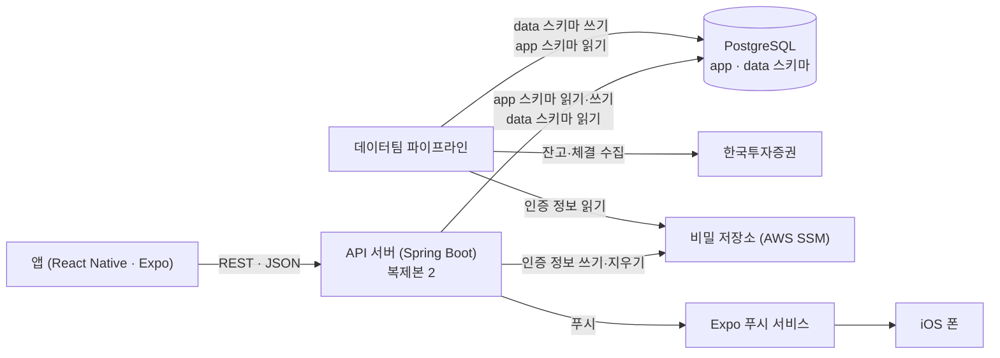

# 공통 설계 — 서비스 전체가 함께 따르는 것

두 기능(포트폴리오 종합 관리 · 매수·매도 타이밍 알림)이 함께 쓰는 것을 둔다. 서비스 개요와 용어, 시스템 구성, 앱 구조, 로그인·세션, API 공통 규칙, 데이터팀과의 경계, 서버 런타임, 역할 분담이다.

| 문서 | 다루는 것 |
|---|---|
| [portfolio.md](portfolio.md) | 포트폴리오 화면 · 집계 모델 · 원장과 등급 · 계좌 연동·동기화 · 보유 스냅샷 생성·확정 |
| [alert.md](alert.md) | 알림 화면 · 조건 모델 · 평가 · 평가 런타임 · 울림 전달 |
| [data-contract.md](data-contract.md) | 데이터팀과의 약속: 어떤 표를 언제까지 어떤 모양으로 주고받는가 |

---

## 1. 서비스 개요

### 1.1 무엇을 왜

장기 투자자가 두 가지를 한 앱에서 한다.

- **포트폴리오 종합 관리.** 연동한 증권사 계좌의 잔고를 모아 종목 · 섹터 · 시장 · 통화 · 계좌 축으로 비중과 손익을 보인다. ETF는 구성종목으로 나눠(ETF 분해) 실제로 어디에 돈이 들어가 있는지 보인다. 값은 하루 한 번 수집한 잔고로 만든다. 실시간이 아니다.
- **매수·매도 타이밍 알림.** 사용자가 종목에 조건을 걸어 두면 서버가 장중 시세나 일별 종가로 평가하다가 조건이 참이 되면 울린다. 울린 알림은 앱 안 기록으로 반드시 남고, 푸시를 받을 수 있는 폰에는 푸시로도 간다. 보유하지 않은 종목에도 걸 수 있다.

알림이 포트폴리오 위에 놓이는 이유는 "내 보유 기준"으로 알려야 의미가 있는 조건이 있어서다(평가손익률 · 비중). 그런 조건만 보유 종목에 걸리고, 나머지는 종목 마스터의 어느 종목에도 걸린다.

증권사는 지금 한국투자증권 하나다. 받는 계좌와 상품은 [portfolio.md «5.1 연동 경로와 받는 계좌»](portfolio.md)가 정한다. 다른 증권사를 더할 자리는 열어 두되, 지금 만든 것은 한국투자증권 전용이다.

### 1.2 원칙

| 원칙 | 뜻 | 자세히 |
|---|---|---|
| 내 자산만 본다 | 데이터 범위는 로그인한 사용자가 정한다. 사용자가 고르는 축이나 필터가 아니다 | 5.4 |
| 모르면 모른다고 보인다 | 계산할 수 없는 값을 0이나 그럴듯한 값으로 채우지 않는다. 빈칸 · 등급 · 안내로 드러낸다. 보유 데이터가 규칙을 어기면 숫자를 내지 않고 조회를 실패시킨다 | [portfolio.md «4.3 등급 판정»](portfolio.md) · [alert.md «4.4 평가 결과»](alert.md) |
| 문장은 서버가 만든다 | 안내 문구 · 조건 문장 · 오류 문구는 서버가 완성해 내리고 앱은 그대로 보인다. 앱은 코드로 색 · 아이콘 · 다음 동작만 고른다. 문구를 고치는 데 앱 배포가 필요 없다 | 5.1 · 5.3 |
| 상태는 데이터에 둔다 | 서버 복제본은 메모리에 상태를 들지 않는다. 같은 작업을 두 복제본이 함께 돌려도 결과가 하나가 되도록 데이터 조건으로 막는다 | 7.2 |
| 증권사 차이는 데이터팀에서 끝난다 | 증권사 · 원천마다 다른 응답을 하나의 모양으로 만드는 것까지가 데이터팀, 그 위의 도메인 규칙이 백엔드다 | 6 |
| 화면은 질문이 생기는 자리에서 들어간다 | 탭 · 스택 · 모달은 그 화면이 답하는 질문이 어디서 생기는지로 정한다 | 3.1 |

### 1.3 용어

두 기능 문서 · 계약 문서 · ADR · 코드 주석이 이 표의 말을 쓴다. 기능 문서의 용어 절은 이 표를 가리킨다. 한 개념에 한 낱말을 쓰고, "쓰지 않을 말"은 그 뜻으로 쓰지 않는다(다른 뜻이면 쓸 수 있다). 코드 이름(클래스 · enum · 컬럼 · API 필드)은 바꾸지 않으며, 문서에서는 코드를 가리킬 때만 쓴다. 정의는 지금 코드의 동작이다.

#### 공통 · 로그인

| 쓸 말 | 정의 | 쓰지 않을 말 |
|---|---|---|
| 기준일 · 데이터 시점 | 그 값이 어느 날(기준일) 또는 어느 시각(데이터 시점, 알림)의 데이터로 계산됐는지. 보유 라인의 `as_of`는 KR 거래일 날짜, 울린 알림의 `as_of`는 시각이다 | 기준 시각(화면 위 기준 줄의 표시 시각만 예외) |
| 화면 | 앱에서 한 번에 보이는 한 페이지. 서버는 조회 화면마다 응답 하나를 준다. "탭"은 하단 탭 막대를 가리킬 때만 쓴다 | 뷰 |
| 거래일 | 시장 캘린더에서 장이 열린 날. 알림 기간의 "일"은 그 종목이 실제로 거래된 날이라 거래정지일이 빠진다 | 영업일(가동일은 데이터팀 일정에만) |
| 인증 정보 갱신 · 토큰 갱신 · 새로고침 | 셋은 다른 일이다. 인증 정보 갱신은 계좌의 앱키 · 앱 시크릿을 바꾸는 일, 토큰 갱신은 로그인 세션의 접근 토큰을 새로 받는 일, 새로고침은 화면 조회만 다시 받는 일이다 | 수집 요청을 뜻하는 "새로고침"(그것은 동기화) |
| 로그인 · 인증 실패 | 앱 계정에 들어가는 것은 로그인이다. 인증 실패는 데이터팀 수집이 증권사에서 앱키 · 앱 시크릿을 거절당한 상태이며 로그인과 무관하다 | 로그인을 뜻하는 "인증" |
| 평가금액 · 평가손익 / 평가 · 평가 시점 | 포트폴리오 쪽은 늘 붙여 쓴다(종가로 매긴 값). 단독 "평가"는 알림에만 쓴다(조건의 참 · 거짓을 계산하는 일) | 포트폴리오 뜻의 단독 "평가" |
| 확정 · 실현손익 · 확정된 일봉 | "확정"은 라인 확정(아래 데이터 연동)에 쓰고, 매도로 생긴 손익은 실현손익, 종가가 굳은 일봉은 "확정된 일봉"처럼 대상을 붙인다 | 대상 없는 "확정" |
| 개념어(영어 상태값 대신) | `UNAVAILABLE` 같은 값은 코드 이름으로만 쓰고, 문서에서는 미포함 · 확보 안 됨 · 미분해 같은 개념어로 쓴다 | 개념어 자리의 영어 상태값 |
| 데이터팀 표 · 미러 | 운영의 데이터팀 소유 표는 데이터팀 표다. 미러는 그 표를 로컬 · 테스트에서만 만드는 복제이며 운영에는 적용하지 않는다 | 운영 표를 가리키는 "미러" |
| 종목 · 종목 마스터 | 대상은 종목, 데이터팀이 주는 종목 목록 표는 종목 마스터다. 라인과 알림은 `instrument_id`로 이 표를 가리킨다 | 본문의 "instrument" |

#### 포트폴리오

| 쓸 말 | 정의 | 쓰지 않을 말 |
|---|---|---|
| 라인 | 계좌 × 종목 × 기준일 한 칸의 보유 수량 · 매입금액 · 평가금액 행. 예수금도 `CASH` 종목 라인 하나로 담는다 | 보유 행 |
| 잔고 · 보유 스냅샷 | 잔고는 한 계좌의 한 날짜 보유 수량 · 예수금이다. 백엔드가 만든 날짜별 라인 묶음은 보유 스냅샷이다 | 스냅샷(단독) |
| 포지션 구간 · 종목 화면 | 포지션 구간은 수량이 0에서 늘어난 때부터 다시 0이 될 때까지이고, 평단 등급은 지금 열린 구간마다 매긴다. `positions` 화면은 종목 화면이다 | 종목 화면을 뜻하는 "포지션" |
| 평단 | 잔고 기준 Σ매입금액 ÷ Σ수량. 체결로 계산한 취득원가와 다를 수 있다 | 평균단가, 평균 매입가 |
| 매입금액 | 증권사 잔고가 준 매입금액. 평가손익 = 평가금액 − 매입금액 | 이 뜻의 "원가" |
| 취득원가 | 체결 이력으로 매도 한 건에 배분한 매입 비용. 정하지 못하면 비어 있고, 그 매도는 실현손익 합계에서 빠진다 | 단독 "원가" |
| 실현손익 | 기간 안 매도 체결마다 매도금액 − 취득원가 − 수수료·세금을 더한 값. 체결일로 기간에 넣는다 | 확정 손익 |
| 평가손익 | 그날 평가금액 − 매입금액(예수금 제외) | 미실현손익 |
| 투자손익의 확정 · 평가 | 투자손익을 매도로 생긴 몫(확정 = 그 기간 실현손익)과 나머지(평가 = 투자손익 − 확정)로 나눈 것. 기간 동안의 변화분이라 평가손익과 숫자가 다르다. 늘 "투자손익의"를 붙인다 | 단독 "미실현" |
| 투자손익 | 기말자산 − 기초자산 − 넣은 돈 − 배당 + 수수료·세금 − 계좌 편입 + 계좌 제외 | 투자 손익(띄어쓰기) |
| 번 돈 | 투자손익 + 배당 − 수수료·세금 | — |
| 넣은 돈 | 두 잔고 사이 (기초 기준일, 기말 기준일]에 사용자가 입력한 입금 − 출금 | 순입금, 순유입 |
| 입출금 · 배당·수수료·세금(손익성 현금흐름) | 입출금은 사용자가 앱에서 입력한 입금 · 출금이다. 배당 · 수수료 · 세금은 데이터팀이 주며 묶어 부를 때 손익성 현금흐름이다. "현금흐름"은 둘을 아우를 때만 쓴다 | 수동 입출금 |
| 기초자산 · 기말자산 | 기초는 `from` 전날까지의 가장 늦은 잔고(없으면 기간 안 첫 잔고), 기말은 `to` 이하 가장 늦은 잔고의 총자산 | 시작 자산, 기간 말 자산 |
| 총자산 | 예수금을 포함한 평가금액 합계 | — |
| 계좌 편입 · 계좌 제외 | 기간 중 처음 잔고가 생긴 계좌의 첫 잔고 총자산(편입), 기간 중 잔고가 끊긴 계좌의 마지막 잔고 총자산(제외). 늘 "계좌"를 붙인다 | 단독 "편입 · 제외" |
| 미포함 | 취득원가를 정하지 못한 매도 체결. 실현손익 목록에는 매도금액만 남고 취득원가 · 손익은 비며, 합계에서 빠진다. 그런 체결이 있는 계좌 수를 따로 센다 | 이 뜻의 "제외", 합계에서 뺀 계좌 |
| 추정 | 거래내역이 포지션 구간 시작보다 늦게 확보됐거나 매매 없이 입고된 수량에 잔고 평단을 취득원가로 매겨 계산한 손익 | 시드, 시드 평단 |
| 예수금 · 현금 | 예수금은 계좌에 남은 현금 잔고이며 `CASH` 라인으로 총자산에 든다. 자산군 이름일 때만 현금이다. ETF 안 현금은 예수금이 아니다 | 현금보유 |
| ETF 분해 | 구성종목을 아는 ETF만 구성비중대로 안에 든 종목으로 나눠 같은 종목끼리 합쳐 보이는 보기. 행의 평단 · 평가손익은 빠진다 | 렌즈, 전개, 룩스루, 구성종목 기준 보기 |
| 확보 | 데이터팀이 그 계좌의 거래내역 · 배당 등을 빠짐없이 갖고 있다고 보장하는 기간(확보 구간). 체결 이력 · 손익성 현금흐름 · ETF 구성종목 세 가지에 쓴다 | 커버리지, 수집 창 |
| 이월 | 그날 잔고로 라인을 만들지 못한 계좌에 직전 확정 라인을 금액 · 환율 · 원천 시각 그대로 옮겨 쓴 것. `source_as_of`가 원본 날짜다 | 캐리포워드, 직전 값, 이전 값 |
| 계좌유형(일반 · 연금) · KIS 상품(위탁 · 연금저축) | 계좌유형은 증권사와 무관한 분류(GENERAL · PENSION)이고, KIS 상품 01 → 일반, 22 → 연금으로 하나씩 대응한다. 둘을 섞어 쓰지 않는다 | — |
| 직전 거래일 대비 | 그날 총자산 − 직전 기준일 총자산. 두 날 모두 라인이 있고 오늘 연동이 유효한 계좌만 더하며, 견줄 계좌가 없으면 비어 있다 | 일간 변화 |
| 증권사 | 계좌를 연 금융회사. 지금은 한국투자증권 하나 | 이 뜻의 "기관" |
| 체결 · 거래내역 | 매매 한 건은 체결, 체결을 모은 이력은 거래내역. "원장"은 원장 설명에만 쓴다. 알림의 "거래 없음"은 그날 거래량이 없다는 뜻이라 다르다 | — |

#### 알림

| 쓸 말 | 정의 | 쓰지 않을 말 |
|---|---|---|
| 알림 · 푸시 · 알림 걸기 | 알림은 종목 하나에 건 조건 · 평가 시점 · 알림 방식 · 유효기간 묶음이다. 폰으로 보내는 것은 푸시다 | 알림 규칙, 시그널 |
| 울림 · 울린 알림 | 알림의 조건이 한 데이터 시점에서 참이 되어(알림 방식에 따라) 기록과 푸시가 생긴 것. 알림을 지워도 기록은 남는다 | 발화, 이벤트, 트리거(동사) |
| 조건 · 필터 | 조건은 지표와 기준값을 연산자로 견준 식이고, 직접 조건은 최대 5개를 AND로 묶는다. 한 줄만 가리킬 때는 "조건 한 줄". 목록을 거르는 것은 필터다 | 트리거, 규칙, 필터 뜻의 "조건" |
| 평가 시점(장중 · 종가) | 장중은 장중 시세로, 종가는 일별 종가로 평가한다 | 평가 주기, 케이던스 |
| 평가 | 알림의 조건을 한 데이터 시점의 값으로 참 · 거짓 · 확인 불가 중 하나로 정하는 일 | 알림 뜻의 "판정" |
| 꺼짐 · 일시중지 | 꺼짐은 사용자가 평가를 멈춘 상태(끄기 · 다시 켜기)다. 일시중지는 필요한 시장 데이터를 제공하지 않는 동안 서버가 평가를 건너뛰는 상태다 | 멈춤, 정지 |
| 알림 방식 · 다시 알림 간격 | 돌파할 때마다(거짓→참이 될 때마다) · 한 번만(처음 한 번 울리고 끝) · N분마다 다시(참인 동안 마지막 울림의 데이터 시점부터 N분 뒤 다시) | 재무장, 쿨다운 |
| 유지 방식(N일 연속 · N분 이상 유지) | 종가 알림은 N거래일 연속, 장중 알림은 N분 이상 참이어야 울리게 하는 덧붙임 | 유지 조건, 지속, 수식어 |
| 지표 · 기준값 | 조건의 왼쪽은 지표, 오른쪽은 기준값(상수 또는 비교 지표) | 피연산자, 좌변 · 우변 |
| 확인 불가 | 값이 없거나 이력이 모자라 조건의 참 · 거짓을 정할 수 없는 평가 결과 | — |
| 데이터 닫힘 | 데이터 쪽이 장중 시세나 외국인 · 기관 수급을 제공하지 않는 동안 알림을 종가로 돌리거나 일시중지하는 규칙 | — |

#### 데이터 연동

| 쓸 말 | 정의 | 쓰지 않을 말 |
|---|---|---|
| 수집 · 수집 실행 · 정기 수집 | 데이터팀이 계좌 하나의 잔고 · 예수금을 증권사에서 가져오는 한 번의 실행이 수집 실행이고, 매일 정해진 것이 정기 수집이다. 끝나면 백엔드가 그 결과로 라인을 만든다. 계좌의 `last_synced_at`은 성공으로 끝난 수집 가운데 가장 늦은 종료 시각이다 | 자동 동기화, 싱크 |
| 동기화 | 사용자가 요청해 계좌마다 수집을 넣고 그 결과를 한 묶음으로 지켜보는 일. 실제 수집은 다음 수집 시각에 일어난다 | 싱크, 이 뜻의 "새로고침", 수동 새로고침 |
| 확정 · 잠정 | 확정 라인은 정기 수집이 쓴 라인과 확정 단계가 승격 · 이월한 라인이다. 동기화는 확정 라인이 있는 날을 다시 쓰지 않는다. 확정 전 라인은 잠정이다 | 본문의 "final", 이 뜻의 "마감" |
| 확정 마감 | 그날 라인을 더 기다리지 않고 확정하는 시각. 그 날 다음 KR 거래일 08:00(KST)이다. 단독 "마감"은 장 마감에만 쓴다 | — |
| 연동 · 해제 | 사용자가 앱키 · 앱 시크릿 · 계좌번호를 넣어 계좌를 앱에 붙이는 일과 그 상태. 첫 수집이 끝나기 전까지 "연동 중"이다. 되돌림은 해제다 | 등록, 연결, 계좌 추가 |
| 인증 정보 · 앱키 · 앱 시크릿 | 인증 정보는 사용자가 넣는 KIS 앱키와 앱 시크릿의 묶음이다. 서버는 이를 비밀 저장소에 두고 수집 요청에는 참조만 채운다 | 자격증명, 단독 "시크릿", "키" |

#### 그대로 쓰는 말

| 말 | 뜻 |
|---|---|
| 평가금액 · 비중 | 종가로 매긴 값, 행 평가금액 ÷ 총자산 |
| 구성종목 · 구성비중 · 미분해 | ETF 안에 든 종목과 그 비율, 구성종목을 몰라 ETF 분해에서 그대로 남은 ETF |
| 기업행위 · 환율 | 분할 · 유상증자 · 합병, 원화 환산에 쓴 환율 |
| 계좌유형 · 시장 · 통화 · 자산군 · 섹터 | 비중을 나누는 축 |
| 연동 상태 | 연동 중 · 연동됨 · 연동 해제됨 |
| 인증 실패 · 연속 실패 | 증권사가 앱키를 거절함, N일째 수집 실패 |
| 다음 수집 | 데이터팀이 수집 요청을 집는 다음 시각 |
| 집계 | 라인을 만들어 합계에 넣는 일 |
| 라벨 | 사용자가 붙인 계좌 이름 |
| 입금 · 출금 · 기간 | 입출금의 두 종류, 이번 달 · 지난달 · 올해 · 작년 · 지정 |
| 안내 | 화면 위에 뜨는 notice(5.2) |
| 로그인 · 로그아웃 · 계정 | 앱 계정에 들어가고 나오는 일. 문서의 "사용자"는 사람을 가리킬 때만 쓴다 |
| 접근 토큰 · 갱신 토큰 · 세션 | 4장 |
| 프리셋 · 직접 조건 · 지표 · 연산자 | 알림 조건을 만드는 두 방식과 그 조각 |
| 감시 중 · 조건 충족 중 · 울린 뒤 종료 · 만료 | 알림 상태 배지 |
| 유효기간 · 만료 날짜 · 미리보기 · 현재값 · 읽음 | 알림의 기간, 저장 전 현재값 계산, 울린 알림을 본 표시 |
| 발송 | 폰 하나로 보내는 전송 행을 말할 때만 쓴다 |

---

## 2. 시스템 구성



| 구성 | 형태 | 맡는 일 |
|---|---|---|
| 앱 | React Native + Expo. 한 앱에 두 기능이 있다 | 화면, 로그인 세션 보관, 푸시 수신. 푸시는 iOS로만 간다([alert.md «6.6 플랫폼 제약»](alert.md)) |
| API 서버 | Spring Boot, MyBatis. 쿠버네티스 Deployment 복제본 2 | API, 주기 작업(7장), 스키마 마이그레이션(기동 시) |
| DB | PostgreSQL 16, 클러스터 안 StatefulSet 한 대. 볼륨은 지워도 남는 회수 정책이다 | 백엔드 표(`app`)와 데이터팀 표(`data`)를 한 데이터베이스의 두 스키마로 둔다 |
| 데이터팀 파이프라인 | 데이터팀 소유(이 저장소 밖) | 증권사 · 시장 데이터를 모아 `data` 스키마에 적재한다. 계약은 [data-contract.md](data-contract.md) |
| 비밀 저장소 | AWS SSM Parameter Store | 계좌 인증 정보. 백엔드는 쓰고 지우기만 하고, 수집할 때 데이터팀이 읽는다([portfolio.md «5.2 인증 정보 보관»](portfolio.md)) |
| Expo 푸시 서비스 | 외부 서비스 | 앱 푸시를 폰으로 전달한다([alert.md «6.3 발송»](alert.md)) |

**스키마는 소유로 가른다.** `app`은 백엔드 소유이고 마이그레이션이 만든다. `data`는 데이터팀 소유다. 권한이 스키마 단위로 끊기므로 데이터팀에 `app`을 쓰지 못하게 닫을 수 있다. 서버의 SQL은 스키마 이름 없이 쓰고 접속 경로(`app`, `data` 순)가 해석을 정한다. 데이터팀 역할의 권한 범위는 [data-contract.md «7. 데이터팀이 읽는 백엔드 테이블»](data-contract.md).

**배포.** `main`에 푸시하면 CI가 테스트를 통과한 커밋만 이미지로 만들어 올리고(태그는 커밋 해시, 같은 태그 덮어쓰기 금지), 매니페스트의 이미지 태그를 고치는 커밋을 남긴다. ArgoCD가 그 매니페스트를 클러스터에 맞추고 파드를 롤링으로 바꾼다. 새 파드는 기동하면서 마이그레이션을 운영 DB에 적용한다. 그래서 `main` 푸시가 곧 운영 반영이다. 롤링 중의 스키마 호환 규칙은 7.2.

**노출.** API는 클러스터 안에서만 닿는 서비스이고 클러스터 밖으로 여는 경로(Ingress)가 없다. 외부 노출과 TLS는 정하지 않았다. 브라우저 출처 허용은 5.5.

---

## 3. 앱 구조

화면 목록 · 진입 경로 · 배지 · 푸시를 눌렀을 때 여는 곳 · 첫 화면 · 공통 이름을 둔다. 각 화면의 내용은 [portfolio.md «2. 화면»](portfolio.md)과 [alert.md «2. 화면»](alert.md)이 정한다.

### 3.1 원칙

**화면은 그 화면이 답하는 질문이 생기는 자리에서 들어간다.**

| 질문 | 생기는 자리 | 그래서 |
|---|---|---|
| 지금 내 자산은? 뭘 갖고 있나? 어디에 쏠렸나? | 앱을 연 순간 | 탭 |
| 요약에서 본 저 증감은 무엇이었나? | 요약 · 실현손익을 보던 중 | 스택(자산 변화) |
| 넣은 돈에 무엇이 들어갔나? | 자산 변화를 보던 중 | 스택(입출금) |
| 무엇이 울렸나? | 푸시 · 배지 | 푸시 → 울린 알림 상세 |
| 이 종목에 알림을 걸까? | 종목을 보던 중 | 종목 상세 → 새 알림 흐름 |
| 내가 뭘 걸어 뒀나? | 어디에도 딸리지 않음 | 탭(알림) |

"내가 뭘 걸어 뒀나"는 포트폴리오의 어느 화면을 보다가 생기는 질문이 아니고, 알림은 보유하지 않은 종목에도 걸리므로 종목 화면에 매달 수 없다. 그래서 알림은 탭이다.

**배지는 누르면 그 내용이 보이는 자리에만 둔다.** 갈 곳 없는 점은 불안만 준다.

**모든 화면이 따르는 동작**

- **새로고침은 그 화면의 조회만 다시 받는다.** 포트폴리오 화면은 기준 줄의 `↻ 새로고침`, 알림 화면은 당겨서 새로고침이다. 필터 · 축 · ETF 분해 상태는 그대로다. 수집을 요청하는 것은 계좌 화면의 `지금 동기화`(동기화)뿐이다([portfolio.md «5.6 동기화»](portfolio.md)).
- 다시 받는 동안 본문은 이전 값을 그대로 둔다. 다시 받기가 실패해도 보던 값은 남고 오류는 본문 위 한 줄로 알린다(5.3).
- 같은 조회는 기본으로 30초 안에는 다시 받지 않는다(카탈로그는 1시간, 동기화 진행과 알림 미리보기는 늘 새로). 앱이 앞으로 오면 낡은 조회를 다시 받는다. 서버에 닿지 못한 조회만 두 번까지 저절로 다시 보낸다. 저장 · 삭제 같은 쓰기는 저절로 다시 보내지 않는다.
- **쓰기 버튼은 요청이 도는 동안 잠긴다.** 저장 · 연동 · 삭제 · 끄기 같은 버튼은 요청이 끝날 때까지 누를 수 없게 되고(로딩 표시), 응답이 오면 풀린다. 계좌 연동 · 인증 정보 갱신 · 해제 · 입출금 저장 · 알림 저장처럼 두 번 나가면 안 되는 쓰기는 버튼이 다시 그려지기 전의 빠른 연타도 첫 요청 하나만 보낸다.

### 3.2 탭 · 화면 · 진입 경로

**탭**은 여섯이다: `요약 · 종목 · 비중 · 계좌 · 손익 · 알림`. 아이콘 아래 두 글자 이름을 둔다. 첫 탭은 요약이다.

**다른 탭에 갔다 돌아와도 그 탭의 필터 · 축 · ETF 분해 · 접힘 상태가 남는다.** 탭 화면은 떠나도 내려가지 않는다.

| 화면 | 기능 | 형태 | 들어오는 곳 |
|---|---|---|---|
| 로그인 | 공통 | 탭 바깥 | 앱 시작(세션 없음) · 세션이 끝남 · 로그아웃 |
| 요약 | 포트폴리오 | 탭 | 탭 · 로그인 직후 |
| 계정 시트 | 공통 | 시트 | 요약 제목 줄의 계정 아이콘 |
| 종목 | 포트폴리오 | 탭 | 탭 · 계좌 화면의 계좌 행(그 계좌로 거른 채) |
| 비중 | 포트폴리오 | 탭 | 탭 · 요약의 `비중 →`(시장 축) |
| 계좌별 | 포트폴리오 | 탭 `계좌` | 탭 |
| 실현손익 | 포트폴리오 | 탭 `손익` | 탭 · 자산 변화의 `실현손익 보기 →`(기간 · 계좌를 들고) |
| 자산 변화 | 포트폴리오 | 스택 | 요약의 `이번 달 자산` 줄(이번 달) · 실현손익 하단 `이 기간 전체 투자손익 보기 →`(같은 기간) |
| 입출금 | 포트폴리오 | 스택 | 자산 변화의 `넣은 돈 입력 →`(보던 기간 · 계좌) |
| 종목 상세 | 포트폴리오 | 스택 | 종목 화면의 행 |
| 계좌 연동 | 포트폴리오 | 스택 | 계좌 화면의 `계좌 연동 관리` · 수집 안내의 `인증 정보 갱신`(대상 계좌가 여럿이거나 계좌번호를 알 수 없을 때) |
| 한국투자증권 연동 | 포트폴리오 | 스택 | 계좌 연동의 `＋ 계좌 연동` |
| 인증 정보 갱신 | 포트폴리오 | 스택 | 계좌 연동 행의 `갱신` · 수집 안내의 `인증 정보 갱신`(대상 계좌가 하나일 때) |
| 알림 | 알림 | 탭 | 탭 |
| 울린 알림 | 알림 | 스택 | 알림 탭의 `울린 알림 전체 →` · `외 N건 →` · 알림 상세의 `전체 →`(그 알림으로 거른 목록) · 요약 제목 줄의 종 |
| 울린 알림 상세 | 알림 | 스택 | 푸시 · 울린 알림 행 · 알림 탭의 새로 울린 알림 행 · 알림 상세의 최근 울린 알림 행 |
| 알림 상세 | 알림 | 스택 | 알림 탭의 내 알림 행 · 울린 알림 상세의 `알림 보기` · 새 알림 저장 |
| 새 알림 | 알림 | 모달 | 알림 탭의 `＋ 새 알림`(종목 선택부터) · 종목 상세의 `알림 걸기`(조건 선택부터, 종목이 채워짐) · 알림 상세의 `수정`(입력 화면부터, 값이 채워짐) |

- 스택 화면은 탭 묶음 위에 얹힌다. 뒤로 가면 들어온 자리로 돌아간다. 종목 상세에서 돌아오면 보던 필터 · 정렬 · ETF 분해 그대로다.
- 새 알림을 모달로 여는 것은 흐름 전체가 저장 한 번으로 끝나는 작업이라서다. 닫으면 들어온 자리로, 저장하면 알림 상세로 간다. 단계 구성은 [alert.md «2.5 새 알림 흐름»](alert.md).
- 종목 상세의 `알림 걸기`를 종목 행이 아니라 상세에 두는 것은 행을 누르는 자리가 이미 상세로 가는 길이라서다. 행에 두 번째 동작을 붙이면 누를 곳이 둘로 갈린다.
- 계정 시트는 로그인한 이메일과 `로그아웃` · `취소`를 보인다. 요약은 로그인 직후 첫 화면이고 제목 줄은 조회가 실패해도 그려지므로 공용 기기에서도 바로 찾는다. 아이콘과 시트를 거쳐 두 번 눌러야 하므로 따로 확인을 묻지 않는다. 로그아웃 동작은 4.5.

### 3.3 배지

| 자리 | 형태 | 뜨는 조건 | 누르면 |
|---|---|---|---|
| `알림` 탭 | 숫자(100 이상은 `99+`) · 배지 전용 색 | 안 읽은 울린 알림 수(`GET /alert-events/unread-count`) | 알림 탭 — 새로 울린 알림 블록이 맨 위 |
| 요약 제목 줄의 종 | 점 | 알림 탭 배지와 같은 사실 | 울린 알림 목록 |
| `계좌` 탭 | 숫자 없는 점 | 계좌 화면 응답에 이월 계좌 · 인증 실패 · 연속 실패 안내가 있음 | 계좌 화면 — 해당 계좌 행 배지, 수집 안내의 `인증 정보 갱신`, 동기화, 계좌 연동 관리가 한 화면에 있다 |

- 알림 수는 앱이 앞으로 올 때와 푸시를 받을 때 다시 받는다. 받지 못하면 배지를 달지 않는다.
- 울린 알림 상세를 열면 그 울림이 읽음이 된다. 알림 탭을 여는 것만으로는 읽음이 되지 않는다. 블록에는 제목만 보이고 내용을 본 것이 아니다. 울린 알림 화면에 `모두 읽음`이 있다.
- 계좌 탭의 점은 숫자가 아니다. 알릴 것은 "낡거나 손봐야 할 계좌가 있다"는 사실이고 개수는 계좌 화면이 말한다. 인증 정보를 갱신하고 다음 수집을 기다리는 것만으로는 켜지 않는다. 사용자가 이미 조치했다. 그 계좌가 아직 이월 중이면 이월로 켜진다. 아직 집계하지 못한 계좌 안내도 점을 켜지 않는다. 점은 서버가 센 안내만 보고 계좌 행을 다시 세지 않는다.

### 3.4 푸시를 눌렀을 때

푸시의 `data`에는 `event_id` 하나만 실린다. 앱은 **탭을 알림으로 바꾼 뒤 그 위에 울린 알림 상세를 쌓는다.** 탭을 먼저 바꾸지 않으면 뒤로 갈 때 직전 탭으로 돌아간다. 위에 다른 스택 화면이 떠 있으면 탭 묶음까지 걷어낸 뒤 쌓는다. 푸시는 울림을 가리키고 알림을 가리키지 않는다. 알림은 뒤에 고쳐지거나 지워질 수 있지만 울림은 그때 울린 내용 그대로 남는다.

| 앱 상태 | 동작 |
|---|---|
| 앞에 떠 있음 | 화면을 옮기지 않는다. 시스템 배너 대신 앱 안 배너를 띄우고 알림 데이터를 다시 받는다. 앱 안 배너를 누르면 푸시를 누른 것과 같다 |
| 뒤에 있음 · 꺼져 있음, 세션 살아 있음 | 울린 알림 상세. 접근 토큰이 만료됐으면 로그인 화면 없이 토큰을 갱신한 뒤 연다 |
| 뒤에 있음 · 꺼져 있음, 세션 끝남 | 로그인 화면. `event_id`를 맡아 두었다가 로그인 뒤 탭이 그려지면 한 번 연다 |
| 새 알림 작성 중 | 작성 모달이 먼저 버릴지 묻는다. 버리면 곧바로 열고, 계속 쓰면 모달이 닫힐 때까지 기다린다. 저장으로 닫혔으면 방금 저장한 알림 상세를 가로채지 않고 열지 않는다. 기다리는 동안 온 푸시는 마지막 것만 연다 |
| 다른 계정으로 로그인됨 | 서버가 `404`로 답하고 울린 알림 상세가 `찾을 수 없는 알림이에요`를 보인다 |

- 앱은 로그인 화면과 탭 묶음 중 하나만 그린다. 그래서 로그인 전에 받은 `event_id`는 화면 바깥에 맡겨 둔다. 로그인에 실패해도 버리지 않고, 로그아웃하면 버린다. 다른 사람이 이어 로그인할 수 있기 때문이다.
- 연 울린 알림 상세가 결과를 그리기 전에 세션이 끝나면 그 `event_id`를 다시 맡아 로그인 뒤에 연다. 맡아 둔 것을 연 직후 세션이 또 끝나면 다시 열지 않는다.

### 3.5 로그인 직후 첫 화면

**요약이다.** 안 읽은 울린 알림이 있어도 화면을 옮기지 않고 배지로만 알린다. 사용자가 스스로 앱을 연 순간이라 늘 같은 자리에서 시작하는 편이 낫다. 예외는 푸시로 열린 경우뿐이다(3.4).

새 사용자는 계좌가 없으므로 요약의 온보딩(빈 상태 `NO_ACCOUNTS`)이 첫 화면이다. 알림은 계좌 없이도 만들 수 있어 온보딩이 알림 탭을 막지 않는다.

### 3.6 공통 이름

화면 문구 · 문서 이름 · 코드의 화면 키를 한곳에 둔다. 새 화면을 더하면 이 표에 먼저 올린다. 개념의 이름은 1.3.

| 화면 문구(탭 · 머리글) | 문서 이름 | 화면 키 |
|---|---|---|
| 요약(탭) · 내 자산(머리글) | 요약 | `summary` |
| (제목 없음) | 계정 시트 | — |
| 종목 | 종목 | `positions` |
| 비중 | 비중 | `allocation` |
| 계좌 | 계좌별 | `accounts` |
| 손익 | 실현손익 | `realized-pnl` |
| 자산 변화 | 자산 변화 | `asset-change` |
| 입출금 | 입출금 | `cashflows` |
| (종목 이름) | 종목 상세 | `instrument-detail` |
| 계좌 연동 | 계좌 연동 | `account-link` |
| 한국투자증권 연동 | 계좌 연동 폼 | `account-link/new` |
| 인증 정보 갱신 | 인증 정보 갱신 | `account-link/credentials` |
| 알림 | 알림 탭 | `alerts` |
| 울린 알림 | 울린 알림 | `alert-events` |
| 울린 알림 | 울린 알림 상세 | `alert-event` |
| 알림 상세 | 알림 상세 | `alert` |
| 새 알림 · 알림 수정 | 새 알림 흐름 | `alert-editor` |

탭 화면의 머리글은 탭 이름과 같다(종목 · 비중 · 계좌 · 손익). 종목 · 비중은 화면 문구를 그대로 문서 이름으로 쓴다. 계좌 · 손익 화면은 문서에서 "계좌별" · "실현손익"으로 부른다. "계좌" · "손익"만으로는 용어표의 다른 말(계좌 개념, 실현손익 · 투자손익 · 평가손익)과 겹치기 때문이다. 이 표가 두 이름을 한 줄에 대응시킨다.

---

## 4. 로그인·세션

계정은 운영자가 만든다. 회원가입 · 비밀번호 재설정 경로가 없다(만드는 절차는 운영 문서). 이메일 · 비밀번호로 로그인하면 서버가 **세션**을 하나 만들고 **접근 토큰**과 **갱신 토큰**을 준다. 요청은 접근 토큰을 `Authorization: Bearer`로 보낸다. 접근 토큰이 만료되면 앱이 갱신 토큰으로 새 쌍을 받으므로, 앱을 쓰는 동안에는 로그인 화면으로 가지 않는다. 무상태 토큰 대신 서버 세션과 갱신 토큰 회전을 고른 이유는 ([ADR 0007 서버 세션과 토큰 회전](../decisions/0007-server-session-token-rotation.md)).

| API | 요청 | 응답 |
|---|---|---|
| `POST /auth/login` | `{ email, password }` | `{ access_token, expires_at, refresh_token }` |
| `POST /auth/refresh` | `{ refresh_token }` | 같은 모양의 새 쌍 |
| `POST /auth/logout` | `{ refresh_token }` | `204`. 맞는 세션이 없어도 `204` |
| `GET /auth/me` | — | `{ user_id, email, display_name }` |

- 세 API(로그인 · 갱신 · 로그아웃)는 접근 토큰 없이 열린다. 접근 토큰이 만료된 뒤에도 갱신과 로그아웃이 된다.
- `expires_at`은 접근 토큰의 만료 시각이다. 갱신 토큰의 만료는 내리지 않는다. 앱이 판단할 일이 없다.
- `refresh_token` · `email` · `password`가 비었으면 `400` `INVALID_REQUEST`다.
- 로그인 실패는 `401` `INVALID_CREDENTIALS`이며 **이메일이 없는 것과 비밀번호가 틀린 것을 구분하지 않는다.** 없는 이메일도 비밀번호 대조를 한 번 해서 응답 시간으로도 가입 여부가 드러나지 않게 한다.
- 비밀번호는 BCrypt 해시만 저장한다. 비밀번호와 갱신 토큰 원문은 로그 · 응답 어디에도 남기지 않는다.

### 4.1 수명

| 값 | 기준 | 기본값 |
|---|---|---|
| 접근 토큰 | 발급 후 | 30분 |
| 유휴 만료 | 마지막 토큰 갱신(처음은 로그인) 후 | 7일 |
| 절대 상한 | 로그인 후. 갱신해도 늘지 않는다 | 30일 |

세 값은 환경변수로 덮을 수 있다. **세션이 살아 있다**는 "마지막 갱신이 유휴 만료 안이고, 절대 상한 전"이다.

**쓰는 중에 로그인 화면으로 밀려나는 것은 다음뿐이다.**
- 로그인 후 30일이 지났다.
- 갱신 토큰 재사용이 감지됐거나, 훔친 쪽이 먼저 갱신해 주인의 갱신 토큰이 맞지 않게 됐다(4.2). 둘 다 토큰이 새어 나간 경우다.

7일 동안 앱을 쓰지 않았으면 다음에 열 때 로그인 화면이다. 쓰는 중에 서버에 닿지 않아 갱신이 실패하면 밀려나지 않고 평소의 연결 오류를 보인다.

### 4.2 토큰과 갱신

**접근 토큰**은 서버 비밀키로 HMAC 서명한 JWT다(알고리즘은 키 길이에 따라 HS256 · HS384 · HS512 중 하나로 정해진다). 사용자(`sub`) · 세션(`sid`) · 세대(`gen`) · 발급 · 만료 시각을 싣는다. `sid`나 `gen`이 없으면 서명이 맞아도 거절한다. **계좌 목록은 싣지 않는다.** 계좌는 연동 · 해제로 바뀌는데 토큰은 발급 시점에 고정된다. 소유는 요청마다 DB에서 확인하므로 방금 해제한 계좌가 토큰 만료까지 조회되는 일이 없다.

**요청마다 세션을 확인한다.** 서명 · 만료가 맞아도 세션 행이 없거나, 살아 있지 않거나, 세션의 사용자가 토큰과 다르면 로그인하지 않은 요청으로 본다. 끝난 세션의 접근 토큰은 만료 전이라도 `401`이다. 토큰의 세대가 지금 세대이면 "새 갱신 토큰이 앱에 닿았다"(확인)는 표시를 세운다. 갱신 전에 받은 아직 30분 안의 접근 토큰도 받지만 확인으로 치지 않는다.

**갱신 토큰**은 32바이트 난수이고 서버는 SHA-256 해시만 저장한다. 갱신할 때마다 새것으로 바뀐다(회전). 세션 행은 지금 갱신 토큰과 바로 전 갱신 토큰의 해시를 함께 든다. 갱신 요청은 해시가 둘 중 하나와 같은 행을 잠그고 판정하므로, 같은 토큰으로 동시에 온 갱신은 하나씩 처리된다.

| 맞은 행 | 처리 | 응답 |
|---|---|---|
| 없음 | — | `401` |
| 살아 있지 않음 | 세션 행을 지운다 | `401` |
| 지금 토큰 | 새 토큰으로 바꾸고 세대를 올린다. 확인 표시를 내린다 | 새 쌍 |
| 바로 전 토큰, 확인 전 | 갱신 응답이 앱에 닿지 않은 것으로 보고 새 쌍을 다시 준다 | 새 쌍 |
| 바로 전 토큰, 확인 뒤 | 재사용이다. 세션 행을 지운다 | `401` |

- 그보다 오래된 갱신 토큰은 어느 행과도 맞지 않아 `401`일 뿐 세션을 끝내지 않는다.
- 거절은 모두 `401` `UNAUTHENTICATED`이고 이유(모르는 토큰 · 끝난 세션 · 재사용)를 응답으로 구분하지 않는다. 앱이 할 일은 모두 "로그인 화면으로"다.
- 로그인은 새 세션을 만들고 같은 사용자의 다른 세션은 건드리지 않는다. 한 사람이 폰과 웹을 함께 쓸 수 있다.

**바로 전 토큰을 한 번 봐주는 이유.** 지하철에서 갱신하다 응답을 잃은 사람이 쓰는 중에 밀려나지 않게 하려는 것이다. 대가로 재사용 감지에 빈틈이 있다.

| 순서 | 결과 |
|---|---|
| 훔친 쪽이 갱신하고 새 토큰으로 요청한 뒤 주인이 옛 토큰으로 갱신 | 재사용으로 세션이 끝난다. 둘 다 로그인 화면 |
| 주인이 갱신하고 새 토큰으로 요청한 뒤 훔친 쪽이 옛 토큰으로 갱신 | 재사용으로 세션이 끝난다 |
| 주인이 갱신한 뒤 새 토큰으로 요청하기 전에 훔친 쪽이 옛 토큰으로 갱신 | 응답 유실과 구분되지 않아 훔친 쪽이 새 쌍을 받는다. 주인만 로그인 화면으로 간다. 훔친 쪽 세션은 유휴 만료 · 절대 상한까지 남는다 |

셋째 경우의 창은 보통 갱신과 다시 보내기 사이의 짧은 시간이다. 훔치려면 먼저 폰의 보안 저장소에서 갱신 토큰을 꺼내야 하고, 밀려난 주인이 다시 로그인하면 새 세션이 생긴다. 이 창은 받아들인다.

### 4.3 세션 저장

**서버.** 두 표를 쓴다.

| 표 | 역할 · 그레인 | 키 · 유일성 | 쓰는 쪽 · 읽는 쪽 | 수명 |
|---|---|---|---|---|
| `app_user` | 계정 한 명 | 사용자 id, 이메일 유일 | 운영자가 SQL로 만들고 고친다. 백엔드는 읽기만 한다. 데이터팀 역할은 읽지 못한다 | 지우지 않는다 |
| `auth_session` | 로그인 한 번이 만든 세션 하나 | 세션 id. 지금 · 바로 전 갱신 토큰 해시는 각각 유일 | 백엔드가 로그인 · 갱신 · 로그아웃 · 요청 확인에서 쓴다. 데이터팀 읽기 역할도 `app` 스키마의 다른 표처럼 읽을 수 있다(토큰 원문이 아니라 해시다) | 끝나면 행을 지운다(4.4 · 4.6) |

`auth_session`의 규칙에 나오는 값은 이렇다. 세대는 갱신마다 1씩 오르고 처음 로그인하면 1이다. 확인은 지금 세대의 접근 토큰으로 요청이 한 번이라도 들어왔는지다. 유휴 만료 시각은 저장하지 않고 마지막 갱신 시각과 설정값으로 계산하므로, 설정을 바꾸면 기존 세션에도 바로 적용된다. **끝난 세션은 기록을 남기지 않는다.** 보여 줄 화면이 없고, 행이 없으면 그 세션의 토큰은 똑같이 거절된다.

**앱.** 접근 토큰 · 만료 시각 · 갱신 토큰을 폰의 보안 저장소(iOS Keychain · Android Keystore) **한 자리에 하나로** 쓴다. 따로 쓰면 앱이 쓰는 도중 죽었을 때 새 접근 토큰과 옛 갱신 토큰이 섞여 남고, 다음 갱신이 재사용으로 판정된다. 마지막 이메일은 따로 둔다. 비밀번호는 어디에도 저장하지 않는다. 세 값 중 하나라도 없거나 읽지 못하면 세션이 없는 것으로 친다. 브라우저에서 띄운 개발용 화면은 보안 저장소가 없어 브라우저 저장소에 둔다. 웹은 배포하지 않는다.

### 4.4 세션이 끝날 때

**세션이 끝나는 경우는 넷이다.** 로그아웃 · 유휴 만료 · 절대 상한 · 갱신 토큰 재사용. 세션이 끝나면 그 세션으로 등록한 폰으로 푸시를 보내지 않는다. 공용 기기에서 로그아웃한 사람의 알림이 오면 안 된다.

**푸시 수신 폰 등록은 세션에 묶인다.** 앱은 로그인한 동안 켜질 때와 앞으로 올 때마다 폰을 등록한다(`POST /devices`). 같은 푸시 토큰이 이미 있으면 그 행을 지금 사용자 · 지금 세션으로 옮긴다. 등록 규칙과 권한 처리는 [alert.md «6.2 수신 폰 등록»](alert.md).

| 끝나는 경우 | 세션 행 | 폰 등록 | 이미 만든 발송 대기 |
|---|---|---|---|
| 로그아웃 | 바로 지움 | 함께 지움 | 함께 지움 |
| 갱신 토큰 재사용 | 바로 지움 | 함께 지움 | 함께 지움 |
| 유휴 만료 · 절대 상한 | 정리 작업이 한 시간 안에 지움 | 그때부터 발송에서 빠지고 정리 때 지움 | 보내지 않고 실패(`SESSION_ENDED`)로 끝냄 |
| 다른 사람이 같은 폰에서 로그인해 등록 | 앞사람 세션은 남음 | 새 사용자 · 새 세션으로 옮김 | 보내지 않고 실패(`OWNER_CHANGED`)로 끝냄 |
| 같은 사람이 다시 로그인해 등록 | 앞 세션은 남음(유휴 만료로 끝남) | 새 세션으로 옮김 | 그대로 보냄 |

울림이 생길 때 발송 대기는 살아 있는 세션에 묶인 폰으로만 만든다. 보내기 직전에도 세션을 다시 보므로, 대기 중에 세션이 끝난 폰으로는 나가지 않는다. 울린 알림 기록과 배지는 세션과 무관하게 남는다.

**로그아웃 뒤 그 폰으로 푸시가 올 수 있는 최대 시간**

| 로그아웃 요청 | 서버 등록 | 그 폰으로 푸시 |
|---|---|---|
| 서버에 닿음 | 그 자리에서 지워진다 | 오지 않는다 |
| 닿지 않음, 앱을 켠 채 다시 연결 | 다음에 앱이 앞으로 올 때 지워진다 | 그 사이는 폰의 푸시 수신 끊기가 막는다 |
| 닿지 않음, 앱을 끔 | 마지막 갱신 후 7일에 세션이 끝나 발송에서 빠진다 | 폰의 푸시 수신 끊기가 막는다. 그마저 듣지 않아도 최대 7일 |

마지막 갱신은 로그아웃보다 앞이므로 서버가 보낼 수 있는 기간은 로그아웃부터 7일을 넘지 않는다.

### 4.5 앱 동작

**로그인 화면**

- 이메일 · 비밀번호 칸과 `로그인` 버튼이 있다. 회원가입 · 비밀번호 찾기는 없고 `계정은 관리자가 발급합니다`를 보인다. 마지막 이메일이 있으면 이메일 칸을 채우고 비밀번호 칸부터 시작한다.
- 빈 칸은 서버로 보내지 않는다. 이메일이 비었으면(앞뒤 공백만 있어도) `이메일을 입력해 주세요`, 비밀번호가 비었으면 `비밀번호를 입력해 주세요`를 그 칸 아래에 띄운다. 그 칸을 다시 고치면 칸 오류가 사라진다. 이메일은 앞뒤 공백을 지워 보내고 비밀번호는 그대로 보낸다.
- 보내는 동안 `로그인` 버튼이 로딩 표시로 바뀌어 눌리지 않고 두 칸도 고칠 수 없다. 이미 보내는 중이면 다시 보내지 않는다. 성공하면 탭 화면으로 바뀐다.
- 실패하면 버튼 위 한 줄에 문장을 띄우고 다시 입력할 수 있게 푼다.

| 실패 | 보이는 문장 |
|---|---|
| 이메일 없음 · 비밀번호 틀림(`401` `INVALID_CREDENTIALS`) | 서버의 `이메일 또는 비밀번호가 올바르지 않습니다` |
| 서버에 닿지 못함 · 15초 안에 답이 없음 | `연결에 실패했어요. 잠시 후 다시 시도해 주세요` |
| 그 밖에 서버가 오류 모양으로 답함 | 서버의 `message` 그대로(5.3의 쓰기 실패와 같다) |
| 문장을 꺼낼 수 없는 실패 | `로그인하지 못했어요. 잠시 후 다시 시도해 주세요` |

- 로그인 요청의 `401`은 "비밀번호가 틀렸다"는 뜻이라 토큰 갱신도 세션 끝남 처리도 하지 않는다.

**부팅**

| 저장된 세션 | 첫 화면 |
|---|---|
| 없음 · 읽지 못함 | 로그인. 안내 없음 |
| 접근 토큰이 살아 있음 | 탭. 서버에 묻지 않는다. 그 사이 서버가 세션을 끝냈으면 첫 조회의 `401`이 갱신으로 이어진다 |
| 접근 토큰이 만료됨 | 로딩 화면인 채로 토큰 갱신을 먼저 보낸다. 최대 5초 기다린다 |
| └ 갱신 성공 | 탭 |
| └ 갱신 거절 | 로그인. 안내 없음. 저장된 세션을 지운다 |
| └ 서버에 닿지 못함 · 5초 초과 | 탭. 세션을 지우지 않는다. 늦게 끝난 갱신 결과는 쓰는 중의 갱신과 같이 반영된다 |

**쓰는 중의 토큰 갱신**

- 요청이 `401`을 받으면 토큰을 갱신한 뒤 새 접근 토큰으로 **한 번만** 다시 보낸다. 다시 보낸 요청도 `401`이면 세션이 끝난 것으로 본다.
- 갱신은 한 번에 하나만 돈다. 갱신 중에 `401`을 받은 요청은 모두 그 갱신을 기다린다.
- 갱신에 성공하면 **보안 저장소에 먼저 쓰고** 그다음 메모리에 넣는다. 그 전에 앱이 죽으면 저장소에는 옛 갱신 토큰이 남는데, 새 접근 토큰이 서버에 닿지 않았으므로 서버는 이를 응답 유실로 보고 새로 준다. 저장소 쓰기가 실패하면 메모리의 새 쌍으로 이번 실행을 이어 간다.
- 갱신 결과를 이렇게 나눈다.

| 갱신 응답 | 다루기 |
|---|---|
| `200`, 세 값이 모두 있음 | 성공 |
| `408` · `429`를 뺀 `4xx`(없는 갱신 API의 `404` 포함) | 거절. 다시 보내도 같은 답이다 |
| 응답 없음 · 15초 초과 · `5xx` · `408` · `429` · 그 밖의 상태 | 닿지 못함. 세션을 지우지 않고 원래 요청은 연결 오류로 끝난다 |
| `200`인데 세 값 중 하나라도 없음 | 중간의 무언가가 답한 것으로 보고 닿지 못함으로 다룬다 |

- 만료 직전에 미리 갱신하지 않는다. 아끼는 것이 왕복 한 번뿐이다.
- 로그인 · 갱신 · 로그아웃 요청 자체와, 로그아웃 뒤에 끝나는 요청은 토큰 갱신을 부르지 않는다.

**세션이 끝났을 때(갱신 거절)**

- 어느 화면에 있든 화면 트리를 통째로 걷고 로그인 화면으로 간다. 화면마다 상태를 두지 않고 앱 전체에서 한 번 처리한다.
- 쓰는 중에 끝났으면 `로그인이 만료되었어요. 다시 로그인해 주세요`를 띄우고 이메일 칸을 채운다. 부팅 때 끝났으면 안내 없이 이메일만 채운다. 며칠 만에 연 사람에게 만료 안내는 사고가 난 것처럼 읽힌다.
- **조회 캐시를 비운다.** 캐시의 키에는 사용자가 없어, 비우지 않으면 같은 폰에서 다음에 로그인한 사람에게 앞사람의 자산 · 계좌 · 알림이 먼저 그려진다. 로그인할 때도 한 번 더 비운다.

**로그아웃**

- 누르면 바로 마지막 이메일을 지우고 맡아 둔 푸시를 버린다. 공용 기기에서 다음 사람에게 앞사람의 이메일이 보이지 않게 한다.
- 갱신 토큰으로 `POST /auth/logout`을 보낸다. 서버가 세션과 그 세션의 폰 등록을 함께 지운다. 기다리는 상한은 3초다.
- **로그아웃 요청이 끝나거나 3초가 지나면** 조회 캐시를 비우고 로그인 화면으로 간다. 그 사이 화면은 그대로이고 막는 표시는 없다.
- 토큰 갱신이 진행 중이면 상한 안에서 그것을 기다린 뒤 가장 최근 갱신 토큰으로 보낸다. 옛 토큰으로 보내도 서버는 바로 전 토큰으로 세션을 찾아 지운다.
- 결과를 이렇게 나눈다.
  - `2xx` 또는 `408` · `429`를 뺀 `4xx`: 끝난 것이다. 서버는 모르는 토큰에도 `204`로 답하므로 그런 `4xx`는 요청 모양이 틀린 경우뿐이다.
  - 응답 없음 · `5xx` · `408` · `429` · 3초 초과: 폰의 푸시 수신을 끊고, 갱신 토큰을 메모리의 대기 목록에 넣는다. 앱이 켜져 있는 동안 **로그인 상태와 상관없이** 앱이 앞으로 올 때마다 다시 보낸다. 이 요청은 끝난 사람의 세션만 끝낸다. 같은 사람이 다시 로그인했어도 새 세션은 다른 행이라 영향이 없다.
- 대기 목록은 메모리에만 둔다. 로그아웃한 사람의 갱신 토큰이 저장소에 남으면 그것으로 세션을 다시 살릴 수 있다. 앱을 끄면 사라지고, 그때는 유휴 만료가 세션을 끝낸다. 목록이라 두 사람이 연달아 닿지 못한 채 로그아웃해도 앞사람 몫이 덮이지 않는다.
- 끊은 폰의 푸시 수신은 다음에 누가 이 폰에서 로그인해 등록하면 다시 켜진다.
- 갱신 토큰이 없으면(저장된 세션이 없던 경우) 보내지 않고, 푸시 권한이 있으면 수신만 끊는다.
- 로그아웃이 시작된 뒤에 끝난 토큰 갱신 결과는 저장소에도 메모리에도 넣지 않는다. 넣으면 로그아웃한 사람의 살아 있는 세션이 디스크에 남아, 앱을 다시 켜면 그 사람으로 로그인돼 있게 된다. 로그아웃이 시작된 뒤에 나온 `401`도 만료 안내를 띄우지 않는다.
- 로그아웃이 도는 동안에는 앱이 앞으로 와도 폰을 다시 등록하지 않는다. 등록은 진행 중인 로그아웃 재시도가 끝난 뒤에 나간다.
- 로그아웃 요청보다 먼저 나간 폰 등록이 늦게 닿아도 폰이 남지 않는다. 로그아웃이 먼저 처리되면 세션이 없어 그 등록은 `401`이고, 등록이 먼저 처리되면 로그아웃이 그 행을 함께 지운다.

### 4.6 끝난 세션 정리

한 시간마다 살아 있지 않은 세션 행을 지운다. 폰 등록과 발송 대기 행이 함께 지워진다. 끝난 세션으로 토큰 갱신을 시도하면 그 자리에서도 지운다. 발송에서 빼는 일은 4.4가 그때그때 하므로 정리 주기는 표의 크기만 정한다. 모든 복제본에서 돌아도 결과가 같다(7.1).

### 4.7 알려진 한계

- 재사용 감지의 빈틈(4.2 셋째 경우)은 받아들인다.
- 로그인 시도 횟수를 제한하지 않는다. 서버가 클러스터 밖에 열려 있지 않아 같은 네트워크 안에서만 닿는다는 전제에서 받아들인다. 외부에 노출하면 다시 본다.
- 다른 폰의 세션 목록 보기와 원격 로그아웃이 없다. 세션 표는 있지만 화면이 없다.

---

## 5. API 공통 규칙

### 5.1 응답 봉투

**기준 시점이 있는 조회 결과는 같은 봉투를 쓴다.** 포트폴리오의 조회 화면 응답(요약 · 종목 · 비중 · 계좌별 · 실현손익 · 자산 변화 · 종목 상세)과 알림 목록 · 울린 알림 목록이다. 상세 · 생성 · 수정 · 미리보기 · 카탈로그 · 계좌 연동 목록 · 동기화 · 입출금은 봉투를 쓰지 않는다.

```json
{
  "as_of": "2026-07-27T15:30:00+09:00",
  "data": { },
  "empty_reason": null,
  "notices": [
    { "code": "STALE_ACCOUNTS", "severity": "warn",
      "message": "1개 계좌가 07-26 기준입니다",
      "params": { "count": 1, "oldest": "2026-07-26" } }
  ]
}
```

| 필드 | 뜻 |
|---|---|
| `as_of` | 화면 위 기준 줄의 시각. 없을 수 있다(알림 목록은 평가한 알림이 없으면 null). null이면 기준 줄을 그리지 않는다 |
| `data` | 화면마다 다른 본문 |
| `empty_reason` | 목록이 비었을 때 화면이 무엇을 보일지 고르는 값. 비지 않았으면 null. **빈 상태는 오류가 아니다** — 상태 코드는 `200`이고 이 필드로 알린다. 값은 [portfolio.md «8.2 보유 화면 응답»](portfolio.md) · [alert.md «8.2 요청·응답»](alert.md) |
| `notices[]` | 화면 위 안내. `code` · `severity`(`info` · `warn` · `error`) · `message`(서버가 완성한 문장) · `params`(같은 내용의 기계용 값) |

- 빈 상태마다 안내 코드를 만들지 않는다. 화면이 늘 때마다 코드가 늘어난다.
- 안내 코드의 목록과 발생 조건은 [portfolio.md «8.5 notice 목록»](portfolio.md)과 [alert.md «8.2 요청·응답»](alert.md)이 정한다.
- 계좌 단위 상태(연동 상태 · 마지막 수집 · 수집 안내)는 안내가 아니라 계좌별 화면 응답의 행에 싣는다. 안내에는 그런 계좌가 있다는 사실과 대상 계좌 id만 싣는다.

**JSON 공통.** 필드 이름은 snake_case다. 시각은 한국 시간 오프셋이 붙은 ISO 8601(`+09:00`)이다. 계좌의 마지막 동기화 시각 · 수집 종료 시각 같은 기록 시각도 같다. 날짜는 `YYYY-MM-DD`다. 값이 없는 필드는 기본으로 빼지 않고 null로 싣는다. 예외로 포트폴리오 응답의 몇 필드(현지 통화 금액 · 추정 사유 등)는 값이 없으면 키를 뺀다. 어느 필드인지는 [portfolio.md «8.2 보유 화면 응답»](portfolio.md) · [portfolio.md «8.3 실현손익·자산 변화 응답»](portfolio.md) · [portfolio.md «8.4 종목 상세·계좌·동기화·입출금 응답»](portfolio.md)이 정한다. 서버의 날짜 계산 기준 시간대는 Asia/Seoul이다.

### 5.2 notice 배치

앱은 안내를 세 자리 중 하나에 그린다.

| 자리 | 무엇 |
|---|---|
| 기준 줄 둘째 줄 | `info` 안내. ` · `로 이어 붙인다 |
| 기준 줄 아래 줄 | `warn` · `error` 안내. 한 줄에 하나씩 쌓고, 셋을 넘으면 접어 `안내 N개 더`를 둔다. 경고가 화면 절반을 먹으면 볼 숫자가 밀려난다 |
| 화면 안 정해진 자리 | 문장 곁에 조치나 수식할 대상이 있어야 뜻이 통하는 안내. 줄로도 캡션으로도 쌓지 않는다 |

- 문장은 서버의 `message`를 그대로 낸다. 앱이 정하는 것은 색과 아이콘뿐이다.
- **같은 안내가 여러 화면 응답에 함께 실려 오므로, 안내마다 그릴 화면을 앱이 정해 둔다.** 목록에 없는 코드는 조용히 버린다. 서버가 코드를 늘려도 화면이 깨지지 않는다.

| 화면 | 그리는 안내 |
|---|---|
| 요약 | 환율 적용 · 시장별 가격 기준일 · 이월 계좌 · 아직 집계하지 못한 계좌 |
| 종목 · 비중 | 환율 적용 · 시장별 가격 기준일 · 구성비중 기준일 · 구성종목 확보 안 됨 · ETF 분해로 빠진 지표 |
| 계좌별 | 환율 적용 · 시장별 가격 기준일 · 이월 계좌 · 아직 집계하지 못한 계좌 · 동기화 진행 중 · 이미 확정 · 인증 실패 · 연속 실패 · 갱신 뒤 확인 대기 |
| 실현손익 | 기업행위 이력 미확인 · 추정 · 미포함 |
| 자산 변화 | 손익성 현금흐름 확보 안 됨 · 기간 경계 이월 · 기간 잘림 |
| 종목 상세 | 환율 적용 · 환율 오래됨 · 기업행위 이력 미확인 |
| 알림 · 울린 알림 | 시장 데이터 지연 |

코드마다의 발생 조건 · 싣는 응답 · 그리는 자리(기준 줄 · 아래 줄 · 화면 안 자리)는 [portfolio.md «8.5 notice 목록»](portfolio.md)이 정하고, 알림 쪽은 [alert.md «8.2 요청·응답»](alert.md)이 정한다.

### 5.3 오류 모양 · 화면 문구

**모양.** 오류는 봉투를 쓰지 않고 `{ "error": { "code", "message" } }`로 내린다. 앱은 `code`로 다음 동작을 고르고 `message`를 그대로 보인다. 칸별로 틀린 곳을 알려야 하는 저장(알림 · 입출금)만 `error.fields[]`를 더한다. 칸 오류는 [alert.md «8.3 오류»](alert.md) · [portfolio.md «8.6 오류»](portfolio.md).

| 상태 | 쓰는 경우 | 공통 `error.code` |
|---|---|---|
| `400` | 요청 형식 · 값이 틀림 | `INVALID_REQUEST`(공통 기본값). API마다 더 구체적인 코드가 있으면 그것이 먼저다 |
| `401` | 토큰 없음 · 만료 · 서명 불일치 · 세션 끝남 · 갱신 거절 / 로그인 실패 | `UNAUTHENTICATED` / `INVALID_CREDENTIALS` |
| `403` | 남의 계좌 · 남의 동기화 실행을 지정함(5.4) | `FORBIDDEN_ACCOUNT` 등 |
| `404` | 없는 것 또는 남의 것(5.4) · 없는 화면 | `*_NOT_FOUND` · `UNKNOWN_VIEW` |
| `409` | 지금 상태와 부딪힘(이미 연동됨 · 해제한 계좌 · 같은 id에 다른 입출금 등) | 기능 문서 |
| `415` | 본문이 JSON이 아님 | `UNSUPPORTED_MEDIA_TYPE` |
| `500` | 보유 데이터가 규칙을 어김 · 처리하지 못한 오류 | `FACT_INVARIANT_VIOLATED` · `INTERNAL_ERROR` |
| `503` | 인증 정보 저장소에 닿지 못함 | `CREDENTIAL_STORE_UNAVAILABLE` |

- 예외 메시지(요청 원문 조각 · 내부 타입 이름 · DB 제약 메시지)는 응답에 싣지 않는다. DB 오류(연결 실패 포함)는 어느 API에서든 `500` `INTERNAL_ERROR` `요청을 처리하지 못했습니다`로 답하고, 로그에는 오류 종류와 SQLSTATE만 남긴다.
- 보유 데이터가 규칙을 어기면 어긴 규칙은 서버 로그에만 남기고 응답에는 `일시적인 문제로 불러오지 못했어요`를 싣는다.
- 위에 없는 종류의 처리하지 못한 오류는 이 모양이 아니라 프레임워크의 기본 오류 본문으로 나갈 수 있다. 앱은 그 경우도 아래 규칙대로 다룬다.
- 기능별 코드 전체는 [portfolio.md «8.6 오류»](portfolio.md) · [alert.md «8.3 오류»](alert.md).

**화면 문구.**

| 경우 | 조회 실패(오류 자리 · 오류 띠) | 쓰기 실패(저장 · 삭제 · 끄기 등) |
|---|---|---|
| 서버가 오류 모양으로 답함(`4xx`) | 서버의 `message` 그대로 | 서버의 `message` 그대로 |
| 서버가 오류 모양으로 답함(`5xx`) | `일시적인 문제로 불러오지 못했어요` + `다시 시도`. 서버의 `message`를 보이지 않는다. 사용자가 고칠 수 있는 내용이 아니고 서버 안쪽 사정이 실려 올 수 있다 | 서버의 `message` 그대로(예: 인증 정보 저장소에 닿지 못한 `503`의 `계좌 인증 정보 저장소에 연결하지 못했습니다. 잠시 뒤 다시 시도해 주세요`, `500` `INTERNAL_ERROR`의 `요청을 처리하지 못했습니다`) |
| 우리 오류 모양이 아닌 본문 | `4xx`는 `요청을 처리하지 못했어요`, `5xx`는 위의 고정 문구 | `요청을 처리하지 못했어요` |
| 서버에 닿지 못함 · 15초 안에 답이 없음 · `200`인데 JSON이 아님 | `연결에 실패했어요. 잠시 후 다시 시도해 주세요` | 같음 |

우리 오류 모양이 아닌 본문의 코드는 `HTTP_<상태>`로 둔다. "닿지 못함"에는 사설 Wi-Fi의 로그인 관문처럼 중간의 무언가가 답한 경우도 든다.

- 조회가 값 없이 실패하면 오류 자리가 본문을 대신하고 `다시 시도`를 둔다. 값을 들고 있는데 다시 받기가 실패하면 그 값(빈 상태 포함)을 남기고 본문 위 한 줄로 알린다. 다시 받기 하나가 실패했다고 보던 숫자를 지우지 않는다.
- 필터를 바꾼 다시 받기가 실패해도 필터 칩과 필터 시트는 남는다. 실패한 화면에 갇히지 않는다.
- `401`은 화면마다 다루지 않는다(4.5).

### 5.4 사용자 스코프 · 소유 검사

여러 사용자가 각자 계좌를 연동하므로, 집계 전에 **대상 행이 누구 것인가**가 먼저 정해진다. 이것은 축도 필터도 아니다.

| 개념 | 정하는 것 | 사용자가 고르는가 |
|---|---|---|
| 축 | 결과를 어떻게 묶을지 | 예 |
| 필터 | 어떤 행을 대상으로 할지 | 예 |
| **스코프** | 애초에 어떤 행이 있는지 | **아니오 — 로그인한 사용자가 정한다** |

- **사용자를 축으로 두지 않는다.** 남의 자산과 내 자산을 한 분모에 넣는 질문은 이 서비스에 없다. **필터로도 두지 않는다.** 필터는 끄고 켤 수 있는데 스코프는 끌 수 없어야 한다.
- **사용자 id는 요청에서 받지 않는다.** 경로 · 쿼리 · 본문 어디에도 없고 접근 토큰에서만 온다. 두면 토큰과 파라미터 중 무엇을 믿을지가 문제가 되고, `/users/{id}/...` 꼴이면 남의 id를 넣어 볼 자리가 생긴다.
- **소유는 한 곳에만 적는다.** 포트폴리오 자산은 계좌가 소유를 들고(`account.user_id`), 라인 · 실현손익 · 입출금은 계좌를 거쳐 소유자가 정해진다. 소유를 라인에 복사하면 같은 사실이 여러 곳에 놓여 어긋날 자리가 생긴다. 알림은 보유하지 않은 종목에도 걸리므로 계좌가 아니라 사용자에게 직접 속하고, 만든 뒤 소유자가 바뀌지 않는다. 푸시 수신 폰은 사용자와 세션에 속한다.
- **스코프는 집계의 맨 앞에 선다.** ETF 분해 · 조인 · 필터 · 집계가 받는 라인이 이미 그 사용자의 것이어야 어느 단계도 스코프를 빠뜨릴 수 없다. 사용자 자산을 읽고 쓰는 SQL은 모두 사용자 범위를 첫 인자로 받고, 빠뜨리면 빌드의 자동 검사가 실패한다.
- **기준일 고르기도 스코프 안이다.** 직전 기준일 · 기간 경계는 그 사용자의 계좌에 라인이 있는 날에서만 고른다. 연동을 늦게 시작한 사용자에게 남의 기준일을 기초로 잡으면 기간 손익이 남의 세계에서 계산된다.

**남의 것을 가리키면.** 빈 결과로 조용히 비우지 않는다. 비우면 남의 id가 있는지가 응답 차이로 드러난다. 남의 것과 없는 것은 같은 응답이다.

| 대상 | 응답 |
|---|---|
| 계좌 필터의 계좌 | 형식(UUID)은 맞는데 내 것이 아니거나 없으면 `403` `FORBIDDEN_ACCOUNT`. UUID가 아니면 형식 오류로 `400` `UNKNOWN_FILTER_VALUE` |
| 동기화 대상 · 계좌 해제 · 인증 정보 갱신의 계좌(UUID가 아닌 값 포함) | `403` `FORBIDDEN_ACCOUNT` |
| 동기화 실행 조회 | `403` `FORBIDDEN_SYNC_RUN` |
| 알림 · 울린 알림 · 푸시 수신 폰 · 입출금 삭제 | `404` 각 `*_NOT_FOUND` |
| 입출금 저장의 id가 남의 행 | `409` `CASHFLOW_ID_CONFLICT`. 같은 id에 다른 내용을 보낸 경우와 같은 응답이다([portfolio.md «4.6 입출금 입력과 미입력 판정»](portfolio.md)) |

### 5.5 요청 검증

| 규칙 |
|---|
| 로그인 · 토큰 갱신 · 로그아웃과 상태 점검(`/actuator/health`)을 뺀 모든 요청은 살아 있는 세션의 유효한 접근 토큰을 요구한다. 없거나 만료됐거나 세션이 끝났으면 `401` |
| 사용자 id를 요청 값으로 받지 않는다(5.4) |
| 계좌를 지정하는 값은 로그인한 사용자 소유인지 검사한다. 아니면 빈 결과가 아니라 `403`이다. 계좌 필터 값이 UUID가 아니면 `400`(5.4) |
| 깨진 JSON · 필수 파라미터 누락 · 형 변환 실패는 `400` `INVALID_REQUEST`다. 전용 처리가 있는 API(계좌 연동은 `INVALID_ACCOUNT_REQUEST`, 입출금 · 알림 저장은 칸별 오류, 동기화)는 그 코드가 먼저다 |
| 본문이 JSON이어야 하는 요청에 다른 형식이 오면 `415` |
| 화면 · 축 · ETF 분해 · 필터 값은 카탈로그에 있는 것만 받는다([portfolio.md «9. 검증 규칙·불변식»](portfolio.md)). 알림 저장 검증은 [alert.md «9. 검증 규칙·불변식»](alert.md) |

**브라우저 출처 허용.** 출처를 설정한 환경에서만 연다. 여는 범위는 앱이 실제로 부르는 경로와 메서드 전부이고 그 밖은 열지 않는다. 앱이 부르는 경로를 더하면 이 목록에도 더한다. 쿠키를 쓰지 않아 자격 증명 전달은 허용하지 않는다. 운영은 PC의 개발용 웹(`http://localhost:8081`)이 포트 포워딩으로 API를 부를 수 있게 이 출처 하나를 연다. API가 클러스터 밖에 열려 있지 않아 이 출처로 들어올 수 있는 것은 터널을 연 사람뿐이다.

---

## 6. 데이터팀 연동

경계 원칙만 둔다. 어떤 표를 언제까지 어떤 모양으로 주고받는지는 [data-contract.md](data-contract.md)가 정한다.

- **경계는 증권사 · 원천마다 다른 모양이 사라지는 지점이다.** 원천마다 다른 응답을 하나의 공통 모양으로 만드는 것까지가 데이터팀이다. 그 위의 도메인 규칙(라인 생성 · 이월 · 기업행위 상태 보정 · 평단과 등급 · 실현손익 · 지표 계산 · 평가 · 울림)은 백엔드다.
- **사용자 개념은 백엔드 안에만 있다.** 백엔드가 읽는 데이터팀 표에는 사용자 id가 없다. 계좌는 백엔드가 만든 불투명 문자열(`account_ref`)로만 식별하고, 그 계좌가 누구 것인지는 백엔드가 해석한다. 알림 대상 종목 목록도 종목만 담고 누가 알림을 걸었는지는 담지 않는다. 소유를 경계 너머로 넘기면 두 팀이 같은 사실을 각자 들고 스코프가 어느 쪽에서 걸리는지가 흐려진다.
- **지표는 백엔드가 계산한다.** 사용자가 기간을 고르므로(RSI 9 · 14, 이동평균 5 · 20 · 60) 미리 계산한 고정 메뉴로는 알림 조건이 성립하지 않는다. 데이터팀이 줄 것은 일봉 원재료다.
- **수정주가 보정은 데이터팀이 한다.** 포트폴리오가 받는 기업행위와 같은 행으로 보정해, 수량 · 평단 보정과 알림의 가격 계열이 같은 사실을 보게 한다.
- **백엔드는 데이터팀의 레이크를 읽지 않는다.** 백엔드가 읽는 표는 모두 같은 PostgreSQL의 `data` 스키마에 있다. 백엔드가 `data`에 쓰는 것은 수집 실행 표의 정해진 칸뿐이다(수집 요청과 인증 정보 참조).
- **두 팀 사이에 FK를 걸지 않는다.** 교차 FK는 두 팀의 배포 순서를 묶는다.
- **약속이 지켜지지 않을 때 백엔드는 빈 값을 그럴듯하게 채우지 않는다.** 표마다의 대응은 data-contract.md 각 표 블록의 "안 지켜질 때"에 있고, 지금 지켜지지 않는 약속은 [data-contract.md «9.1 지금 지켜지지 않는 것»](data-contract.md)에 있다.

수집 요청이 오가는 순서(백엔드가 요청을 넣고 → 데이터팀이 다음 수집 시각에 집어 수집하고 → 결과를 백엔드가 라인으로 만든다)는 [portfolio.md «5.7 수집 시점»](portfolio.md), 데이터팀 역할이 읽을 수 있는 백엔드 표는 [data-contract.md «7. 데이터팀이 읽는 백엔드 테이블»](data-contract.md).

---

## 7. 서버 런타임

### 7.1 주기 작업

API 서버는 요청 처리 외에 아래 주기 작업을 돌린다. 모두 "끝난 뒤부터 센다"는 방식이라 한 번이 길어져도 겹쳐 돌지 않는다.

| 작업 | 주기(첫 실행) | 하는 일 | 자세히 |
|---|---|---|---|
| 알림 평가 | 1분(기동 10초 뒤) | 평가할 알림을 평가하고 울림을 기록한다. 회차마다 소요를 로그 한 줄로 남기고, 주기의 절반을 넘으면 경고로 남긴다 | [alert.md «5. 평가 런타임»](alert.md) |
| 푸시 발송 | 5초(15초 뒤) | 발송 대기를 집어 Expo로 보낸다. 한 묶음이 꽉 차면 이어서 보낸다 | [alert.md «6.3 발송»](alert.md) |
| 영수증 확인 | 5분(1분 뒤) | 보낸 푸시의 전달 결과를 확인한다 | [alert.md «6.4 영수증»](alert.md) |
| 보유 스냅샷 생성 | 1분(20초 뒤) | 한 회차에 차례로: 수집 요청에 인증 정보 참조 채우기 → 끝난 수집을 라인으로 반영 → 날짜 확정 → 끝난 동기화 닫기 → (켜져 있으면) 평단 · 실현손익 계산. 한 단계가 실패해도 다음 단계는 돈다. 한 회차에 수집 실행을 설정한 수(기본 100)까지 반영한다. 몰린 날은 실행 수 ÷ 그 수만큼 회차가 필요하고 회차 사이 1분을 쉰다. 두 대의 회차가 겹치면 같은 대상 목록을 읽어 처리량은 한 대와 같다 | [portfolio.md «6.1 처리 단계»](portfolio.md) |
| 끝난 세션 정리 | 1시간(5분 뒤) | 4.6 | 4.6 |
| 가린 계좌번호 채우기 | 1시간(30초 뒤) | 가린 계좌번호가 빈 연동 계좌를 채운다. 빈 값만 채운다 | [portfolio.md «5.2 인증 정보 보관»](portfolio.md) |

주기 작업을 돌리는 스레드는 작업 수와 같은 6개라, 작업끼리 서로를 기다리지 않는다. 작업을 더하면 스레드 수도 함께 올린다.

### 7.2 두 대 동시 실행 전제

- **API 서버는 복제본 두 대로 돈다.** 파드 하나가 교체되는 동안에도 요청을 받기 위해서다. 서버는 상태를 메모리나 디스크에 들지 않는다. 로그인 세션도 DB에 있다.
- **모든 주기 작업이 두 대에서 함께 돈다.** 리더를 뽑거나 분산 잠금을 쓰지 않고, 같은 일을 두 번 해도 결과가 하나가 되도록 데이터 조건(조건부 UPDATE · 유일 제약 · 행 잠금 · 잠긴 행 건너뛰기)으로 막는다. 작업마다 무엇으로 막는지는 위 표의 "자세히" 절에 있다. ([ADR 0001 리더 없는 다중 복제본](../decisions/0001-leaderless-replicas.md))
- **마이그레이션은 기동할 때 각 복제본이 시도한다.** 두 대가 함께 떠도 한쪽이 적용하고 다른 쪽은 이미 적용된 것으로 넘어간다.
- **롤링 배포 중에는 옛 파드와 새 파드가 몇 분 함께 돈다.** 그래서 한 배포에는 옛 코드가 깨지지 않는 스키마 변경만 넣는다. 컬럼 삭제 · 이름 변경 · 옛 코드가 채우지 않는 NOT NULL 추가는 다음 배포로 미룬다. CI의 정적 검사가 운영 마이그레이션에서 이런 문형을 잡는다 — 컬럼 삭제 · 이름 변경 · 테이블 삭제 · 기본값 없는 NOT NULL 컬럼 추가 · 기존 컬럼에 NOT NULL 걸기 · CHECK 교체. 이미 운영에 적용돼 다시 돌지 않는 판과, 허용 값을 더하기만 해 옛 코드가 깨지지 않는 CHECK 교체는 이유와 함께 허용 목록에 둔다. 문형만 보므로 옛 코드가 실제로 그 컬럼을 쓰는지 같은 의미까지 막지는 못한다. ([ADR 0006 배포 중 스키마 호환](../decisions/0006-schema-compat-during-deploy.md))

### 7.3 스위치

같은 이미지를 설정으로 켜고 끈다. 켜는 절차는 운영 문서에 둔다.

| 스위치 | 기본 | 운영 | 끄면 |
|---|---|---|---|
| 알림 런타임(평가 · 발송 · 영수증) | 켬 | 켬 | 이 파드는 API만 한다. 평가가 API 응답을 늦추면 같은 이미지를 워커로 따로 띄우고 API 파드에서는 알림 런타임을 끈다(워커는 API와 설정이 같아 다른 주기 작업도 함께 돈다) |
| 푸시 보내기 | 끔 | 켬 | 발송 대기가 그대로 남는다. 울린 알림 기록과 배지는 그대로다 |
| 수급 데이터 · 장중 데이터 사용 | 켬 | 켬 | 그 데이터를 아예 확보하지 못하는 동안 운영자가 끈다. 동작은 [alert.md «4.11 데이터 닫힘»](alert.md) |
| 보유 스냅샷 생성 | 끔 | 켬 | 회차 전체(인증 정보 참조 채우기 · 라인 반영 · 확정 · 동기화 닫기)가 돌지 않는다. `data` 스키마의 데이터팀 표를 읽으므로 표가 갖춰진 환경에서만 켠다 |
| 평단 · 실현손익 계산 | 끔 | 켬 | 보유 스냅샷 생성이 켜져 있어야 돈다 |
| 끝난 세션 정리 · 가린 계좌번호 채우기 | 켬 | 켬 | 테스트가 끄고 직접 부른다 |

설정값 가운데 규칙에 나오는 것은 해당 절에 있다: 로그인 수명(4.1), 확정 마감 시각([portfolio.md «6.5 확정»](portfolio.md)), 한 회차에 처리하는 수집 실행 수([portfolio.md «6.3 수집 결과 반영»](portfolio.md)), 다음 수집 시각과 동기화 시한([portfolio.md «5.6 동기화»](portfolio.md)). 인증 정보 저장소 종류와 `account_ref`를 만드는 키는 기본값이 없어, 빠지면 서버가 기동하지 않는다.

### 7.4 프로브 · 종료

**상태 점검.** 관리 경로 가운데 열리는 것은 상태 점검(`/actuator/health`)뿐이고 토큰 없이 열린다. 응답에 세부를 싣지 않는다.

| 점검 | 보는 것 | 실패하면 |
|---|---|---|
| 준비(readiness) | 앱 상태 + DB 연결 | 트래픽만 끊는다. 모든 화면이 DB를 읽으므로 DB가 끊기면 받지 않는다 |
| 생존(liveness) | 앱 상태만 | 컨테이너를 다시 띄운다 |

DB가 끊긴 것은 트래픽을 끊을 이유이지 재시작할 이유가 아니다. 생존 점검에 DB를 넣으면 DB 장애가 파드 무한 재시작으로 번진다. 그래서 DB는 준비 점검에만 넣는다. DB가 끊기면 모든 파드가 함께 준비 해제되고, 응답은 `500`이 아니라 연결 거절로 나타난다.

**기동.** 앱 컨테이너는 DB가 접속을 받을 때까지 기다린 뒤 시작한다. 기동 중에 죽이지 않도록 생존 점검은 준비 점검보다 늦게 시작하고, 30초 연속 실패해야 다시 띄운다.

**종료.** 종료 신호를 받으면 처리 중인 요청을 최대 20초, 진행 중인 주기 작업을 최대 20초 기다린다. 쿠버네티스의 강제 종료 대기는 둘을 합친 것보다 길게(50초) 두어, 앱이 먼저 정리를 끝내고 그다음 강제 종료되는 순서를 만든다. 주기 작업이 중간에 끊겨도 트랜잭션이 롤백될 뿐이고 상태는 데이터에 있어 다음 회차가 이어 간다.

---

## 8. 역할 분담

| 영역 | 데이터팀 | 백엔드 · 앱 |
|---|---|---|
| 수집 | 증권사 잔고 · 예수금 · 체결 · 손익성 현금흐름, ETF 구성종목, 일봉 · 수급 · 장중 시세, 환율 수집과 원천 장애 대응 | 수집 요청(정기 수집은 데이터팀 일정, 동기화는 백엔드가 요청을 넣는다) |
| 참조 데이터 | 종목 마스터 · 거래일 캘린더 · 기업행위의 소유와 갱신, ETF 구성비중 중첩 평탄화, 수정주가 보정 | 조인만 |
| 포트폴리오 계산 | — | 라인 생성(이월 · 환산 · 기업행위 상태 보정), 확정, 평단 등급, 실현손익, ETF 분해 안분 · 집계 · 응답 조립 |
| 알림 계산 | — | 지표 계산, 평가, 울림, 푸시 발송 · 재시도 · 영수증 |
| 로그인 · 소유 | — | 로그인 · 세션, 사용자 스코프 강제 |
| 연동 | 수집할 때 인증 정보를 비밀 저장소에서 읽는다 | 계좌 연동 · 해제 · 인증 정보 갱신, `account_ref` 발급, 인증 정보 쓰기 · 지우기 |
| 운영 | 수집 파이프라인 감시 | API · 주기 작업 감시 |

- ETF 분해는 두 팀에 걸친다. 중첩 ETF를 펼쳐 "ETF → 최종 종목 → 최종 비중" 한 겹으로 만드는 것까지가 데이터팀이고, 그 비중으로 사용자 보유분을 나눠 기타 묶음 · 합계 검증까지 하는 것이 백엔드다. 무겁고 자주 바뀌는 참조 데이터 손질과 사용자 자산에 대한 도메인 규칙을 나눈 것이다.
- 인프라는 클러스터 · 저장소 · 비밀값 주입 · 클러스터 밖 통신(Expo)을 맡고 기능 산출물에는 직접 관여하지 않는다.

**주고받는 것**

| 방향 | 무엇 |
|---|---|
| 데이터팀 → 백엔드 | 종목 마스터 · 거래일 캘린더 · 기업행위와 그 확보 여부, 알림용 시장 데이터(수정주가 일봉 · 투자자별 순매수 · 장중 시세)와 완료 신호, 포트폴리오 원천(잔고 · 예수금 · 체결 · 손익성 현금흐름과 확보 구간, ETF 구성비중과 확보 여부, 환율, 보유 종목 종가 평가), 수집 실행 결과 |
| 백엔드 → 데이터팀 | 수집 요청과 인증 정보 참조(수집 실행 표의 정해진 칸), 계좌 식별자 `account_ref`, 알림 대상 종목 목록, `app` 스키마 읽기 권한 |
| 인프라 → 백엔드 | 비밀값(DB · 토큰 서명 · `account_ref` 키 · 비밀 저장소 접근 · Expo), 클러스터 밖 통신 |

각 항목의 모양과 약속은 [data-contract.md «3. 한눈에»](data-contract.md)에서 시작한다. 두 기능을 합쳐 정한 것(같은 종목 마스터 · 같은 캘린더 · 같은 일봉)은 [data-contract.md «8. 두 기능을 합쳐 정한 것»](data-contract.md).
